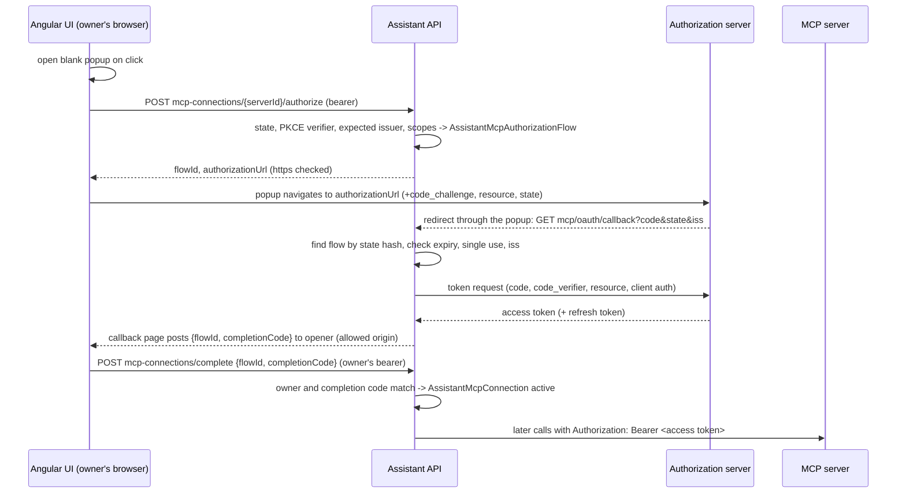

# Assistant MCP Connections Plan

This document is the architecture and implementation plan for how the NewHeap assistant connects to
external MCP servers: more authentication methods (OAuth 2.1 with refresh tokens for a person and for
the organization, client credentials, basic authentication, secret references and client
certificates), the transports the MCP specification still allows, connection health, and the identity a
headless agent run uses for an MCP call. It extends the administrator-connected MCP servers of SPM-251
and the governed import of SPM-228, and follows the conventions of the
[agent run configuration plan](ai-agent-run-configuration-plan.md). It was checked against `main` at
`7298d9c8` on 2026-10-19 and against MCP specification revision `2026-07-28`.

## Status

Accepted on 2026-10-19. Lars decided the [questions](#questions-decided-on-2026-10-19); Q5 and Q7 differ
from the original recommendation. Phases M1 to M4 follow the [delivery order](#delivery-order).

| Phase | Status |
| --- | --- |
| M1 | Implemented, not yet released: the per-request credential pipeline, `headlessUse` per server (`never`, `organization`), executable deferred MCP proposals, per-caller tool lists that leave the catalog alone, connection health, the `McpConnectionPolicy` migrations, the editor and list, the mock API, the texts and SPM-251. See [implementation notes](#implementation-notes-m1). |
| M2 | Implemented, not yet released: basic authentication, the three secret sources, client certificates, the transport choice, the per-person background-use consent (moved forward from M4), the headless `forward-user-token` variant with `AddNewHeapPlatformAIMcpDelegatedTokens`, the `McpServerCredentials` migrations, the editor, the preferences, the mock API, the texts and SPM-251. See [implementation notes](#implementation-notes-m2). |
| M3 | Implemented, not yet released: discovery and pinning, registration (pre-registered, Client ID Metadata Document, dynamic), the organization authorization code flow, `oauth-client-credentials` with a secret or `private_key_jwt`, token storage, single-flight refresh, step-up for client credentials, revocation, the callback and metadata document endpoints, the admin endpoints, the opt-in health check, metrics, retention, `NhAiTestAuthorizationServer`, the `McpOAuthConnections` migrations, the editor and list, the mock API, the texts and SPM-299. See [implementation notes](#implementation-notes-m3). |
| Follow-ups | Implemented, not yet released, on Lars's request of 2026-10-20: asymmetric signing of NewHeap tokens (F1) the removal of connections of people the platform no longer resolves (F2) a missing personal connection in a headless run, recorded on the run and told to the person (F3, migrations `McpRunConnectionSkips`), and the public credential provider contract (F4). See [implementation notes](#implementation-notes-follow-ups). |
| M4 | Implemented, not yet released: personal OAuth connections (`connectionScope: user`) with the authorize, complete and disconnect endpoints, the `connection.required` event and part with `nh-assistant-connection-required`, connect and disconnect in `nh-assistant-mcp-connections`, redirect mode, `personal` headless use with consent, the approval identity of Q10, per-person caching, step-up prompts, revoke-all, retention, `McpConnectionOwner`, the mock API, the texts and SPM-300. See [implementation notes](#implementation-notes-m4). |

## Implementation notes (M1)

- **Headless use values.** M1 ships `never` and `organization` (`NhAssistantMcpHeadlessUses`); `personal`
  is added with the headless `forward-user-token` variant (M2) and personal OAuth connections (M4).
  `FitsAuthMode` refuses `organization` for `forward-user-token` at save, in the API and the mock.
- **Credential providers stay internal in M1.** `INhAssistantMcpCredentialProvider` and
  `NhAssistantMcpCredentialHandler` are internal; the last registered provider of a mode wins, which the
  renewal test uses. `AddMcpCredentialProvider<T>` was to become public in M3, when a second kind of
  provider exists; I8 kept it internal, and F4 published it (I31).
- **Request checks.** The handler keeps every request on the planned origin and re-applies
  `CheckUri`, including `AllowedHosts`. The client also no longer opens the standalone stream for
  server-initiated messages (`EnableStandaloneGetStream = false`), which the assistant does not handle.
- **Failure codes of tool calls.** A failed MCP tool call now reports the classified connection code
  (`assistant-mcp-unauthorized`, `assistant-mcp-insufficient-scope`, `assistant-mcp-host-blocked`,
  `assistant-mcp-credential-mismatch`) instead of always `assistant-mcp-unreachable`. A request stopped
  before it left the host (`host-blocked`, `credential-mismatch`) is not reported as possibly
  executed, so a deferred proposal ends `execution-failed` rather than `execution-unknown`.
- **Forwarded tokens and the call context.** The `forward-user-token` provider refuses a call that the
  gate authorized with another grant source than none or `Delegated`
  (`assistant-mcp-credential-mismatch`), the first use of `NhAiMcpCallContext`.
- **Sample.** SPM-251 shows background use with the status advisor, which a participant starts and
  which acts with that participant's rights (`Delegated`), instead of the project planner with a code
  grant; the library tests cover the code grant, `requiredPolicy` for the run's person and the
  execution and refusal of deferred MCP proposals on both providers.
- **Evidence.** `AssistantMcpHeadlessTests` (SQL Server and PostgreSQL), new cases in
  `AssistantMcpTests` and `AssistantAdminEndpointTests`, `NhAiMcpCallContextTests`, the admin UI and
  mock specs, and `SPM_251_a_background_run_uses_an_mcp_server_only_when_an_administrator_allows_its_own_credential`.

## Implementation notes (M2)

- **A delegated token per request, not per call.** The credential handler asks for a credential before
  every HTTP request, so a personal server gets a fresh delegated token for each request of a run:
  `initialize` and `tools/list` carry the marker `connection-<id>`, a tool call the invocation id from
  `NhAiMcpCallContext`. Planning a connection mints the first one, to report an unavailable token as a
  skip code before the client connects; the connection's first request outside a tool call reuses it
  while it is valid for at least 30 seconds more (Lars's recommendation 1, after M2). Issuing is counted
  per service scope in `NhAssistantMcpDelegatedTokenLedger` and audited once per turn, server, person and
  outcome as `McpDelegatedTokenIssued` with `TokenCount` when the turn releases its MCP tools; a run
  normally has one turn, and a proposal execution is a scope of its own. The token itself never leaves
  the request.
- **Issuer contract.** The assistant sends a token only when it is a JWT with exactly one marker and one
  audience claim with the requested values that expires within the requested lifetime (plus 30 seconds
  of clock tolerance), as delegated gateway reads check theirs. A custom
  `INhAiMcpDelegatedTokenIssuer` that returns anything else, fails or throws gives
  `assistant-mcp-delegated-token-unavailable`; only the exception type is logged.
- **Receiving hosts.** The "small helper" became `AddNewHeapPlatformAIMcpDelegatedTokens` in
  `NewHeap.Platform.AI.AspNet.Common`: it wraps every JWT bearer scheme with the delegated read
  restriction's events, refuses tokens with `nh-ai-mcp-delegated` everywhere, and accepts them only for
  an audience named with `Accept(origin, path)` below that path. `AddNewHeapAssistant` calls it without
  `Accept`. Before minting, the assistant checks `IsDelegatedTokenRestrictionEnforcedAsync`: a JWT bearer
  scheme with `EventsType` or replaced events stops it, because the host could then accept its own token.
- **Lifetime.** `ForwardedTokenLifetime` is validated at startup; a value changed at runtime outside
  (0, 5 minutes] refuses tokens instead of stretching them.
- **Consent record.** `AssistantMcpConnection` holds the person's consent with `OwnerKind` `user`, the
  actor id and an empty `TenantKey`; M3 and M4 add organization connections and the token columns to it.
  The person's list contains enabled `personal` servers of agents the person may use whose
  `requiredPolicy` the person passes. The preferences component is `nh-assistant-mcp-connections`
  (`NhAssistantMcpConnectionsComponent`, exported for profile pages); M4 extends it with connection
  status and "Connect". A headless run without consent leaves the server out with
  `assistant-mcp-consent-required`, which a deferred proposal reports as its result code; notifying the
  person, as planned for a missing personal connection, was left for M4 and is implemented as F3.
- **Secret references.** Names contain no `:` and no `..`. A `config:` value is read with
  `NhConfigurationSecrets.Read` (since the merge of `main`): the key itself or `Secrets:<key>` from the
  secrets files, and a blank value or an unresolved `${...}` reference counts as missing (fail
  closed). Resolver exceptions are logged with the prefix and the exception type only.
- **Client certificates.** A loaded certificate is cached until its configuration changes; a replaced
  certificate is not disposed while a cached connection may still use it. The library test performs a
  real mutual TLS handshake with the handler of a plan; only the test trusts the self-signed server.
- **Mock.** The mock API validates the new fields and the consent endpoints, but, as before M2, does not
  require a secret for `bearer` and `api-key`, which the server does.
- **Test package.** `ModelContextProtocol.AspNetCore` 2.2.0 is pinned in `Directory.Packages.props` for
  the assistant tests' HTTP MCP servers, including a legacy HTTP+SSE server.
- **Sample.** SPM-251 adds `SampleMountedSecretResolver` (`secret-file:<name>` reads a file of a mounted
  secrets directory) and `SampleFirstPartyMcpServer` in the tests, which validates the sample's tokens and
  accepts delegated MCP tokens for its own origin below `/mcp`. The sample API itself accepts none.
- **Evidence.** `AssistantMcpCredentialTests` (secret references, basic authentication and the personal
  flow on SQL Server and PostgreSQL; certificates, transports, refusals and the credential mismatch on
  PostgreSQL), the new endpoint tests in `AssistantAdminEndpointTests`, `NhAiMcpDelegatedTokenTests`, the
  admin UI, preferences and mock specs, and the SPM-251 sample tests
  `SPM_251_mcp_secrets_can_stay_with_the_application_and_basic_authentication_sends_a_user_name` and
  `SPM_251_a_background_run_reaches_a_first_party_server_with_a_delegated_token_once_the_participant_consents`.

## Implementation notes (M3)

- **Code layout.** The OAuth client lives in `NewHeap.Platform.AI.Chat.AspNet/Mcp/OAuth`:
  `NhAssistantMcpOAuthHttp` (no redirects, 64 KiB bodies, the connect timeout and the host guard, which
  always blocks private networks for OAuth URLs unless the host is in `AllowedHosts`, Q9),
  `NhAssistantMcpDiscovery` (RFC 9728 from the challenge or the well-known URIs, RFC 8414 then OpenID
  Connect metadata with the issuer checked, cached for ten minutes per issuer and read again on
  confirmation), `NhAssistantMcpOAuthClient` (registration in the order of Q6, the token, refresh, client
  credentials and revocation requests, `client_secret_basic`, `client_secret_post` or
  `private_key_jwt`), `NhAssistantMcpOAuthConnections` (credentials, renewal, step-up, the issuer check,
  disconnect with revocation), `NhAssistantMcpAuthorizationFlows` (start, callback, completion) and the
  credential provider for both OAuth modes. Persistence is `NhAssistantMcpOAuthStore` in
  `NewHeap.Platform.AI.Chat`.
- **Pinning.** Saving an OAuth server with `oauth.confirmAuthorization` runs discovery again (the
  pinned issuer is preferred while the server still names it) and audits
  `AdminMcpServerAuthorizationConfirmed`. A new server, a changed address or a switch to OAuth needs it.
  A `401` whose `resource_metadata` names other authorization servers suspends every connection of the
  server as `issuer-changed`; confirming the same issuer again reactivates them, another issuer revokes
  them as a server change.
- **Single flight.** A semaphore per connection in the process and a lease on the row
  (`RefreshLeaseUntil`, `RefreshLeaseOwner`, a conditional `ExecuteUpdate` that also bumps `Version`).
  An instance that finds the lease taken polls the row every 100 ms for up to `RefreshLeaseDuration` and
  uses the tokens the other instance stored. Renewed tokens are written only while the writer still
  holds the lease. The test simulates the other instance on the same row (see I6).
- **Endings.** `invalid_grant` on refresh and a refresh token that no longer unprotects make the
  connection `reauthorization-required` with its tokens removed and audit; other failures keep it
  active, record `LastFailureCode` and fail the call with `assistant-mcp-token-request-failed`. Client
  credentials never end: the next use asks for a new token.
- **Completion.** `POST mcp-connections/complete` is one endpoint for both owner kinds on the access
  policy; it checks the starter, the completion code (hashed, compared in fixed time) and, for an
  organization flow, the admin policy. The token response waits protected in the flow between the
  callback and the completion and is cleared then. The authorization start returns `callbackOrigin`,
  the origin of the redirect URI, and the default window accepts only that popup's message from that
  origin for the started flow. The callback page addresses its message to every allowed origin (I5).
- **Endpoint status codes.** `connection-required`, `reauthorization-required`, `issuer-changed` and
  `authorization-not-confirmed` answer `409`, `discovery-failed` and `token-request-failed` `502`,
  `too-many-authorizations` `429`, `forbidden` `403`, the rest `400`.
- **Options.** `NhAssistantMcpOAuthOptions.Validate` runs at startup: absolute https URLs (http on
  loopback or a `.localhost` name in Development), return origins without a path, bounded durations
  and at most 50 pending flows per person.
- **Maintenance.** `NhAssistantMcpMaintenance`, a background service of its own, deletes expired flows
  and removes personal connections unused for `ConnectionRetention` with revocation and audit
  (`retention`), at the run maintenance interval and at least every minute (I7).
- **Health and metrics.** `AddNewHeapAssistantMcpHealthCheck` (opt-in) reports enabled servers whose last
  connection failed and connections that need someone, with counts and server ids only. The
  `NewHeap.Platform.AI` meter counts `nh.ai.mcp.requests` (`ok`, `renewed`, `http-<status>` or a code),
  `nh.ai.mcp.token_requests` (grant and outcome) and `nh.ai.mcp.authorizations`.
- **Evidence.** `AssistantMcpOAuthTests` (client credentials, step-up, the authorization code flow,
  refresh, lease, endings and maintenance on SQL Server and PostgreSQL; `private_key_jwt`, issuer
  changes, discovery refusals, the metadata document, the endpoints and the options on PostgreSQL), the
  headless client credentials test in `AssistantMcpHeadlessTests` on both providers, the endpoint names
  in `AssistantAdminEndpointTests`, the Angular editor, list, window and mock specs, and the SPM-299
  sample tests `SPM_299_an_administrator_connects_an_oauth_server_with_the_hosts_client_credentials` and
  `SPM_299_an_administrator_connects_the_organizations_account_and_the_agent_acts_as_that_account`.

## Implementation notes (M4)

- **The turn's person.** A request turn now passes the person who sent the message as the credential
  subject, so a personal OAuth server uses that person's connection; organization credentials and
  forwarded sign-ins ignore it. In a shared conversation every participant's turn uses their own
  connection.
- **Connection needed.** The tool source reports personal OAuth servers of a request turn that are
  not connected (`not-connected`), whose connection ended (`reauthorization-required`), or that refused
  the connection's scopes (`insufficient-scope`, also when an earlier refusal recorded
  `RequiredScopes`). The turn runner loads the MCP tools before it creates the agent, adds a short
  note to the model's instructions when it fits, stores one `connection-required` part per server and
  streams `connection.required` once per turn. An organization server whose issuer changed is not
  shown as a card: the person cannot fix it.
- **Step-up.** The refusal usually comes while the tools are listed, so the card appears in the same
  turn (I12). A refusal during a call fails the call with `assistant-mcp-insufficient-scope` and the
  next turn shows the card. Connecting again requests the recorded scopes within the allowed ones.
- **Consent and disconnect.** Disconnecting removes the tokens and revokes them; a consent to
  background use stays on the row without tokens (I10), so Q10 holds: an approved proposal of a
  person who disconnected fails with `assistant-mcp-connection-required`. Connecting can grant the
  consent but never withdraws one. The consent hash of an OAuth server covers its issuer and scopes.
- **Administrators.** A server people connect to has no organization connection; administrators
  test and sync it with their own personal connection, started through the existing admin authorize
  endpoint (I11), and see and revoke the personal connections.
- **Caching.** Connections and tool lists of a personal OAuth server are cached per person and use
  (request, or the grant source of a run) under a hash of the actor id, for at most
  `ToolListCacheDuration`; a disconnect, an ended connection and retention close them (I15). Forwarded
  sign-ins are still never cached.
- **Audit.** `ToolInvoked` events of MCP tools carry `McpConnectionOwner`: `organization`, the
  person's actor id (a personal connection or a forwarded sign-in) or `none` (I17).
- **Angular.** `NhAssistantMcpConnectService` runs every connection, in a popup or in redirect mode
  (`mcpConnectMode`, `mcpConnectReturnUrl`, I13); a redirect-mode return is completed by an
  environment initializer and reported through `returned`. The card is shown to everyone who reads
  the conversation and connects the viewer's own account (I14); "Ask again" sends the question of
  the answer it belongs to.
- **Evidence.** `AssistantMcpPersonalConnectionTests` (each person's own account, a colleague in a
  shared conversation, the card and its part, disconnect and revocation, step-up and retention on SQL
  Server and PostgreSQL; the endpoints on PostgreSQL), the personal headless test with consent and
  Q10 in `AssistantMcpHeadlessTests` on both providers, the Angular card, preferences, redirect, mock,
  reducer and admin specs, and the SPM-300 sample tests
  `SPM_300_a_person_connects_their_own_account_from_the_chat_and_the_agent_works_with_it` and
  `SPM_300_a_background_run_uses_the_participants_own_oauth_connection_only_after_consent`.
  In a browser, at desktop and 375px widths, the playground showed the card, connected, asked again
  and answered with the tool; the preferences connected and disconnected after confirmation; the
  server list connected the administrator's own account and revoked every personal connection;
  without console errors or horizontal overflow. The management app's initial bundle warning
  budget moved from 1.65MB to 1.7MB.

## Implementation notes (follow-ups)

Lars asked on 2026-10-20 to resolve the [proposed follow-ups](#proposed-follow-ups) now. Each is
implemented as below; the decisions are I22 onwards in the
[implementer's decisions](#decisions-by-the-implementer-for-lars-to-review).

### F1: asymmetric signing of NewHeap tokens

- **Configuration.** `NewHeap:PlatformAspNetCommon:Authorization:JWT:Token:Signing` (`NhJwtSigningKeys`
  in `NewHeap.Platform.AspNet.Common`): `Algorithm` (`HS256` by default, `RS256`, `ES256`), `KeyId`,
  exactly one of `PrivateKey` (PEM) and `Pkcs12` (Base64, with `Pkcs12Password`), all read with
  `NhConfigurationSecrets.Read`, and `PreviousKeys` (`KeyId`, `PublicKey` as a PEM public key or
  certificate). Without the section, or with `HS256`, nothing changes: `NhJwtSigningKey` signs and
  validates as before. A configuration error throws at startup with the setting's name only. Keys are
  cached per configuration instance and read again when their settings change (a fingerprint of the
  settings, never kept as text).
- **Signing and validation.** `NhAuthenticationService.GetSigningCredentials` (protected virtual) signs
  with the private key and its `kid`; HS256 keeps using the overridable `GetTokenKey`. `CreateToken`
  delegates to the new protected `CreateTokenForAudienceAsync`. `NhJwtSigningKeySet.ApplyTo` sets the
  platform's validation parameters: HS256 exactly as before, otherwise the current public key, every
  validation key and `ValidAlgorithms`. Validation keys are public-only copies, so they cannot sign.
- **Key set.** `MapNewHeapJwks(pattern = "/.well-known/jwks.json")` is opt-in, anonymous, cached for
  five minutes, contains `kty`, `use`, `kid`, `alg` and the public parameters only, and fails at
  startup for an HS256 application. `UseNewHeapJwks(jwksUri, issuer, audiences)` configures a JWT
  bearer scheme of another host with a `ConfigurationManager` over the key set: issuer, audiences,
  RS256 and ES256 only, read every hour and at most once a minute for an unknown `kid` (I22).
- **Delegated tokens.** `INhAuthenticationService` gained the default method
  `CreateDelegatedTokenAsync(userId, claims, expiration, audience)`; `NhAuthenticationService` sets
  `aud` to `audience` when it signs asymmetrically and keeps the issuer with HS256 (I23). The built-in
  issuer of `AddNewHeapPlatformAIMcpDelegatedTokens` passes the server's origin. The marker and
  `nh-ai-mcp-audience` claims, `Accept(origin, path)` and the issuing host's restriction are unchanged,
  so a receiving host applies one rule to both kinds of token.
- **Migration.** `AcceptSharedKeyTokens` lets the issuing application keep validating tokens of its
  shared key while it moves from HS256 (I24); the shared key is never published.
- **Sample.** The assistant sample host of the agent run tests (`AssistantAgentRunSampleHost`) signs
  with ES256 from a key generated in the process and published with `MapNewHeapJwks`;
  `SampleFirstPartyMcpServer` validates with `UseNewHeapJwks` and holds no key. The SPM-251 test asserts
  that each delegated token carries the server's origin as `aud` and the host's `kid`. The sample API
  itself keeps HS256 (I25).
- **Evidence.** `NhJwtSigningKeysTests` (HS256 unchanged, ES256 from PEM, RS256 from PKCS#12, rotation,
  a previous key as certificate, the shared key while moving, configuration errors, the key set's
  shape, another host with rotation), `NhAuthenticationServiceSigningTests` (the `aud` of delegated
  tokens with both algorithms), `NhAiMcpDelegatedTokenTests.A_first_party_host_validates_an_asymmetric_delegated_token_with_the_published_key_only`
  and `SPM_251_a_background_run_reaches_a_first_party_server_with_a_delegated_token_once_the_participant_consents`.

### F2: connections of people the platform no longer resolves

- **The sweep.** `NhAssistantMcpOwnerSweep` asks `INhAiPrincipalFactory` for every owner of a personal
  token connection, with the whole application (`nh-system/global`) as subject, the question a
  background run on the whole application asks. A person it does not resolve, because the person is
  unknown or may no longer sign in, loses every token connection: the tokens are deleted, revoked at
  the authorization server and audited as `McpConnectionDisconnected` with `owner-unresolved`, as
  retention does (R6). A consent to background use stays on the row without tokens (I26).
- **Batches and limits.** `NhAssistantMcpMaintenance` runs one batch of at most 100 people per
  maintenance run, in the provider's order of actor ids, and starts a pass over everyone at most every
  hour, the first one an hour after start-up (I27). Each removal is conditional, so instances that sweep
  at the same time audit a removal once; a failing lookup skips that person and a failing batch leaves
  the place in the pass, so retention still runs.
- **Hosts that cannot resolve people.** The built-in principal factory resolves nobody without the
  NewHeap user manager; the sweep then asks nobody instead of removing every connection (I26).
- **Evidence.** `AssistantMcpOAuthTests.Connections_of_people_the_platform_no_longer_resolves_are_removed_in_batches`
  (SQL Server and PostgreSQL) and `The_owner_sweep_removes_nothing_when_the_platform_cannot_resolve_anyone`;
  the retention test still passes on both providers. No sample code: the sweep is maintenance without
  a public surface (I28).

### F3: a missing personal connection in a headless run, on the run and for the person

- **What is recorded.** The tool source notes every server with `personal` headless use that a headless
  turn leaves out with `assistant-mcp-consent-required`, `assistant-mcp-connection-required`,
  `assistant-mcp-reauthorization-required` or `assistant-mcp-initiator-only`
  (`NhAssistantMcpMissingConnection`, I29). The turn's result carries them; the run operation stores
  them after each turn in the new column `AssistantRun.McpConnectionSkips` (a JSON array with the
  server's id, display name and code, one entry per server with its latest code, at most 32, written
  only while unchanged since it was read) and `NhAssistantRunHistoryDto.McpConnectionSkips`
  (`NhAssistantRunMcpSkipDto`) shows them in the run history and the run result.
- **Who is told.** The person whose consent or connection is missing gets the new agent notification
  `NhAssistantAgentNotificationKind.McpConnectionMissing` (6) through Web Push and every channel,
  including `UseInAppAgentNotifications`; the default policy sends it to that person only
  (`McpConnectionPersonId`), never to the approvers. `assistant-mcp-initiator-only` is recorded but
  told to nobody, because no consent or connection changes it (I29). Shadow work tells nobody.
- **Bounded.** At most once per person and server within a day (`NoticeInterval`), across instances:
  the new table `AssistantMcpConnectionNotice` (server and person as key, the code and when) is claimed
  with a conditional update or an insert whose unique key decides concurrent claims; the MCP
  maintenance removes notices older than seven days (I30).
- **Texts.** The notification names the server and says what to do (allow background use, or connect
  the account) in English and Dutch; the run result and the runs views use the error code texts.
- **Migrations.** `McpRunConnectionSkips` for SQL Server (`20261020184615`) and PostgreSQL
  (`20261020184623`) on top of `AgentBoards`, generated with the EF CLI.
- **Angular.** `AgentRunHistoryItem.mcpConnectionSkips` (`AgentRunMcpSkip`); `nh-assistant-run-result`
  lists the servers with their reason, the administration's runs view and the flow view's latest runs
  show how many were left out; the mock API serves `mcpConnectionSkips` of scenario runs.
- **Evidence.** `AssistantMcpHeadlessTests.A_run_records_a_personal_server_it_left_out_and_tells_the_person_once_a_day`
  and `Concurrent_notices_for_a_person_and_server_are_claimed_once` (SQL Server and PostgreSQL), the
  initiator-only assertion in `A_run_started_by_hand_uses_only_the_starters_own_personal_connection`,
  the Angular spec `nh-assistant-run-mcp-skips.spec.ts` and the SPM-251 sample test, whose first run
  without consent records the server and reaches the participant's inbox.

### F4: a public credential provider contract (D1)

- **The contract.** `INhAssistantMcpCredentialProvider` is public with the shape the built-ins already
  had (`Supports`, `CanRenew`, `GetAsync`, `RenewAsync`, `AuthorizeCall`), and with it
  `NhAssistantMcpCredential` (headers and expiry, redacted `ToString`, `Bearer`),
  `NhAssistantMcpCredentialSubject` and `NhAssistantMcpChallenge` (I31). The built-in modes stay
  providers of that interface.
- **Registration.** `NhAssistantBuilder.AddMcpCredentialProvider<TProvider>(mode, ownership)`
  (`NhAssistantMcpCredentialProviders`) registers the provider as a singleton for a dash-case mode of
  at most 40 characters that is no built-in mode and is registered once. `NhAssistantMcpCredentialOwnership`
  says whose credential it sends: `Organization` (shared and cached, `headlessUse: organization`, agent
  grants) or `Person` (never cached, `headlessUse: personal` with consent, listed in the person's
  `GET mcp-connections`). An internal `NhAssistantMcpAuthModeCatalog` answers every rule that depends on
  the mode (validation, sharing, headless use, provider choice). Helpers: `Failed(code)` and
  `AuthorizePersonalCall(subject, call)`, the rule of the built-in forwarded token.
- **Administration.** `GET admin/mcp-auth-modes` (`NhAssistantMcpAuthModeDto`) lists the registered
  modes; a server of such a mode takes no secret, user name or OAuth settings (I32). The editor lists
  them after the built-in modes, named by their translation `nh-assistant.admin.mcp.auth.<mode>` or else
  by the mode, with a hint whose credential they send; `McpAuthMode` admits them
  (`McpBuiltInAuthMode | string`), `getMcpAuthModes` and `McpCustomAuthMode` are new, and the mock API
  serves scenario `mcpAuthModes` with the server's validation.
- **Sample.** `SampleTokenExchangeCredentialProvider` (`sample-token-exchange`, `Person`) exchanges the
  person's NewHeap token at the identity provider (RFC 8693) for a token of the MCP server, so the
  person's own token never reaches it; a background run carries nobody's token, so the mode serves a
  person's own requests only (I33). The playground lists the mode.
- **Evidence.** `AssistantMcpCredentialTests.An_application_mode_supplies_the_credential_and_its_ownership_decides_background_use`
  (SQL Server and PostgreSQL), `Administrators_read_the_modes_the_application_registered` and
  `A_mode_is_registered_once_by_a_dash_case_name_that_no_built_in_mode_has`, the Angular spec
  `nh-assistant-mcp-custom-auth-modes.spec.ts` and the SPM-251 sample test
  `SPM_251_the_application_adds_an_authentication_mode_that_exchanges_the_persons_token`.

## Problem

### What exists today

- **Registration.** `NhAssistantAdminEndpoints.Map` maps `admin/mcp-servers` behind the admin policy:
  list, create, `PUT {id}`, `DELETE {id}`, `POST {id}/test`, `POST {id}/sync`, `GET {id}/tools` and
  `PUT {id}/tools/{remoteName}`. `NhAssistantMcpAdministration`
  (`NewHeap.Platform.AI.Chat.AspNet/Mcp/NhAssistantMcpAdministration.cs`) validates and stores
  `AssistantMcpServer` (`NewHeap.Platform.AI.Chat/Entities/AssistantAdminEntities.cs`): a dash-case `Id`
  of at most 40 characters, `DisplayName`, an http(s) `Url`, `AuthMode`, `HeaderName`,
  `ProtectedSecret`, `RequiredPolicy`, `IsEnabled`, `LastSyncAt` and `LastSyncStatus`. Agents receive
  servers through `mcpServerIds` (`AssistantAgentMcpServer`, at most 32 per agent).
- **Authentication.** `NhAssistantMcpAuthModes` has `none`, `bearer` (`Authorization: Bearer
  <secret>`), `api-key` (the secret in `HeaderName`, default `X-Api-Key`) and `forward-user-token` (the
  caller's bearer from `INhAiCallerCredentialAccessor`, only to exact host names in
  `NhAssistantMcpOptions.ForwardUserTokenHosts`). A server has one write-only secret: `null` keeps it,
  `""` clears it, and `NhAssistantMcpServerDto` reports only `HasSecret`.
- **Secret protection.** `NhAssistantMcpSecretProtector` protects the secret with ASP.NET Data
  Protection, purpose `NewHeap.AI.Assistant.Mcp`. A secret whose key left the key ring unprotects to
  `null` and the connection fails with `assistant-mcp-unauthorized`.
- **Network safety.** `NhAssistantMcpHostGuard` requires https (plain http only to loopback in
  Development), blocks cloud metadata host names, link-local addresses including `169.254.169.254` and
  `fd00:ec2::254`, loopback outside Development and, when configured, every host outside
  `AllowedHosts`. Every DNS answer is checked; `NhAssistantHttpMcpClientFactory` checks the resolved
  addresses again in `SocketsHttpHandler.ConnectCallback`, disables redirects and gives the SDK no
  logger because it can log request headers. Private ranges such as `10.0.0.0/8` are not blocked.
- **Transport and client.** The official C# SDK (`ModelContextProtocol` 2.2.0) with
  `HttpClientTransport` in `HttpTransportMode.StreamableHttp`; credentials are `AdditionalHeaders` fixed
  when the client connects. `NhAssistantMcpConnectionCache` shares connections with shared credentials
  for `ToolListCacheDuration` (5 minutes) per server id and `UpdatedAt`; `forward-user-token`
  connections are never shared. A 401 or 403 maps to `assistant-mcp-unauthorized`, a blocked address to
  `assistant-mcp-host-blocked`, anything else to `assistant-mcp-unreachable`.
- **Tool catalog.** A sync stores the remote tools (`AssistantMcpTool`: remote name, bounded
  description, input schema hash and the untrusted `ReadOnlyHint`). New tools start disabled as
  mutations; an administrator enables a tool as `read-only` or `mutation`. At runtime
  `NhAssistantMcpToolSource.ImportAsync` disables a tool whose schema hash changed (`schema-changed`) or
  that the server no longer lists (`missing`).
- **Governance.** Every turn imports the enabled tools through `INhAiMcpClientToolImporter` as
  `mcp.<server>.<tool>`: read-only tools with policy-controlled approval, mutations with required
  approval and idempotency, the policy `RequiredPolicy` or the access policy, exposure `Agent` and no
  agent grants (`AllowAgentGrant` is `false`). Mutations are only offered to agents that may mutate.
  Consultations receive no MCP tools. A reviewed tool may receive the assistant context as `_meta`
  (`AddMcpContextBinding`, SPM-266).
- **Authorization and audit.** Calls pass `NhAiAgentInvocationGate`; the grant source is stored on
  `AssistantToolInvocation`. Administration changes are content-free audit events
  (`AdminMcpServerCreated`, `AdminMcpServerUpdated`, `AdminMcpServerDeleted`, `AdminMcpServerSynced`,
  `AdminMcpToolUpdated`); secrets never reach responses, logs or audit
  (`AssistantMcpTests.Secrets_are_protected_and_never_reach_responses_logs_or_audit`).
- **`NewHeap.Platform.AI.Mcp`.** The importer (allow-list, a remote tool discovered exactly once,
  bounded schemas, approval and idempotency rules, a verifier for destructive tools, no re-export),
  `INhAiMcpInvocationBinder` for `_meta`, the export adapter `WithNewHeapPlatformAITools` and the client
  helpers `CallNewHeapToolAsync` and `CallNewHeapFlatToolAsync`.
- **Interface, mock and sample.** `nh-assistant-admin-mcp-servers`, `-mcp-server-editor` and
  `-mcp-tools` in `@newheap/platform-ai-chat/admin`; the mock in `@newheap/platform-ai-chat/testing`
  (`nh-assistant-mock-admin.ts`) simulates the four modes and their failures. SPM-251 connects a real
  Streamable HTTP server with an API key in `AssistantAdministrationSamplesTests`.

### Headless runs, as the code behaves

The [autonomous runs plan](ai-autonomous-agent-runs-plan.md) and the
[application context plan](ai-application-context-plan.md) state that MCP tools are not offered in
headless runs because they forward the caller's credentials. The code does not enforce that:

- `RunAgentTurnAsync` reaches `CreateAgentAsync`, which calls `LoadMcpToolsAsync` in every turn; only
  `CreateConsultationStateAsync` sets `McpTools` to `NhAssistantMcpToolSet.Empty`.
- A headless run has no `HttpContext`. `forward-user-token` servers are skipped with a warning
  (`assistant-mcp-unauthorized`) and servers with a `RequiredPolicy` are skipped because
  `NhAssistantMcpToolSource.CanUseAsync` reads `HttpContext.User`. Servers with `none`, `bearer` or
  `api-key` and no `RequiredPolicy` **are** imported and offered. The gate then allows a call with the
  initiator's rights (`Delegated`) or the accountable account's rights (`Accountable`), never with an
  agent grant.
- A deferred proposal of an MCP tool can never execute: `ExecuteProposalAsync` resolves functions only
  through `FindGovernedFunction` over registered catalogs and answers `assistant-approval-invalid` for
  `mcp.*`. Inline approvals (`ExecuteApprovedAsync`) do resolve MCP tools.
- No test covers MCP tools in a headless run.

### What it cannot do

- **No OAuth.** No protected resource metadata discovery, no authorization code flow, no refresh token,
  no client credentials, no step-up. A 401 skips the server for that turn as
  `assistant-mcp-unauthorized`; a 403 `insufficient_scope` is indistinguishable from a wrong key.
- **No personal credentials except token forwarding.** `forward-user-token` sends the NewHeap JWT
  itself. NewHeap signs it with a symmetric HMAC key and sets the audience to the issuer
  (`NhAuthenticationService.CreateToken`), so only a server that shares the signing key and accepts
  another service's audience can validate it. The MCP specification calls this token passthrough and
  forbids it ("MCP servers **MUST NOT** accept or transit any other tokens").
- **Static secrets only.** One secret per server, entered in the screen; no rotation without an
  administrator, no reference to configuration or a vault, no basic authentication, no client
  certificate.
- **One transport.** Streamable HTTP only; servers that still use the deprecated HTTP+SSE transport
  cannot be connected.
- **Headless behavior** contradicts the documentation, is untested, and its deferred MCP proposals
  cannot execute (see above).
- **Per-caller tool lists change the shared catalog.** With `forward-user-token`, a person whose remote
  account lacks a tool marks it `missing` for everyone.
- **Health.** Only `LastSyncStatus`; a server that fails during turns is a log line.

## Decision record

### Decisions

| # | Decision | Reason |
| --- | --- | --- |
| D1 | **Building blocks stay code and data names them.** Authentication modes are providers registered in code (`INhAssistantMcpCredentialProvider`): the built-ins and, through `AddMcpCredentialProvider<T>(mode)`, a consumer's own, for example a token exchange with its identity provider. Administrators choose among the registered modes. | Data combines what code made safe, as in the run configuration plan (D2 there). Enterprise identity flows differ per host and stay reviewable code. |
| D2 | **Credentials are attached per HTTP request** by `NhAssistantMcpCredentialHandler`, a `DelegatingHandler` in the existing client factory, instead of `AdditionalHeaders` fixed at connect time. It also renews once after a 401 and repeats the host checks for every request. | A token can expire while a client is cached; one place handles renewal, 401, 403 and host checks for all modes. The 2026-07-28 protocol is stateless, so a request-level credential is natural. |
| D3 | **NewHeap implements the OAuth client** (discovery, PKCE, token, refresh, revocation, registration) and does not use the SDK's `ClientOAuthProvider` at runtime. | The SDK's provider completes the browser step inside a blocking connect (`AuthorizationCallbackHandler`); here the browser step spans several HTTP requests and instances. Its `ITokenCache` has no cross-instance single-flight, which refresh token rotation requires. The SDK's metadata types may still be reused. |
| D4 | **One connection row per server, owner and tenant key** (`AssistantMcpConnection`): owner kind `organization` or `user`. Tokens never leave the row unprotected. Organization connections are application-wide in this plan; the tenant key is part of the unique key so per-tenant connections need no new index later. | One model for all OAuth and client credential tokens; the key avoids a later unique-index migration. |
| D5 | **Tokens are protected with Data Protection** under purpose `NewHeap.AI.Assistant.Mcp.Connection.v1` with the server id and connection id as sub-purposes; flows and registrations get their own purposes. A key that left the ring makes the connection `reauthorization-required`. | A protected value copied to another row does not unprotect; key loss degrades like today's secrets. |
| D6 | **Refresh is single-flight in the process and across instances:** a per-connection gate plus a lease (`RefreshLeaseUntil`, taken with a conditional `ExecuteUpdate`). A rotated refresh token is stored in the same write as the new access token. `invalid_grant` ends the connection as `reauthorization-required`. | Two instances refreshing with the same rotated refresh token trigger reuse detection, which revokes the whole token family at many authorization servers. |
| D7 | **Authorization flows are cookie-free and bound to their owner.** A 256-bit `state` stored as a hash, PKCE `S256` required (the flow refuses an authorization server without it), the `resource` parameter always sent, the RFC 9207 `iss` checked, flows single-use and valid for 10 minutes. The callback exchanges the code; the connection becomes active only when the owner's own bearer session presents the one-time completion code that the callback page handed to the browser that completed the flow. | The assistant API is called with bearer tokens (`getAccessToken`), so a top-level callback carries no session. Without the binding an attacker could have a victim authorize the attacker's flow and receive the victim's remote account. |
| D8 | **The authorization server is pinned** when an administrator confirms discovery (`AuthorizationServerIssuer`, `ResourceUri`). A changed issuer or resource suspends the server's OAuth connections with `assistant-mcp-issuer-changed` until an administrator confirms again. Client registrations are keyed by issuer. | Mix-up and authorization server substitution protection; the specification requires credentials to be bound to their issuer (SEP-2352). |
| D9 | **Every OAuth URL passes the host guard:** `resource_metadata`, metadata documents, token, registration and revocation endpoints. https only (loopback in Development), no redirects followed, bounded response bodies (64 KiB) and the connect timeout. The authorization endpoint is opened only in the person's browser and must be https. | The specification's SSRF section names exactly these URLs as attacker-controlled. |
| D10 | **Headless use is an explicit server setting** (`HeadlessUse`: `never`, `organization`, `personal`), and a turn fixes the person whose credential lists and calls the tools. A call for which the gate decided on another person fails closed with `assistant-mcp-credential-mismatch`. | One rule for runs, deferred proposals and request turns; the remote audit shows the same person as the NewHeap audit. |
| D11 | **Tools of an organization server that allows headless use accept agent grants** (`NhAiMcpImportedToolPolicy.AllowAgentGrant`), so a code grant `mcp.<server>.*` can authorize them for an agent that answers to itself. Tools of a personal server never accept agent grants. | Two keys, as elsewhere: an administrator allows the server, reviewed code grants the agent. |
| D12 | **Remote tool lists seen through a personal connection never change the reviewed catalog.** Only an administrator's sync writes `missing` and `schema-changed`; at runtime such a tool is skipped for that person and logged with a code. | Remote lists may differ per person (`cacheScope: private` in 2026-07-28). |
| D13 | **Content-free audit; secrets never logged** (see [Audit, logging and telemetry](#audit-logging-and-telemetry)). | Same rule as today's secrets, extended to tokens, codes, verifiers and remote error texts. |
| D14 | **Provider-neutral schema:** `OwnerActorId` and `TenantKey` are non-null with `""` for none, because SQL Server and PostgreSQL treat `NULL` differently in unique indexes; an integer `Version` concurrency token instead of `rowversion` or `xmin`; protected tokens in unbounded text columns. Migrations in both provider projects, tests on both. | AGENTS.md treats provider semantics as test cases. |
| D15 | **A reusable test authorization server** `NhAiTestAuthorizationServer` in `NewHeap.Platform.AI.Test`: metadata, authorize (scripted outcomes), token with PKCE, refresh rotation with reuse detection, client credentials, registration, revocation and JWT access tokens with the resource as audience. | Library tests, sample tests and consumers verify connections without an external identity provider. |
| D16 | **No stdio.** An administrator-configured stdio server would let configuration start processes with the host's privileges; stdio has no per-person identity and does not scale over instances. | The specification's stdio authorization reads credentials from the environment, which suits local clients, not a hosted assistant. |
| D17 | **Client identity:** a pre-registered confidential client uses `client_secret_basic` (or `client_secret_post` when it is the only advertised method). A Client ID Metadata Document client starts as a public client (`token_endpoint_auth_method: none`) with PKCE and rotation; `private_key_jwt` follows when certificate references (M2) exist. | Works with every authorization server now; keys for `private_key_jwt` need the M2 certificate references. |
| D18 | **Retention:** a personal connection unused for `ConnectionRetention` (default 90 days) is deleted by the existing run maintenance; connections of a person the principal factory no longer resolves are deleted on first use. Changing a server's URL, issuer or scopes revokes its connections. | Stored refresh tokens are standing access to another system and must not outlive their reason. |

### Questions decided on 2026-10-19

Lars decided the open questions on 2026-10-19. Q5 and Q7 differ from the recommendation in the
proposal; the design below follows the decisions. After M1 he added on 2026-10-19 that the headless
`forward-user-token` variant also needs the person's consent (Q5 below), and confirmed that the Q5
variant and the Q7 secret sources belong in M2.

| # | Question | Decision | Reason |
| --- | --- | --- | --- |
| Q1 | Who owns a connection? | **Both, chosen per server:** an organization connection (one credential for everyone) or personal connections (each person connects their own account). | A shared knowledge base or a machine API needs one credential; a mailbox, calendar or ticket system must act as the person. |
| Q2 | May an administrator create an organization connection by signing in interactively? | **Yes, labeled as a technical account:** the editor asks for the remote account's name and warns that everyone using the assigned agents acts as that account; the audit names the administrator who connected it. | Many hosted MCP servers offer only the authorization code flow; refusing it pushes administrators to paste personal tokens as `bearer`. |
| Q3 | May a headless run use a person's personal connection? | **Only when the server allows `personal` headless use and the person consented to background use** ("Agents I am accountable for may use this connection in background runs"). The person is the initiator (`Delegated`) or the accountable account (`Accountable`); a technical account has no personal OAuth connection. | Matches the `Accountable` grant source while consent stays with the person. |
| Q4 | What do existing servers do in headless runs after M1? | **`never` for every existing and new server**, with a release note and the required action (set `organization`). | Makes the documented behavior true; the previous behavior was accidental, untested and produced deferred proposals that could not execute. |
| Q5 | What happens to `forward-user-token`? | **Keep it and add a headless variant** that mints short-lived delegated NewHeap tokens for the accountable person, with the safeguards in [Delegated NewHeap tokens for first-party hosts](#delegated-newheap-tokens-for-first-party-hosts). A token is minted for a person only when that person consented to background use, with the consent record planned for M4, which therefore moves to M2; the administrator's `personal` setting and `ForwardUserTokenHosts` remain additional keys. | First-party hosts that already trust the NewHeap signing key get headless access without a second identity system. |
| Q6 | Which client registration methods are supported? | **Pre-registration, then Client ID Metadata Documents, then dynamic client registration as a fallback.** | The specification's own priority; dynamic registration is deprecated but often the only option. |
| Q7 | How are secrets referenced instead of stored? | **All three, chosen per secret:** stored and protected with Data Protection, a `config:` reference restricted to the dedicated section, or a reference with an application's own prefix resolved by a public `INhAssistantMcpSecretResolver`. A reference can never name an arbitrary configuration key. | Hosts with a configuration-backed vault use `config:`; hosts with a vault SDK register a resolver. |
| Q8 | Is the deprecated HTTP+SSE transport supported? | **Per server `transport: auto`** with the SDK's HTTP+SSE fallback, shown as deprecated, and the same-origin rule for the SSE `endpoint` event; the default stays `streamable-http`. | The SDK implements the fallback; the origin rule closes the new risk. |
| Q9 | Are private network addresses blocked? | **Always for OAuth URLs; for MCP endpoints only with `BlockPrivateNetworks`;** hosts in `AllowedHosts` stay reachable. | Metadata URLs come from the remote server; MCP endpoints are typed by an administrator and intranet servers are legitimate. |
| Q10 | Whose personal connection executes an approved MCP proposal? | **The person whose rights authorized the call**, also when a colleague approves; a person who disconnected fails with `assistant-mcp-connection-required`. | The remote system attributes the action to the person the NewHeap audit names. |

### Decisions by the implementer, for Lars to review

Lars accepted the three recommendations after M2 (reuse the planning token and audit issuing per run,
a mock that requires secrets, `NhConfigurationSecrets.Read` after the merge of `main`) and asked to work
through M4 without waiting. Where a choice came up, the implementer decided as below.

| # | Decision | Reason |
| --- | --- | --- |
| I1 | Decided by the implementer on 2026-10-19, for Lars to review: after merging `main`, the `McpConnectionPolicy` and `McpServerCredentials` migrations were regenerated with the EF CLI on top of `AgentChatAvailability`, with the same names and new timestamps. | Their designer models lacked `main`'s columns; regenerating keeps every migration's target model correct. Neither was released. |
| I2 | Decided by the implementer on 2026-10-19, for Lars to review: delegated token issuing is audited per service scope, which is one turn of a run or one proposal execution, as `McpDelegatedTokenIssued` with the new public `NhAssistantAuditEvent.TokenCount`; the planning token serves the connection's first request outside a tool call while it is valid for 30 more seconds. | A run normally has one turn; flushing when the turn releases its MCP tools avoids writing audit events while a service scope is disposed. A tool call always gets its own token, bound to its invocation. |
| I3 | Decided by the implementer on 2026-10-19, for Lars to review: the server editor no longer offers **Clear** for a secret. | The server has always refused `bearer`, `api-key` and `basic` without a secret, which the stricter mock now shows; choosing a reference or a mode without a secret removes the stored secret. |
| I4 | Decided by the implementer on 2026-10-20, for Lars to review: `private_key_jwt` signs with the certificate that the server's `clientCertificateReference` names; there is no separate key reference. The same certificate is presented for mutual TLS when the MCP server asks for one. | One reference per server keeps the editor simple, and a host that registers a key at an authorization server usually also uses it for TLS. A separate reference can be added without a migration of meaning. |
| I5 | Decided by the implementer on 2026-10-20, for Lars to review: the callback page posts its message to each origin in `ReturnOrigins` (or the redirect URI's origin); the browser delivers it only to the opener's origin. The start response names `callbackOrigin`, and the window accepts the message only from its own popup and that origin. | Applications often serve several front-ends from other origins than the API, as the sample does; recording the opener's origin per flow would need another column for no extra safety, because the completion code is useless without the starter's session. |
| I6 | Decided by the implementer on 2026-10-20, for Lars to review: the cross-instance single flight is verified by a second lease owner on the same row, not by two hosts. | Each test host owns its own schema; the lease, the conditional writes and the waiting path are the same code either way. |
| I7 | Decided by the implementer on 2026-10-20, for Lars to review: expired flows and stale personal connections are removed by `NhAssistantMcpMaintenance`, not by the run maintenance (D18). | The run maintenance only runs when agent runs are registered, while MCP OAuth also serves hosts without them. |
| I8 | Decided by the implementer on 2026-10-20, for Lars to review: `INhAssistantMcpCredentialProvider` and `AddMcpCredentialProvider<T>` stay internal after M3 (D1, M1 notes). | The provider contract (subject, challenge, renewal) changes again with personal connections in M4; publishing it afterwards avoids a breaking change. Token exchange stays out of scope. Published with F4 (I31). |
| I9 | Decided by the implementer on 2026-10-20, for Lars to review: the counters live on a `NewHeap.Platform.AI` meter instance of `NewHeap.Platform.AI.Chat.AspNet`, because the existing instance is internal to `NewHeap.Platform.AI.Common`; listeners subscribe by meter name, so both report together. | No new public surface in AI.Common for three counters. |
| I10 | Decided by the implementer on 2026-10-20, for Lars to review: disconnecting a personal connection keeps the consent to background use on the row without tokens; connecting can grant the consent but never withdraws it. | Q10 asks an approved proposal of a person who disconnected to fail as not connected; dropping the consent would report `consent-required` instead, and connecting again from a chat card would silently withdraw a consent. |
| I11 | Decided by the implementer on 2026-10-20, for Lars to review: administrators test and sync a server that people connect to with their own personal connection, started through `POST admin/mcp-servers/{id}/connection/authorize`. | Such a server has no organization connection, and an administrator must see its tools before any agent offers them. |
| I12 | Decided by the implementer on 2026-10-20, for Lars to review: step-up of a personal connection asks with the card as soon as listing the tools is refused, in the same turn; a refusal during a call fails that call and the next turn asks. | The refusal almost always comes at `initialize`; asking at once is the clearest prompt and needs no retry inside a call. |
| I13 | Decided by the implementer on 2026-10-20, for Lars to review: the redirect-mode settings are `NhAssistantConfig.mcpConnectMode` and `mcpConnectReturnUrl` (a function), instead of `connectMode` and `connectReturnRoute`. | The names say they concern MCP; a function lets a host return to any route of its own. |
| I14 | Decided by the implementer on 2026-10-20, for Lars to review: the connection card is shown to everyone who reads the conversation and always connects the viewer's own account. | The part names the server, not the person; a colleague who reads it may need the same connection, and nobody can connect someone else's account. |
| I15 | Decided by the implementer on 2026-10-20, for Lars to review: a person's OAuth connection and its tool list are cached per person and use under a hash of the actor id. | D12 asks for per-person tool lists; caching the client with them avoids an `initialize` per turn while keeping people apart. |
| I16 | Decided by the implementer on 2026-10-20, for Lars to review: connections of a person the principal factory no longer resolves are not deleted on first use (D18); they end through retention, revoke-all or a refused refresh. | A first-use check would add a principal lookup to every turn; retention removes them within `ConnectionRetention`. Since F2 a sweep of its own removes them within about an hour (I26, I27). |
| I17 | Decided by the implementer on 2026-10-20, for Lars to review: `McpConnectionOwner` is the person's actor id also for a forwarded sign-in, and `none` for servers without a credential. | The audit names whose account the remote system saw, whatever the mode. |
| I18 | Decided by the implementer on 2026-10-20 with W4 of the [plan for agents working on application objects](ai-agent-work-on-objects-plan.md), for Lars to review: a run a person started by hand (`POST threads/start`, trigger `manual`) uses a personal connection (personal OAuth or the headless `forward-user-token` variant) only of its initiator, with the initiator's consent to background use. When the person whose rights the run uses is someone else, such as the accountable account of an agent with `ActWithAccountableRights`, servers with `personal` headless use are left out with `assistant-mcp-initiator-only`; organization credentials are unaffected, and other triggers keep Q3. | A person must never make someone else's remote account act at a moment of their choosing; the whole application has no members whose connection could serve. Runs from agent requests and queued messages follow the same rule since I21. |
| I19 | Decided by the implementer on 2026-10-20 with W5 of the [plan for agents working on application objects](ai-agent-work-on-objects-plan.md), for Lars to review: MCP tools never declare a subject (K12), so a run's MCP proposal always waits in the run's own thread and executes there under Q10's identity rules, as before; the platform does not place it at another object even when its arguments name one. A proposal placed at another object is always a generated or hand-built governed tool: it executes through the governed function in the object's scope with the agent's account, and the MCP re-checks at execution (headless use, contract, connection and consent) never apply to it. | The model cannot say which object an MCP call concerns, and the platform checks only what a tool declares; Q10's identity of MCP executions stays untouched. |
| I20 | Decided by the implementer on 2026-10-20 with W6 of the [plan for agents working on application objects](ai-agent-work-on-objects-plan.md), for Lars to review: a run's result keeps what MCP tools returned only as far as the model's answer repeats it; it is bounded to 20,000 characters, shown to whoever sees the run (K14) and rendered as safe Markdown, never as HTML. The run's detail does not name the connection owner of its MCP calls: `McpConnectionOwner` is recorded on the audit events only, not per stored tool call. | The answer is visible in the run's thread already; storing it bounded next to the run adds no new exposure for object runs. Naming the owner would need a stored column per call; the audit keeps answering whose account a call used. |
| I22 | Decided by the implementer on 2026-10-20 with F1, for Lars to review: `UseNewHeapJwks` reads the key set every hour and, for a token with an unknown key id, at most once a minute; rotation is done by making a new key current and moving the old public key into `PreviousKeys`, not by announcing the next key first. | A receiving host asks for the key set as soon as a token names the new key, so a rotation reaches it within a minute without a two-step rollout; the one-minute floor keeps forged key ids from hammering the issuer. |
| I23 | Decided by the implementer on 2026-10-20 with F1, for Lars to review: only an application that signs asymmetrically sets the receiving service as `aud` of a delegated token; with HS256 the issuer stays the audience. `nh-ai-mcp-audience` stays in both. | First-party hosts that share the HS256 key validate the issuer as audience today; changing `aud` for them would be a breaking change without a security gain, because they can mint tokens anyway. |
| I24 | Decided by the implementer on 2026-10-20 with F1, for Lars to review: `AcceptSharedKeyTokens` (off by default) lets an application that moves to RS256 or ES256 accept tokens of its former shared key on its own host. | Switching would otherwise refuse every access token issued before the switch and sign everyone out at once. The key is never published and receiving hosts never accept it. |
| I25 | Decided by the implementer on 2026-10-20 with F1, for Lars to review: the sample API keeps HS256; asymmetric signing is shown in the assistant sample host of the agent run tests with a key generated in the process. | `npm run security:public-source` refuses committed PEM private keys, and a development key in source would be copied into real deployments. |
| I26 | Decided by the implementer on 2026-10-20 with F2, for Lars to review: the owner sweep asks `INhAiPrincipalFactory` (not the actor directory) with the whole application as subject; an unresolved person loses the tokens of every personal connection, which are revoked, and keeps a consent to background use without tokens. The built-in factory of a host without the NewHeap user manager is not asked. | The principal factory is the platform's documented answer to "unknown or no longer allowed to sign in", the question background runs ask; the actor directory only names people and may not know everyone. Keeping the consent, as retention does (R6), means a temporary lock-out costs the person a new connection, not their decision. Asking a factory that resolves nobody would remove every connection. |
| I27 | Decided by the implementer on 2026-10-20 with F2, for Lars to review: the sweep checks at most 100 people per maintenance run and starts a pass at most once an hour, the first one an hour after start-up; the place in a pass is kept per instance, in memory. | Bounded load on the identity store, a removal within about an hour after a person was removed or locked, and nothing to migrate; a restart only delays the next pass. |
| I28 | Decided by the implementer on 2026-10-20 with F2, for Lars to review: F2 has library tests on both providers and no sample code; SPM-300 names the behavior. | The sweep is internal maintenance without a public surface that a sample could call, and its timing makes an end-to-end sample test wait an hour. |
| I29 | Decided by the implementer on 2026-10-20 with F3, for Lars to review: a run records the four personal skip codes, including `assistant-mcp-reauthorization-required` next to the three named, and only servers with `personal` headless use; it tells the person for consent, connection and reauthorization, not for `assistant-mcp-initiator-only`. | A personal connection that ended needs the same action as a missing one. A run that acts for someone other than the person who asked cannot use either person's connection, so a notice would ask for something that does not help; the run's history shows it to whoever reads the run. |
| I30 | Decided by the implementer on 2026-10-20 with F3, for Lars to review: the notice is bounded to once per person and server within a day, whatever the code, with a table of its own (`AssistantMcpConnectionNotice`), and recorded on the run as JSON in one column. | A table with a unique key bounds notices across instances and restarts without a column per run; the code may change between runs of a day, but one reminder a day is enough. One JSON column keeps the run row as it is and is read only with the run. |
| I31 | Decided by the implementer on 2026-10-20 with F4, for Lars to review: the public `INhAssistantMcpCredentialProvider` keeps the shape the built-ins had since M4 (`Supports(mode)`, the server entity, the subject, the challenge and `AuthorizeCall`), not the `Mode` and `Capabilities` of the original sketch; whose credential a mode sends is declared when it is registered (`NhAssistantMcpCredentialOwnership`). I8's reason to wait no longer applies. | The built-ins and the handler already work with it, so publishing it needs no second adapter; ownership is a decision of the registering code, which also decides the headless use an administrator may choose. |
| I32 | Decided by the implementer on 2026-10-20 with F4, for Lars to review: a server with an application's mode takes no secret, user name, header or OAuth settings; the provider reads what it needs from the application's configuration (for example with `NhConfigurationSecrets.Read` or its own secret resolver), and `AddMcpCredentialProvider` refuses the names of built-in modes. | A custom mode's inputs differ per provider, and a generic secret field would invite storing an identity provider's client secret per server. Replacing a built-in mode stays a test seam, not a public feature. |
| I33 | Decided by the implementer on 2026-10-20 with F4, for Lars to review: the sample's token exchange serves only a person's own requests and refuses in background runs (`assistant-mcp-unauthorized`). | A background run has nobody's token to exchange; an identity provider that can impersonate a person without a token is a different, riskier grant that the sample does not show. |
| I21 | Decided by the implementer on 2026-10-20 in the final cleanup of `feature/assistant-agents-on-objects`, for Lars to review: I18 covers every turn a person asked for. The people who asked for a headless turn are the initiator of a run started by hand (`manual`), through another assistant's request tool (`agent-request`) or by a message typed while a run worked (`queued-message`), and the author of every message among the inputs the run claimed, also a message that joined a run nobody asked for, such as a scheduled run that answers it in a further turn, and a turn that continues after a wait (`NhAssistantRunStore.ListInputAuthorsAsync`). When any of them is not the person whose rights the turn uses, servers with `personal` headless use are left out with `assistant-mcp-initiator-only`; the asking person's own connection serves only when that person is the one whose rights the turn uses (`DelegateFromInitiator`, or the accountable person asking themselves) and consented. Organization credentials are unaffected; event, schedule, hand-off and decision follow-up runs whose inputs no person wrote keep Q3, and deferred proposal executions keep Q10. | Queued messages are mostly answered in a further turn of the run that was working, so a rule on the run's trigger alone would let a person's message steer the accountable person's account; agent requests carry the asking person like a start by hand. A follow-up run after a decision is the agent's own policy at work, not a person's request, and its input is no person's message. |

## Review fixes

A review of result and error handling after M4 and W7 found the items below; they are fixed on
`feature/assistant-agents-on-objects`. Codes keep one HTTP status for every assistant endpoint
(`NhAssistantHttpErrors`, shared with the
[plan for agents working on application objects](ai-agent-work-on-objects-plan.md#review-fixes)).

| # | Decision | Reason |
| --- | --- | --- |
| R1 | A request the credential stopped before it was sent (a blocked target, a call the credential may not carry, a credential that could not be obtained: not connected, reauthorization required, a failed token request, no delegated token, an invalid or unreadable secret) and a request the server refused with `401` or `403` that no renewed credential could repeat are marked `ToolNotRun` on `NhAssistantMcpException`; the interceptor then does not report the call as possibly executed, so an approved proposal ends `execution-failed`, not `execution-unknown`. A failed renewal after `401` reports the renewal's code instead of `assistant-mcp-unauthorized`. | Fencing is for calls whose effect is unknown; these certainly had none. |
| R2 | One rule for OAuth connection endpoints (`NhAssistantMcpConnectionRules`): authorizing needs `oauth`; the organization's connection exists for `oauth` and `oauth-client-credentials`; personal connections only for `oauth` with `connectionScope: user`, where the administrator's `GET` and `DELETE admin/mcp-servers/{id}/connection` act on the administrator's own connection, as authorize already did. Anything else answers `409 assistant-mcp-connection-not-supported` (it replaces the `authMode`/`serverId` field errors and `assistant-mcp-connection-required` of the start), and revoking all personal connections of another server audits nothing. | The administrator's get and disconnect acted on the organization's row of a server that has none, and three endpoints answered the same situation three ways. |
| R3 | Test and sync record the outcome as the server's connection health only for organization credentials, the rule turns already follow; a test with the administrator's own personal connection no longer marks the server failing in the health check. | A person's missing connection says nothing about the server. |
| R4 | A dynamic registration whose client secret expired, or no longer decrypts, is registered again on use; `invalid_client` for a dynamic client removes the registration, and an authorization code connection whose refresh failed so ends as `reauthorization-required`. Registration failures keep their cause: transport (`assistant-mcp-unreachable`, `assistant-mcp-host-blocked`), a refusal (`assistant-mcp-client-registration-required`) or a remote failure (`assistant-mcp-token-request-failed`), each logged. | A registration the authorization server forgot must not fail every token request forever. |
| R5 | Decided by the reviewer and implemented: chat approvals of an MCP tool whose server is left out of the turn report the skip code (for example `assistant-mcp-connection-required`, Q10) as headless executions do, instead of `assistant-approval-invalid`. | Q10 names the reason for both paths. |
| R6 | Retention of personal connections removes the tokens and keeps a person's consent to background use on the row, as a disconnect does (I10). | A consent is the person's decision, not the connection's. |
| R7 | A stored secret or OAuth client secret that no longer decrypts fails with `409 assistant-mcp-secret-unreadable` and a warning; a secret resolver that throws fails with `503 assistant-mcp-secret-unavailable` and logs the exception; on save, a `secretReference`, `oauth.clientSecretReference` or `clientCertificateReference` that names nothing is the field error `not-found`. | The administrator fixes the host, not the remote server, and the editor shows the field. |
| R8 | The OAuth callback never answers a bare `500`: an exception is logged and the page or the return URL reports `assistant-mcp-authorization-failed`. The message to the opener carries `messageKey` and the return URL's fragment `nh-mcp-message-key` next to the code; the page names expired and refused authorizations in English and Dutch. Callback codes follow one rule (documented on `CallbackAsync`): a malformed callback is `invalid`, an unknown, used or no longer completable flow `expired`, a removed server `assistant-mcp-server-not-found`, a changed issuer `assistant-mcp-issuer-changed`, and a failed step keeps its code. A completion checks the server and issuer before it uses up the flow and records a failure on the flow with its code and metric. | One error contract for every assistant error; a failed completion must not look completed. |
| R9 | Catch-alls log the exception at `Warning`: the delegated token issuer, the secret resolver, revocation, the MCP maintenance, the health check (which reports no exception text), the health record and the live publisher. This replaces M2's "exception type only" for the issuer and the resolver. | Operators diagnose failures from the log; tokens and secrets are never put into exceptions by the assistant. |
| R10 | The built-in delegated token issuer throws for a missing `INhAuthenticationService` (`InvalidOperationException`) and a lifetime outside (0, 5 minutes] (`ArgumentOutOfRangeException`); a person who may not sign in fails with the unavailable code followed by the authentication service's reason, and the credential provider logs why no token was minted. | Configuration and programming errors are exceptions; an expected refusal keeps its reason. |
| R11 | Smaller fixes: an OAuth response over 64 KiB is dropped with a warning and reads as an unusable answer instead of an unreachable endpoint; a renewal that throws or is cancelled releases its lease; a resource metadata document a challenge names that cannot be read is logged; a stored registration that failed keeps its `DbUpdateException` as inner exception; an update that races with a delete answers not found; one shared code reader replaces five `FirstCode` helpers; metric outcomes are constants. | Review findings L1 to L7. |

## Proposed follow-ups

None open. The four follow-ups proposed after M4 (asymmetric signing, the cleanup of connections of
people the platform no longer resolves, a missing personal connection on the run and for the person,
and the public credential provider contract) are implemented as F1 to F4; see the
[implementation notes](#implementation-notes-follow-ups).

## Design

### Standards and SDK baseline

| Source | Revision or version | Used for |
| --- | --- | --- |
| [MCP specification](https://modelcontextprotocol.io/specification/2026-07-28/changelog) | `2026-07-28` (current) | Stateless protocol without `initialize` and sessions, `server/discover`, Streamable HTTP with `MCP-Protocol-Version`, `Mcp-Method` and `Mcp-Name` headers, HTTP+SSE deprecated, dynamic client registration deprecated in favor of Client ID Metadata Documents, RFC 9207 `iss` validation required, credentials bound to their issuer, `ttlMs` and `cacheScope` on list results. |
| [MCP authorization](https://modelcontextprotocol.io/specification/2026-07-28/basic/authorization/index.md) | `2026-07-28` | OAuth 2.1 (draft-ietf-oauth-v2-1-13) with PKCE `S256`; protected resource metadata (RFC 9728) through `WWW-Authenticate` or the well-known URIs; authorization server metadata (RFC 8414) and OpenID Connect discovery in the specified order; resource indicators (RFC 8707) in authorization and token requests; scope selection from the challenge, then `scopes_supported`; step-up on `insufficient_scope` with the union of scopes; refresh tokens kept confidential, `offline_access` when advertised; rotation required for public clients. |
| Earlier revisions | `2025-11-25`, `2025-06-18`, `2025-03-26` | `2025-11-25` added Client ID Metadata Documents, OpenID Connect discovery, incremental scope consent and URL-mode elicitation; `2025-06-18` made servers OAuth resource servers with RFC 9728 and required RFC 8707; `2025-03-26` introduced OAuth and Streamable HTTP and deprecated HTTP+SSE. Servers on `2025-11-25` remain common. |
| [OAuth client credentials extension](https://modelcontextprotocol.io/extensions/auth/oauth-client-credentials.md) | `io.modelcontextprotocol/oauth-client-credentials` (draft) | Machine-to-machine access with a client secret or a JWT assertion (RFC 7523). |
| [Enterprise-managed authorization](https://modelcontextprotocol.io/extensions/auth/enterprise-managed-authorization.md) | `io.modelcontextprotocol/enterprise-managed-authorization` | Identity assertion grants (RFC 8693 exchange at the enterprise identity provider, RFC 7523 at the MCP authorization server). Out of scope; reachable later through D1. |
| [Security best practices](https://modelcontextprotocol.io/docs/2026-07-28/tutorials/security/security_best_practices.md) | `2026-07-28` | Token passthrough, SSRF in metadata discovery, authorization URL validation, scope minimization, mix-up attacks. |
| C# SDK `ModelContextProtocol`, `.Core`, `.AspNetCore` | 2.2.0 (pinned in `src/Back-end/Directory.Packages.props` and the sample); 2.0.0 of 2026-07-28 introduced `2026-07-28` | Client probes `server/discover` and falls back to `initialize`; `HttpTransportMode` `AutoDetect`, `StreamableHttp`, `Sse`; `HttpClientTransportOptions.OAuth` with `ClientOAuthOptions` (`ClientId`, `ClientSecret`, `RedirectUri`, `ClientMetadataDocumentUri`, `DynamicClientRegistration`, `Scopes`, `ScopeSelector`, `AuthServerSelector`, `AuthorizationCallbackHandler`, `TokenCache`); RFC 9207 and `S256` enforced since 2.0.0; `IdentityAssertionGrantProvider` for enterprise-managed authorization since 1.4.0. The API reference shows no client credentials provider (the TypeScript and Python SDKs have one); confirm before M3. |

Other references: RFC 7009 (revocation), RFC 7591 (dynamic registration), RFC 8693 (token exchange),
RFC 8705 (mutual TLS), RFC 9449 (DPoP) and RFC 9700 (OAuth security best current practice).

### Connection model

A server has a **connection scope**: `organization` (one credential for all callers) or `user` (each
person connects). Static modes are always `organization`; `oauth` is either; `forward-user-token` is
implicitly personal and stores nothing.

| Mode | Credential | Scope | Headless use | Phase |
| --- | --- | --- | --- | --- |
| `none` | none | organization | `never`, `organization` | exists |
| `bearer` | static token, stored or referenced | organization | `never`, `organization` | exists; reference in M2 |
| `api-key` | static header, stored or referenced | organization | `never`, `organization` | exists; reference in M2 |
| `basic` | user name and password | organization | `never`, `organization` | M2 |
| `forward-user-token` | the caller's NewHeap JWT in a person's turn; a minted delegated NewHeap token in a headless run (Q5) | personal, nothing stored | `never`, `personal` | exists; headless variant in M2 |
| `oauth` | authorization code with PKCE and refresh token | organization or user | `organization` or `personal` | M3 (organization), M4 (user) |
| `oauth-client-credentials` | client secret; `private_key_jwt` with a certificate reference | organization | `never`, `organization` | M3 |
| custom (D1) | a consumer's `INhAssistantMcpCredentialProvider` | as the provider declares | as the provider declares | seam in M3 |

A client certificate (mutual TLS) is independent of the mode and can be combined with any of them
(M2).

### Credential pipeline

```csharp
public interface INhAssistantMcpCredentialProvider
{
    string Mode { get; }

    NhAssistantMcpCredentialCapabilities Capabilities { get; } // scopes, headless use, renewal

    ValueTask<TaskResult<NhAssistantMcpCredential>> GetAsync(
        NhAssistantMcpCredentialRequest request,
        CancellationToken cancellationToken);

    ValueTask<TaskResult<NhAssistantMcpCredential>> RenewAsync(
        NhAssistantMcpCredentialRequest request,
        NhAssistantMcpChallenge challenge,
        CancellationToken cancellationToken);
}
```

- `NhAssistantMcpCredentialRequest` carries the server, the connection subject (organization or a
  person's actor id), the tenant key and the invocation context of the call when there is one.
  `NhAssistantMcpCredential` holds the headers to set and the expiry; its `ToString` is redacted and it
  is never stored or logged.
- `NhAssistantMcpConnectionPlanner` keeps the host checks and stops building headers; the plan names
  the provider and the subject.
- `NhAssistantMcpCredentialHandler` asks the provider before every request, applies the headers, and on
  `401` calls `RenewAsync` once and repeats the request once (an MCP server authenticates before it
  processes a request, so a repeated `401` request is safe). A `403` with `error="insufficient_scope"`
  becomes `assistant-mcp-insufficient-scope` with the challenged scopes for step-up; any other `403`
  stays `assistant-mcp-unauthorized`. The handler also checks every request URL against the host guard,
  including `AllowedHosts`, so an SSE `endpoint` event or a metadata URL cannot leave the allowed hosts.
- `NewHeap.Platform.AI.Mcp` gains `NhAiMcpCallContext.Current`: the descriptor and the authorized
  `NhAiInvocationContext` of the call, set by `NhAiGovernedMcpClientFunction` around
  `McpClientTool.CallAsync`. The handler uses it to verify the call's person against the connection
  subject (D10); consumers using the importer with their own HTTP clients can use it the same way.
  `NhAiMcpImportedToolPolicy` gains `AllowAgentGrant` (D11); it enters the contract hash only when
  `true`, so existing contracts and approvals keep their hashes.

### OAuth: discovery, registration and the authorization flow

**Discovery** (`POST admin/mcp-servers/discover`, and again when a challenge differs). Request the MCP
endpoint without a token; read `resource_metadata` and `scope` from `WWW-Authenticate`, else try
`/.well-known/oauth-protected-resource/<path>` and then the root. The metadata's `resource` must equal
the server's canonical URI (lowercase scheme and host, no fragment, no trailing slash). Choose an
authorization server from `authorization_servers` (the first, or the one already pinned), fetch its
metadata in the specified order and require `issuer` to equal the issuer the URL was built from,
`code_challenge_methods_supported` to contain `S256` (else `assistant-mcp-pkce-unsupported`) and every
endpoint to be https. The result shows the administrator the resource, issuer, challenged scopes,
`scopes_supported`, supported grant types and registration options; confirming pins the issuer and
resource (D8).

**Registration** (Q6): pre-registered credentials if the administrator entered them, else the Client
ID Metadata Document when `client_id_metadata_document_supported` is true and the host publishes one,
else dynamic registration with `application_type: web`, the callback as only redirect URI and
`grant_types: [authorization_code, refresh_token]`. A dynamic registration is stored per server and
issuer in `AssistantMcpClientRegistration`.

**The host as OAuth client.** `NhAssistantMcpOAuthOptions` (`ConfigureMcp(mcp => mcp.OAuth...)`):
`RedirectUri` (the public absolute callback URL; required for `oauth`), `ClientMetadataDocumentUri`
(optional, must point to this host's document endpoint), `ClientName`, `ClientUri`, `ReturnOrigins`
(origins the callback page may post to or return to; default the redirect URI's origin), `FlowLifetime` (10
minutes), `RefreshSkew` (60 seconds), `RefreshLeaseDuration` (30 seconds), `ConnectionRetention` (90
days) and `MaxPendingFlowsPerActor` (5). Startup validation rejects an `oauth` server without
`RedirectUri`.

**The flow** (the same for an administrator's organization connection and a personal connection):



- The popup is opened synchronously on the click and navigated when the API answers, so popup blockers
  do not interfere. Without a popup the UI redirects the whole window; the authorize request then
  carries a `returnUrl` whose origin must be in `ReturnOrigins`, and the callback page returns there
  with the flow id and completion code in the fragment, which never reaches a server log.
- The callback page is a minimal document with a nonce-based Content Security Policy,
  `frame-ancestors 'none'`, `Cache-Control: no-store` and `Referrer-Policy: no-referrer`. It only posts
  to `window.opener` with an explicit target origin from `ReturnOrigins`; the UI accepts the message
  only from the API origin and from its own popup.
- A callback with `error` (for example `access_denied`) ends the flow with
  `assistant-mcp-authorization-failed`; the remote `error_description` is neither shown nor stored.
  An unknown, used or expired `state` gives `assistant-mcp-authorization-expired`; an `iss` mismatch
  or a wrong completion code gives `assistant-mcp-authorization-invalid`.
- Organization flows additionally require the admin policy when they are completed.

### Tokens: storage, refresh, revocation and expiry

- Access and refresh tokens, the granted scopes, the issuer, the client id and the expiry times are
  stored on `AssistantMcpConnection` (D4, D5). Client credential tokens are stored the same way, so all
  instances share one token.
- A token within `RefreshSkew` of its expiry is renewed before use; renewal and the `401` path share the
  single-flight lease (D6). An instance that loses the lease waits up to the lease duration for the
  winner's result, then reads the row again.
- `invalid_grant`, a refresh token that unprotects to `null` or a missing refresh token on an expired
  access token make the connection `reauthorization-required` and raise
  `McpConnectionReauthorizationRequired`. Network errors and `5xx` keep the connection active and fail
  only the call (`assistant-mcp-token-request-failed`).
- Disconnecting (a person, an administrator or retention) deletes the tokens and calls the RFC 7009
  `revocation_endpoint` when advertised, best effort, after the local delete.
- Step-up: for client credentials the provider requests a token with the union of scopes once; for an
  authorization code connection the call fails with `assistant-mcp-insufficient-scope`, the connection
  records the required scopes and the person or administrator is asked to reconnect. Scopes outside the
  administrator's `OAuthScopes` fail with `assistant-mcp-scope-not-allowed` without a prompt.

### Personal connections in the chat

- **Before a turn.** Tools of a personal server are offered only when the turn's person has an active
  connection. Otherwise the turn continues without them, the model receives a short system note that the
  named service is not connected, and the turn emits `connection-required` (`serverId`, `displayName`,
  `reason`), which is also stored as a message part so the card survives a reload.
- **In the thread.** `nh-assistant-connection-required` shows the card with "Connect" and, after a
  completed connection, "Try again".
- **In the preferences.** `nh-assistant-mcp-connections` lists the personal servers of the agents the person
  may use with status, granted scopes, the background-use consent (Q3), "Connect", "Reconnect" and
  "Disconnect". M2 ships it with the consent switch only.
- **Shared conversations.** A participant's turn uses that participant's connection; colleagues continue
  with their own accounts, as they continue with their own permissions today.
- **Approvals** follow Q10.
- **Tool lists** are cached per server and person, at most `ToolListCacheDuration` and never beyond
  `ttlMs`; a `private` list is never shared between people (D12).

### Headless runs and grant sources

A turn determines its connection subject once, before it lists tools:

| Turn | Grant source the gate records | Organization server | Personal server |
| --- | --- | --- | --- |
| A person's chat turn, or a person typing in a thread (`IsRequestTurn`) | none or `Delegated` | organization credential | that person's connection, or their own bearer for `forward-user-token` |
| Headless run with `DelegateFromInitiator` and an initiator | `Delegated` | organization credential if `HeadlessUse` is `organization` | initiator's connection if `HeadlessUse` is `personal` and background use is allowed; for `forward-user-token` a delegated token for the initiator |
| Headless run with `ActWithAccountableRights` | `Accountable` | as above | accountable person's connection, as above, never for a technical account; for `forward-user-token` a delegated token for the accountable account when it may sign in |
| Headless run of an agent that answers to itself | `Agent` (code grant, D11) | organization credential if `HeadlessUse` is `organization` | not offered |
| Headless turn a person asked for: started by hand, an agent request, or a message the run answers (I18, I21) | `Delegated` or `Accountable` | as above | the asking person's own connection only, with consent; another person's never (`assistant-mcp-initiator-only`) |
| Gateway reads | `DelegatedRead` | not applicable | not applicable |
| Deferred proposal execution | as recorded on the proposal | organization credential if `HeadlessUse` allows it | the recorded person's connection (Q10) |
| Consultation | none | not offered (unchanged) | not offered (unchanged) |

- M1 implements the organization column and the `never` and `organization` values; `personal` arrives with
  the headless `forward-user-token` variant in M2 and personal OAuth connections in M4.
- `NhAssistantMcpToolSource` evaluates `RequiredPolicy` against the subject's principal from
  `INhAiPrincipalFactory` in headless turns instead of `HttpContext.User`.
- `ExecuteProposalAsync` resolves `mcp.*` functions through the tool source with these rules; an
  unchanged contract executes, a changed one stays `assistant-approval-invalid`.
- A missing or expired personal connection in a headless run leaves the tools out and logs the code per
  server and turn (`LogSkipped`). Since F3 the run records the code and the person whose consent or
  connection is missing is told, at most once per server and day.

### Delegated NewHeap tokens for first-party hosts

Q5 keeps `forward-user-token` and adds a headless variant (M2). In a person's turn nothing changes: the
caller's own bearer is forwarded. In a headless turn of a server whose `HeadlessUse` is `personal`, the
assistant mints a delegated NewHeap token for the person the turn acts for (the initiator with
`DelegateFromInitiator`, otherwise the accountable account with `ActWithAccountableRights`) and sends it
instead. Safeguards, all enforced in code:

- **Only allow-listed hosts.** The server's host must be listed exactly in `ForwardUserTokenHosts`, at
  save, at planning and in the credential handler for every request; redirects stay off.
- **Minutes, per request.** One token per HTTP request, marked with the invocation of a tool call through
  `NhAiMcpCallContext`, with a lifetime of `ForwardedTokenLifetime` (default 2 minutes, at most 5, as
  delegated gateway reads). It is never cached, stored or reused for another request.
- **Bound as far as the format allows.** The token carries `nh-ai-mcp-delegated` with the invocation id and
  `nh-ai-mcp-audience` with the server's origin. NewHeap tokens set the audience to the issuer
  (`NhAuthenticationService.CreateToken`); adding the origin as a second `aud` value would still let the
  issuing host accept the token, so the binding is the dedicated claim. The issuing host rejects tokens
  with `nh-ai-mcp-delegated` on all of its own endpoints, as it restricts delegated read tokens in
  `OnTokenValidated`; a receiving NewHeap host accepts `nh-ai-mcp-audience` for its own origin below its MCP
  path with `AddNewHeapPlatformAIMcpDelegatedTokens(tokens => tokens.Accept(origin, "/mcp"))` in
  `NewHeap.Platform.AI.AspNet.Common`.
- **Only people who may sign in.** Issued through `INhAuthenticationService.CreateDelegatedTokenAsync`,
  which refuses a removed, locked-out or blocked account and one that fails the session gate. A technical
  account that may not sign in gets none; an agent that answers to itself gets none. The call then fails
  with `assistant-mcp-delegated-token-unavailable`.
- **Audited, never logged.** Issuing writes a content-free `McpDelegatedTokenIssued` event per turn,
  server, person and outcome with the number of tokens (`TokenCount`), the conversation, turn and agent;
  the tool audit records each invocation. The token is a credential in the sense of D13.
- **The person's consent.** A token is minted only for a person who consented to background use of the
  server, in the same `AssistantMcpConnection` record that personal OAuth connections use in M4
  (`AllowBackgroundUse` with a `ConsentHash` of the server's id, URL and mode, so a changed server needs
  consent again). M2 introduces that record and the person's endpoints `GET mcp-connections` and
  `PUT mcp-connections/{serverId}`. The administrator's `personal` setting and `ForwardUserTokenHosts`
  are additional keys: all three must allow it.

**Remaining risk.** By default NewHeap signs its tokens with a symmetric HMAC key. A host that can
validate such a token holds the signing key, and with that key it can mint NewHeap tokens for any person
and any claim. The safeguards above limit what a stolen delegated token is worth (minutes, one
invocation, rejected by the issuing host); they do not limit what a compromised receiving host can do.
With the shared key the variant is therefore only for hosts in the same trust domain that already share
it. Since F1 an application can sign with RS256 or ES256 (`NhJwtSigningKeys`) and publish its public
keys (`MapNewHeapJwks`): a receiving host then validates with `UseNewHeapJwks` and cannot mint tokens,
and a delegated token's `aud` is the receiving server's origin, so the issuing host and every other
service refuse it. What remains is what any bearer token carries: a compromised receiving host can use
the delegated tokens it receives, for their few minutes and its own origin, and the person's rights on
that server.

### Transports

- `Transport` per server: `streamable-http` (default, as today) and `auto` (Q8). The SDK
  speaks `2026-07-28` and falls back to `initialize` for `2025-11-25` servers on its own.
- With `auto`, an SSE `endpoint` event outside the configured origin fails the connection with
  `assistant-mcp-host-blocked`.
- stdio is not supported (D16).

### Network and secret safety

- **Host guard.** Unchanged rules plus Q9; checked at save, at planning, in the connect callback and in
  the credential handler for every request URL (D2, D9).
- **Secrets** (Q7, M2). Each secret of a server (bearer token, API key, password, OAuth client secret) is
  one of three sources, chosen per secret:
  - **stored**: protected with Data Protection, as today;
  - **`config:<name>`**: read from `NewHeap:AI:Assistant:Mcp:Secrets:<name>` per request with
    `NhConfigurationSecrets.Read`, so a configuration reload (for example of a Key Vault configuration
    provider) rotates it, and a blank value or an unresolved `${...}` reference counts as missing;
  - **`<prefix>:<name>`**: resolved by an `INhAssistantMcpSecretResolver` that the application registers
    for its own prefix with `AddMcpSecretResolver<T>(prefix)`, for example a vault SDK.

  A reference is `<prefix>:<name>` with a registered prefix and a name matching
  `^[A-Za-z0-9][A-Za-z0-9._/-]{0,199}$`; the name can contain no `:`, so `config:` cannot leave its
  section, and `config` cannot be registered by an application. Save validates that the reference
  resolves (`assistant-mcp-secret-reference-invalid`) without returning the value; the DTO returns the
  reference itself, which is not a secret. A resolver returns `TaskResult<string>` and is called per
  request; caching is the resolver's choice.
- **Client certificates.** `ClientCertificateReference` names
  `NewHeap:AI:Assistant:Mcp:ClientCertificates:<name>` (`Path` and `Password`, or `Thumbprint` and
  `StoreLocation`); the factory adds it to `SslOptions.ClientCertificates`. The same reference later
  signs `private_key_jwt` assertions (D17).
- **Authorization URLs.** Only `https` (loopback `http` in Development); the UI checks the scheme again
  before navigating the popup.

### Audit, logging and telemetry

New `NhAssistantAuditEventKind` values, content-free like the existing ones (`ObjectId` is the server
id, `ActorId` the person or administrator, `ResultCode` a stable code):

| Kind | When |
| --- | --- |
| `McpDelegatedTokenIssued` (53) | Headless `forward-user-token` requests of a turn received delegated tokens, or were refused them (`ResultCode`, `TokenCount`) (M2). |
| `McpBackgroundUseChanged` (54) | A person gave or withdrew consent to background use of a server (M2). |
| `McpConnectionConnected` (55) | A personal or organization connection became active. |
| `McpConnectionDisconnected` (56) | A connection was removed; `ResultCode` is `person`, `administrator`, `server-changed` or `retention`. |
| `McpConnectionReauthorizationRequired` (57) | Renewal failed permanently. |
| `AdminMcpConnectionsRevoked` (58) | An administrator revoked all personal connections of a server. |
| `AdminMcpServerAuthorizationConfirmed` (59) | An administrator confirmed discovery and pinned the issuer. |

`ToolInvoked` events of MCP tools gain `McpConnectionOwner` (`organization`, the person's actor id or
`none`). Successful refreshes are not audited; they are counted.

Never logged, audited, returned or stored outside the protected columns: access, refresh and ID
tokens, authorization codes, PKCE verifiers, `state` and completion codes, client secrets, private keys,
passwords, resolved secret references, `Authorization` and API key headers, full authorization URLs and
remote `error_description` texts. The SDK keeps the null logger. Hosts that log query strings will see
the one-time `code` and `state` of the callback; both are single-use and the code is useless without the
verifier, which the guide states.

Metrics on the existing `NewHeap.Platform.AI` meter: `nh.ai.mcp.requests`,
`nh.ai.mcp.token_requests` and `nh.ai.mcp.authorizations`, tagged with the outcome code only.

### Data and migrations

All storage is library-owned in the `nhai` schema; M1 to M3 each add one migration to
`NewHeap.Platform.AI.Chat.SqlServer` and one to `NewHeap.Platform.AI.Chat.PostgreSql`; M4 needs none.

| Phase | Migration | Changes |
| --- | --- | --- |
| M1 | `McpConnectionPolicy` | `AssistantMcpServer`: `HeadlessUse` (32, default `never`), `LastConnectAt`, `LastConnectCode` (64). |
| M2 | `McpServerCredentials` | `AssistantMcpServer`: `Transport` (32, default `streamable-http`), `UserName` (256), `SecretReference` (256), `ClientCertificateReference` (128). New `AssistantMcpConnection` with the consent columns: `Id`, `ServerId`, `OwnerKind`, `OwnerActorId`, `TenantKey`, `AllowBackgroundUse`, `ConsentHash`, `ConsentedAt`, `CreatedAt`, `UpdatedAt`, `Version`. |
| M3 | `McpOAuthConnections` | `AssistantMcpServer`: `ConnectionScope` (16, default `organization`), `ResourceUri` (2,048), `AuthorizationServerIssuer` (2,048), `OAuthScopes` (1,024), `OAuthClientId` (512), `ProtectedOAuthClientSecret` (4,000), `OAuthClientSecretReference` (256), `OrganizationAccountLabel` (200), `AuthorizationConfirmedAt`, `AuthorizationConfirmedBy`. `AssistantMcpConnection` gains the token columns; new `AssistantMcpAuthorizationFlow` and `AssistantMcpClientRegistration`. |
| M4 | None | Personal connections use the M3 tables: `OwnerKind` `user`, `OwnerActorId` and the token columns. |

`AssistantMcpConnection`: `Id`, `ServerId` (cascade delete), `OwnerKind`, `OwnerActorId` (`""` for the
organization), `TenantKey` (`""`), `Status` (`active`, `reauthorization-required`), `Issuer`,
`ClientId`, `Resource`, `GrantedScopes`, `RequiredScopes`, `ProtectedAccessToken`,
`AccessTokenExpiresAt`, `ProtectedRefreshToken`, `RefreshTokenExpiresAt`, `AllowBackgroundUse`,
`ConsentHash` (server URL, issuer and scopes at connect), `ConnectedBy`, `ConnectedAt`, `LastUsedAt`,
`LastRefreshedAt`, `LastFailureCode`, `RefreshLeaseUntil`, `RefreshLeaseOwner` and `Version`. Unique
index on `ServerId`, `OwnerKind`, `OwnerActorId`, `TenantKey`.

`AssistantMcpAuthorizationFlow`: `Id`, `ServerId`, `OwnerKind`, `OwnerActorId`, `TenantKey`,
`StateHash` (unique), `ProtectedCodeVerifier`, `Issuer`, `Resource`, `RedirectUri`, `RequestedScopes`,
`AllowBackgroundUse`, `CompletionCodeHash`, `ProtectedTokenResponse` (between callback and completion),
`Status` (`pending`, `exchanged`, `completed`, `failed`), `FailureCode`, `CreatedAt`, `ExpiresAt` and
`CompletedAt`; maintenance deletes flows after expiry.

`AssistantMcpClientRegistration`: `ServerId` and `Issuer` (key), `Method` (`dynamic`), `ClientId`,
`ProtectedClientSecret`, `ProtectedRegistrationAccessToken`, `ClientSecretExpiresAt` and
`RegisteredAt`.

The lease is taken with `ExecuteUpdateAsync` and a captured UTC `now`; tests cover the unique index,
the lease and the concurrency token on both providers.

### HTTP contract and error codes

Under the assistant prefix (`/api/assistant` in the sample):

| Endpoint | Policy | Purpose |
| --- | --- | --- |
| `POST admin/mcp-servers/discover` | admin | Discovery result for a URL, nothing stored (`NhAssistantMcpDiscoveryDto`). |
| `POST`/`PUT admin/mcp-servers` | admin | Input gains `headlessUse`, `transport`, `userName`, `secretReference`, `clientCertificateReference`, `connectionScope` and `oauth` (`clientId`, write-only `clientSecret`, `scopes`, `organizationAccountLabel`, `confirmAuthorization`). |
| `GET admin/mcp-servers/{id}/connection` | admin | Organization connection status, no tokens. |
| `POST admin/mcp-servers/{id}/connection/authorize` | admin | Starts the organization flow. |
| `DELETE admin/mcp-servers/{id}/connection` | admin | Removes the organization connection. |
| `GET admin/mcp-servers/{id}/connections/summary` | admin | Personal connections per status. |
| `DELETE admin/mcp-servers/{id}/connections` | admin | Revokes all personal connections. |
| `GET mcp-connections` | access | The caller's personal servers and connection status. |
| `POST mcp-connections/{serverId}/authorize` | access | Starts a personal flow (`allowBackgroundUse`). |
| `POST mcp-connections/complete` | access | Activates a flow with its completion code. |
| `PUT mcp-connections/{serverId}` | access | Changes the background-use consent. |
| `DELETE mcp-connections/{serverId}` | access | Disconnects. |
| `GET mcp/oauth/callback` | anonymous, authenticated by `state` | The redirect URI. |
| `GET mcp/oauth/client-metadata.json` | anonymous | The Client ID Metadata Document, when configured. |

The anonymous endpoints live in a separate group, as the webhook endpoints do. Every endpoint carries a
summary, description and response metadata for Scalar. `NhAssistantMcpServerDto` keeps its fields and
gains `headlessUse`, `transport`, `connectionScope`, `hasClientSecret`, `secretReference`,
`authorization` (issuer, resource, confirmed at) and `health` (`lastConnectAt`, `lastConnectCode`,
organization connection status).

New codes in `NhAssistantAdminErrorCodes` (HTTP status in brackets, as implemented and kept by the
[review fixes](#review-fixes)): `assistant-mcp-connection-required`
(409), `assistant-mcp-reauthorization-required` (409), `assistant-mcp-insufficient-scope` (502, refused by the remote server),
`assistant-mcp-scope-not-allowed` (400), `assistant-mcp-authorization-failed` (400),
`assistant-mcp-authorization-expired` (400), `assistant-mcp-authorization-invalid` (400),
`assistant-mcp-discovery-failed` (502), `assistant-mcp-pkce-unsupported` (400),
`assistant-mcp-client-registration-required` (400), `assistant-mcp-token-request-failed` (502),
`assistant-mcp-issuer-changed` (409), `assistant-mcp-secret-reference-invalid` (400) and
`assistant-mcp-credential-mismatch` (403), `assistant-mcp-delegated-token-unavailable` (502), and after the review
`assistant-mcp-connection-not-supported` (409), `assistant-mcp-secret-unreadable` (409) and
`assistant-mcp-secret-unavailable` (503); `assistant-mcp-headless-not-allowed` is 409. Each is listed in `nh-assistant-error-codes.ts` with English
and Dutch texts in `en.json` and `nl.json`.

### Administration and user interface

- **Server editor** (`nh-assistant-admin-mcp-server-editor`): the mode select lists the modes the host
  registered; per mode only its fields. For `oauth`: "Discover", the discovered issuer, resource and
  scopes as chips the administrator narrows, the registration method, an optional pre-registered client
  id and write-only secret, the connection scope and, for an organization connection, the technical
  account label (Q2). Common fields: headless use, transport, secret source (stored or reference) and
  certificate reference. `forward-user-token` follows Q5.
- **Server list**: health badge, organization connection status with "Connect", "Reconnect" and
  "Disconnect", and the count of personal connections that need attention.
- **Chat**: `nh-assistant-connection-required` in the thread and `nh-assistant-mcp-connections` in the
  preferences; `NhAssistantConfig.connectMode` (`popup` by default, or `redirect` with
  `connectReturnRoute`).
- Every surface has loading, empty, error and disabled states, keyboard focus and accessible names, and
  uses the existing tokens and icon set.

### Mock API, sample and guidance

- **Mock API** (`@newheap/platform-ai-chat/testing`): scenario fields `connectionScope`, `headlessUse`,
  `transport` and `oauth` (`outcome`: `approve`, `deny`, `expire`; `issuer`; `scopes`) on mock servers,
  personal connections per person, all new endpoints with the same codes, and a mock connect window that
  completes immediately, so specs and the sample playground need no browser popup.
- **Sample.** SPM-251 is extended in M1 and M2. M3 and M4 add cases with the next free numbers at the
  time (currently SPM-299 and SPM-300): an organization OAuth connection with client credentials, and
  personal connections in the chat. The sample tests start the existing `SampleMcpServer` with JWT bearer
  validation and protected resource metadata against `NhAiTestAuthorizationServer`; the management
  playground shows the editor, the connect card and the preferences through the mock.
  `SampleAssistantComposition` configures `ConfigureMcp(mcp => mcp.OAuth.RedirectUri = ...)` from
  configuration.
- **Guidance.** The MCP section of `guidance/rules/ai/nh-ai-assistant.md`,
  `guidance/rules/frontend/nh-ai-assistant-ui.md` and, for `NhAiMcpCallContext` and `AllowAgentGrant`,
  `guidance/rules/ai/nh-ai-mcp-imports.md`; the autonomous runs and application context plans get a
  pointer to this plan for MCP in headless runs. Generated guides and skills are regenerated, never
  edited.

### Compatibility

- Existing modes, columns and DTO fields keep their meaning; new columns have defaults, new DTO fields
  are optional in input.
- Behavior changes (release notes, `nuget-common` and `npm-ai-chat`): headless use per Q4 in M1; a `403`
  with `insufficient_scope` gets its own code in M1; with Q9, OAuth URLs on private addresses are
  refused.
- `NhAssistantMcpToolSource`, the planner, the cache and the factory are internal; the public additions
  are the options, constants, provider interface, `AddMcpCredentialProvider<T>`, audit kinds, error
  codes, `NhAiMcpCallContext`, `NhAiMcpImportedToolPolicy.AllowAgentGrant`, the Angular models, services,
  components and mock fields. The public API snapshot is refreshed in each phase.
- A host that adds `oauth` servers must configure `OAuth.RedirectUri` and share its Data Protection key
  ring across instances, as it already must for MCP secrets.

## Delivery order

| Phase | Delivers | Sample |
| --- | --- | --- |
| **M1** | `INhAssistantMcpCredentialProvider` with built-ins for the existing modes, `NhAssistantMcpCredentialHandler` (per-request credentials, host checks per request, one renewal after `401`, `insufficient_scope`), `NhAiMcpCallContext` and `AllowAgentGrant` in AI.Mcp, `HeadlessUse` with the subject rules, `RequiredPolicy` against the run's principal, deferred MCP proposals, runtime import without catalog writes for per-caller servers, connection health, migration `McpConnectionPolicy`, editor and list changes, mock, texts | SPM-251: the status advisor, started by a participant, is not offered an API-key server while it is `never` and calls it with the participant's rights once an administrator allows `organization` |
| **M2** | `basic`, the three secret sources with `INhAssistantMcpSecretResolver`, client certificate references, `transport` with the origin rule, the background-use consent (`AssistantMcpConnection`, `GET` and `PUT mcp-connections`, `nh-assistant-mcp-connections` in the preferences), the headless `forward-user-token` variant with `personal` headless use, `McpDelegatedTokenIssued` and `McpBackgroundUseChanged`, migration `McpServerCredentials`, editor, mock, texts | SPM-251: a basic-authenticated server, an API key read from `NewHeap:AI:Assistant:Mcp:Secrets`, one from a sample resolver, and a headless run that reaches a first-party server with a delegated token |
| **M3** | Discovery and pinning, registration (Q6), the organization authorization code flow, `oauth-client-credentials`, the three tables, Data Protection purposes, single-flight refresh, revocation, step-up for client credentials, callback and metadata document endpoints, admin endpoints, audit kinds, codes, opt-in health check `AddNewHeapAssistantMcpHealthCheck`, retention, metrics, `NhAiTestAuthorizationServer`, migration `McpOAuthConnections`, editor OAuth section and organization connect, mock flows, texts | New case: an administrator discovers and connects a server for the organization; calls carry its access token, an expired token is refreshed once across two hosts, a revoked grant asks for reauthorization; a headless run uses a client credentials server |
| **M4** | Personal OAuth connections: the authorize, complete and disconnect endpoints, completion binding, `connection-required` event and part, connecting from `nh-assistant-mcp-connections` and `nh-assistant-connection-required`, `personal` headless use for OAuth connections with the consent record of M2 (Q3), approval identity (Q10), per-person tool list cache, step-up prompts, revoke-all | New case: a person connects their own account from the chat, the agent uses it, a colleague in the shared conversation is asked to connect, a run the person is accountable for uses it only after consent |

M1 is the foundation of the others. M2 and M3 are independent of each other; M3 uses M2's certificate
references only for `private_key_jwt`. M4 depends on M3. Each phase is a minor release of
`nuget-common` and `npm-ai-chat` with its release notes, rules, generated guides and API snapshot.

### Verification

M1 to M3 change the schema and M4 changes persisted connections, flows and message parts, so every
phase's tests run on SQL Server and PostgreSQL through the existing `AssistantTestProvider` fixtures;
EF Core InMemory is not evidence. Each phase also runs
`dotnet test src/Back-end/NewHeap.Platform.sln`, the sample solution, `npm run nh-ai-chat:test`,
`npm run guidance:generate`, `guidance:snapshot`, `guidance:validate`, `skills:eval`, `plugin:validate`,
`sample:structure`, `generate:samples`, `verify:samples`, `build:management` and `build:workspace`, and a
browser check of the changed screens at desktop and narrow mobile widths without console errors or
horizontal overflow.

- **M1.** Migrations apply on both providers and existing rows read `never`. A headless run lists no
  tools of a `never` server, lists an `organization` server's tools, and calls them only through a code
  grant, `Delegated` or `Accountable`; `RequiredPolicy` is evaluated for the run's person. A deferred
  MCP proposal executes once with its idempotency key; a changed contract stays
  `assistant-approval-invalid`. A renewable provider sees one renewal and one repeat after a `401`; a
  second `401` fails. A `403` with `insufficient_scope` returns `assistant-mcp-insufficient-scope`. A
  request URL outside `AllowedHosts` is refused in the handler. A per-caller list without a tool leaves
  the stored status unchanged. `NhAiMcpCallContext` is set only inside the call and an `AllowAgentGrant`
  of `false` keeps the existing contract hash. Admin UI specs cover the new fields and states.
- **M2.** Basic credentials and referenced secrets reach the server and never the logs, audit or
  responses; a reference outside the section or a missing key fails at save; a reload rotates the value.
  A Kestrel server that requires a client certificate accepts the referenced certificate and refuses a
  connection without it. `auto` connects to a legacy HTTP+SSE server built with the SDK and refuses an
  `endpoint` event on another origin. A `personal` server is skipped without consent and receives a
  fresh delegated token per request with the invocation marker and its origin after consent; withdrawn
  consent, a changed URL and a refused, unbound, long-lived or failing issuer send nothing.
- **M3.** Against `NhAiTestAuthorizationServer`: discovery through `WWW-Authenticate` and through both
  well-known fallbacks, OAuth and OpenID Connect metadata, an issuer mismatch, a missing `S256`, a
  private or metadata URL in any document; registration by pre-registration, metadata document and
  dynamic registration in that priority; `resource` in both requests; `iss` present, absent and wrong;
  state reuse and expiry; a completion with another person's bearer or another code fails. Two hosts on
  the same database refresh an expiring token once (rotation reuse would revoke the family in the test
  server); `invalid_grant` and a lost key make the connection `reauthorization-required` with audit;
  disconnect revokes at the authorization server; a changed issuer suspends the connections. Captured
  logs, audit events and responses contain none of the secrets listed above. Angular specs cover
  discovery, connect, status and error states with the mock.
- **M4.** A person without a connection gets the card and the model's tools exclude the server; after
  connecting, the next turn calls the tool with that person's token; a colleague in the shared
  conversation uses their own connection; disconnect removes the tools. A run uses the accountable
  person's connection only with consent and `personal` headless use, and a technical account never. An
  approved proposal executes with the recorded person's connection; when that person disconnected it
  fails with `assistant-mcp-connection-required`. Per-person tool lists are not shared. Angular specs
  cover the card, the preferences list, popup and redirect completion and message origin checks.

## Out of scope

- stdio servers, administrator-configured or registered in code, and local sidecars.
- Built-in token exchange (RFC 8693), on-behalf-of flows and enterprise-managed authorization; a host
  can implement them as a custom credential provider (D1). A built-in follows when NewHeap keeps an
  identity provider token after sign-in.
- `private_key_jwt` before certificate references exist, DPoP (RFC 9449) and certificate-bound tokens.
- Elicitation (form and URL mode), sampling, roots, resources, prompts and `subscriptions/listen` of
  remote servers.
- Making the NewHeap `/mcp` endpoint an OAuth-protected resource with protected resource metadata for
  external MCP clients; that is the server side and a separate plan.
- Free-form extra headers, per-tenant servers and per-tenant organization connections (the key is
  prepared), and vault SDK adapters shipped by NewHeap (applications register their own resolvers).
