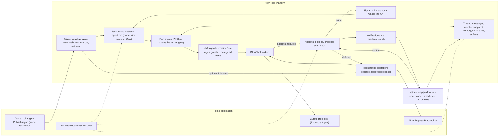

# Autonomous Agent Runs Plan

This document is the architecture and implementation plan for autonomous agent runs. A run
is started by a trigger instead of a chatting user. It works on a domain subject, such as a
project, in a durable thread that several people share. It produces proposals that people
approve, immediately or days later. It is a plan, not usage documentation: once the features
exist, the package READMEs, the consumer guide and the sample cases are authoritative.

It builds on [ai-assistant-and-api-bridge-plan.md](ai-assistant-and-api-bridge-plan.md). That
plan explicitly left "background turns and multi-agent workflows" out of scope.

The plan was checked against the code on 2026-10-13. [Baseline](#baseline) lists what already
exists and what each part of this plan has to change.

## Implementation status

Phases 1 to 3 are implemented in this repository with sample cases SPM-268 to SPM-277;
phase 4 happens in the consumer's repository. The implementation deviates from the plan
below where it turned out simpler or safer:

- **Proposal sets** are the approvals of one run (`AssistantApproval.RunId`); there is no
  separate set entity. People decide them one by one or together through
  `POST approvals/decisions`.
- **Maintenance** (expiry, reminders, escalation, interrupted runs and executions) runs in a
  hosted service with `NhAssistantLimits.MaintenanceInterval`, not as a Hangfire job.
- **Budgets** are counted from the run rows' usage; there is no `INhAiBudgetSettlement`.
- **Escalation** applies to deferred proposals only; inline proposals end with their run.
- **Run rows** are created when a trigger is published, so a receipt always names its run;
  rows of a rolled-back transaction are cleaned up by maintenance.
- **Turns that a person types in a thread** stay bound to the request and their approvals
  are inline.
- **Bridge and MCP tools** are not offered in headless runs, because they forward the
  caller's own credentials.
- **The sample** publishes triggers from its CAP consumer after the commit.
- **No follow-up trigger on failed runs**, to avoid loops; follow-ups exist after an
  executed or rejected deferred proposal when the approval policy asks for them.
- **Working memory** is offered to the model as the internal `memory_get` and
  `memory_update` functions instead of generated tools; `INhAiArtifacts` and
  `INhAiSubjectRetention` live in `NewHeap.Platform.AI.Common`.
- **Proposals carry the application's presentation** from `INhAssistantToolPresenter`, and
  headless runs use the application's default request culture, so approvers read what
  changes instead of the tool input.
- **The Angular client** sends host headers such as the active division through
  `NhAssistantConfig.getRequestHeaders`.

The earlier follow-ups are implemented as well: the chat panel decides agent proposals by the
thread's own decision rules (`thread.decisions`), the active division reaches the hub through
`getHubQueryParameters`, and proposals are presented in every supported UI culture so each
viewer reads their own language. Agent-run clients refresh through the hub's
`AgentWorkChanged` message, which also reaches the subject's members, and the tool call of a
deferred proposal that closed without running reads `rejected` or `not-executed`.

Phase 5, [proposal feedback](#10-proposal-feedback), is implemented with sample case SPM-279; phase 6,
[agent work on the subject itself](#11-agent-work-on-the-subject-itself), with SPM-280. Proposals
that people overtake by hand close on their own since the
[proposal revalidation plan](ai-proposal-revalidation-plan.md), with SPM-282. Agents that run by
fixed rules without a model, and proposals that are never recorded twice, came with the
[rule runs plan](ai-agent-rule-runs-plan.md), with SPM-283. Clients read single proposals by id
since the [proposal reads plan](ai-proposal-reads-plan.md), with SPM-282 extended. Triggers published
inside the application's transaction fire after the commit since the
[trigger transactions plan](ai-trigger-transactions-plan.md), with SPM-281 extended.
Agents that act as broad roles (control, briefings, skills, hand-offs and evaluation) follow the
[agent roles roadmap](ai-agent-roles-plan.md).

## Goals

- **Triggers start agents.** An application registers an agent once and starts it from domain
  events, schedules, webhooks or a button. No user has to be chatting.
- **Explicit accountability.** Every run has an accountable party. By default that is the
  agent itself; a registration can name the subject's responsible user or a service account
  instead.
- **Explicit agent rights.** An agent has its own grants, declared in code at registration.
  - Acting with the initiator's rights is opt-in, and works with and without an HTTP request.
  - A tool may be granted to an agent even when the user may not run it. This needs explicit
    consent from both the tool author and the agent registration.
- **Configurable approval per registration.** Lifetime (minutes to days), approvers,
  four-eyes, expiry behavior, reminders, and inline or deferred mode, for chat turns and for
  headless runs.
- **Production-grade retry and cancellation** at model-call, tool-call and run level, built on
  background-operation checkpoints, signals, idempotency leases and fencing.
- **Work is scoped to a subject, not a person.** Everyone involved in the subject shares the
  same thread, and access follows the subject.
- **Continuity.** Later triggers and people build on earlier work through the thread, a
  structured per-subject memory, run summaries and artifacts.
- **Reusable across applications.** SampleProjectManagement proves every capability with a
  neutral "project intake reviewer" agent. Consumer-specific agents, tools and triggers are
  planned in the consumer's own repository.

## Non-goals

- Multi-agent orchestration (agents calling agents). A run may start a follow-up run of the
  same agent; nothing more.
- Automatic compensation or undo of executed mutations. Mutations go through approval, and an
  uncertain outcome is resolved by a person.
- Replacing the interactive chat. Chat conversations keep today's behavior.
- API bridge tools and imported MCP tools in headless runs. Both depend on the request
  (`HttpContext.User`, the bearer token and the active-division header). Headless runs use
  curated tools only. A service-credential path for bridge tools is a separate plan.

## Concepts

| Concept | Meaning | Builds on |
|---|---|---|
| **Subject** | Typed domain reference `NhAiSubjectRef(Type, Id)`, e.g. `project/7f3c…` | `NhAiExecutionScopeEntry`, `NhAiProposalTarget`, background-operation `DomainObjectType/Id` |
| **Scope key** | Non-null isolation key of a subject: `tenant:{id}`, `division:{id}` or `global` | `NhAiInvocationContext.TenantId`, divisions |
| **Thread** | The durable conversation of one agent about one subject. Unique per `(scope key, agent, subject)` | `AssistantConversation` + participants |
| **Run** | One headless execution of the agent in a thread | Background operation + `INhAiBackgroundOperationRunAdapter` |
| **Turn** | One exchange inside a thread: a request turn (a person typing) or a step of a run | `NhAssistantTurnRunner` |
| **Proposal** | A tool call that needs approval, hash-bound to its arguments | `NhAiProposal`, `AssistantApproval`, `INhAiApprovalValidator` |
| **Proposal set** | The proposals one run produced, decided individually or in bulk | New |
| **Trigger** | A registered rule that turns an event into a run | New |
| **Initiator** | The person who caused a run or turn. Optional | New |
| **Accountable party** | Who answers for a run: the agent, the subject's responsible user or a service account. Always present | `NhAiInvocationContext.AccountableOwnerId` |
| **Grant source** | Why a tool call was allowed: `Agent` (agent grant) or `Delegated` (initiator's rights) | New |

## Baseline

What the plan reuses, and what it must change. Paths are relative to
`src/Back-end/Libraries`.

| Area | Exists today | Gap this plan closes |
|---|---|---|
| Headless AI runs | `INhAiBackgroundOperationRunAdapter` (bind, checkpoints, `WaitForApprovalAsync`), SPM-230; the Agent Framework adapter runs without HTTP | Requires a human accountable owner; does not go through the invoker gate |
| Tool gate | `NhAiAspNetToolInvocationGate` needs `HttpContext` and fails with `ai-tool-authentication-required` without it | A gate for agent grants and delegated rights without a request |
| Division policies | `ActiveDivisionAccessHandler` reads the division from the request header and dereferences `HttpContext` (NullReferenceException without a request) | Resource-aware division check; never throw without a request |
| Tool exposure | `NhAiToolExposure.Agent` exists, but only discovery checks it | Enforce at invocation, because deferred execution skips discovery |
| Approvals | Validator binds proposal hash, tool contract, `RunId`, actor and owner, and model, prompt, catalog and context hashes when present | Execution of a deferred proposal keeps the origin `RunId`; prompt binding becomes configurable |
| Approval decisions | Only the participant who started the turn decides (`ActiveActorId`); expiry is detected lazily on decide | Policy-based approvers for threads; a maintenance job for expiry, reminders and escalation |
| Idempotency | Durable leases in AI.Chat; fencing is an equality check, so a retry with a new fence conflicts | Explicit re-execution after an uncertain outcome |
| Background operations | `OwnerUserId` required (FK to the user, in the consumer's `NhIdentityDbContext`); conflict behaviors `Queue`, `ReturnExisting`, `Reject` (`Reschedule` behaves as `Queue`); no index on `ConcurrencyKey`; signals check the owner; no delayed dispatch | Owner kind, an access hook, a `NotBefore` enqueue option and an access-checked signal API |
| Dispatch timing | The dispatcher polls committed rows and commits the claim before creating the Hangfire job, so dispatch happens after commit | Live update and notification projection still run before an outer commit; no rollback test |
| Budgets | `INhAiBudgetManager` (reserve only); the durable chat ledger is per actor per day and only inside chat turns | A durable ledger per agent per scope key per day |
| Model calls | `NhAiModelProfile.RetryEligible` is stored but never read; `FallbackProfileNames` is used at profile resolution | Retry on transient model failures |
| Tenancy | The platform has divisions only; `TenantId` exists only in the AI layer and is often null | A non-null scope key; no unique index on a nullable column |
| Agent versions | The runtime version is the agent row version, which also changes on admin edits | Record the row version; grants stay code-only |
| Retention | `NhAiRetentionCategory` is metadata; nothing purges | Subject-driven thread retention (phase 3) |

## Architecture



## Decision record

These decisions were taken on 2026-10-13 and are binding for this plan.

| # | Decision | Rationale |
|---|---|---|
| D1 | An agent may hold a grant its user lacks only with two keys: the tool opts in (`AllowAgentGrant`) **and** the code registration grants it. Approving needs the tool's approve policy. A grant can be limited to `TriggerOnly`. Administrators can narrow an agent but never add grants. | Least privilege, with no escalation path through a chat prompt, self-approval or an admin edit. |
| D2 | Inline and deferred approval are both available for request turns and headless runs from phase 1. Trigger runs default to deferred, chat to inline. Both can be overridden per tool. | An agent that makes five proposals should not wait five times in a row, but some flows must continue with the outcome. |
| D3 | A thread is an `AssistantConversation` with `Kind = Thread` and a 1:1 `AssistantThread` row for subject and memory. It is not a separate conversation model. | Reuses persistence, live updates, push, sharing and the Angular UI, and keeps the unique subject index provider-neutral. |
| D4 | Background operations get an owner kind (`User` or `Agent`). `OwnerUserId` becomes nullable, `OwnerKey` holds the agent actor id, and `DomainObjectType/Id` is the subject. `INhBackgroundOperationAccess` decides access for others. | Agent-accountable runs have no user owner, while visibility must follow the subject. |
| D5 | Tool results obtained through an agent grant beyond a viewer's own rights are classified **Restricted** and redacted for that viewer. | Shared threads must not leak data that participants are not entitled to. |
| D6 | Accountability is set per registration: `Agent` (default), `SubjectResponsible` or `ServiceAccount(userId)`. A run always has an accountable party; with `Agent` it is the agent actor itself. Runs accountable to the agent require approval for every non-read effect. | Triggers without a person must still be attributable, budgeted and auditable. |
| D7 | Delegated initiator rights work in request turns **and** headless runs from phase 1. Division checks become resource-aware; policies that cannot be evaluated without a request deny, never throw. | Manual triggers and queued messages should act with the person's rights. |
| D8 | Subject membership is stored as a snapshot in `nhai` for listings, recipients and live updates. Every action checks access live through the resolver. | Threads and roles live in different databases; listings must filter server-side, while authorization must be current. |
| D9 | A non-idempotent execution whose outcome is uncertain is never retried automatically. The proposal becomes `execution-unknown` and an approver resolves it. | The platform cannot prove that a write did not happen. |
| D10 | Uniqueness and budgets use a non-null scope key, not a nullable tenant. | NULL handling in unique indexes differs between SQL Server and PostgreSQL. |

## 1. Identity and authorization

### Accountability (D6)

| Mode | `AccountableOwnerId` | Background-operation owner | When to use |
|---|---|---|---|
| `Agent` (default) | Agent actor id `assistant-agent:{id}` | `OwnerKind = Agent`, `OwnerKey` = agent actor id | Triggers from external systems; nobody in particular answers for the run |
| `SubjectResponsible` | `NhAiSubjectInfo.ResponsibleUserId` from the resolver | `OwnerKind = User` | A person owns the subject, e.g. the project owner |
| `ServiceAccount(userId)` | The configured user | `OwnerKind = User` | The application keeps a technical account for automated work |

- When the mode needs a user and the resolver returns none, the trigger is rejected with
  `no-accountable-owner` and recorded.
- The durable run invariant changes from "a non-human agent actor and an accountable owner" to
  "a non-human agent actor and an accountable party". `BindInvocation` accepts
  `AccountableOwnerId == ActorId` for agent-accountable runs. `nh-ai-durable-runs` is updated.
- The approval validator is unchanged: `actor-or-owner-mismatch` compares the proposal with
  the execution context, and `agent-self-approval-denied` still blocks the agent.
- Agent-accountable runs require approval for every effect other than `ReadOnly`, regardless
  of the tool's `Approval` setting.

### Grant sources

The effective tool set is computed per turn, because the initiator can differ between turns.

| Source | Meaning | Default |
|---|---|---|
| **Agent grants** | Tool ids or selectors granted in the code registration | Required; the only source when nothing else is configured |
| **Delegation** | The agent may also use what the initiator may use, within its tool selectors | **Opt-in** per agent (`DelegateFromInitiator`) |

A tool is offered in a turn when **all** of these hold:

1. It matches the agent's effective `AllowedToolSelectors` (code or admin-narrowed) and its
   effect is allowed by `MaximumAutonomy`.
2. It has `NhAiToolExposure.Agent`. The agent gate enforces this again at invocation.
3. **Either:**
   - (a) a code grant covers it, the tool has `AllowAgentGrant = true`, and the grant is not
     `TriggerOnly` while a person is chatting in a request; **or**
   - (b) delegation is enabled, there is an initiator, and the initiator's principal passes
     the tool's authorization policies against the subject resource.

The invocation records `GrantSource = Agent | Delegated` in the audit record, the tool
invocation row and the proposal. When both sources apply, `Delegated` wins, so results stay
unrestricted for that person.

### Agent invocation gate

A new `NhAiAgentInvocationGate` in `AI.AspNet.Common` handles every turn of a thread. It
replaces neither the ASP.NET gate nor `NhAssistantInvocationGate` for chat.

- **Agent grants** do not evaluate the tool's policies, because there is no user to evaluate.
  The gate adds the tool's `RequiredCapabilities` to the context, so the existing
  `INhAiCapabilityResolver` and effect policy still apply.
- **Delegated rights** are evaluated with `IAuthorizationService` against a principal for the
  initiator:
  - In a request turn the request principal is used, as today.
  - Without a request, `INhAiPrincipalFactory.CreateAsync(userId, scope, ct)` builds it. The
    default implementation uses `INhUserManager.GetValidClaimsByUserIdAsync(userId,
    withDivision: true)`, the same source as token creation. Applications with an
    `IClaimsTransformation` register their own factory.
  - The principal is used for the authorization call only. It is never stored and never put
    in `NhAiInvocationContext` (`nh-ai-aspnet-context`).
- **The authorization resource** is `NhAiSubjectAuthorizationResource` (subject, scope key,
  division id, purpose). It implements a new `INhDivisionScopedResource` in
  `AspNet.Common`, so platform handlers can read the division without an AI dependency.
- **Division scope** comes from the resolver's `NhAiSubjectInfo`, not from a header.

### Resource-aware division authorization

- `ActiveDivisionAccessHandler` uses `INhDivisionScopedResource.DivisionId` when the resource
  carries one, and checks access with `INhUserManager.DivisionAccessAsync` on the principal's
  claims. Otherwise it keeps reading the active-division header.
- Without a request and without a scoped resource it denies. The NullReferenceException is
  removed.
- In a request with a scoped resource, the resource division wins. This is a compatibility-
  sensitive behavior change and gets a release note and a regression test.
- Consumer handlers that read route values deny without a request. Guidance shows how to
  accept `INhDivisionScopedResource` or the subject resource. The sample's
  `ProjectAccessHandler` becomes the example.

### Elevation with two keys (D1)

- **Tool attribute:** new properties on `[NhAiTool]`:
  - `AllowAgentGrant` (default `false`).
  - `ApprovalPolicy`: the authorization policy an approver must pass. The default is the
    tool's own policies.
- **Registration:** `Grant("projects.change-status")`, optionally `.TriggerOnly()`. Grants
  exist only in code. The admin agent editor can narrow selectors and disable the agent, but
  agent grants are evaluated against the code registration.
- **Approval:** the approver must pass `ApprovalPolicy` in their own request. Combined with
  `agent-self-approval-denied`, a user who lacks a right cannot get it done by asking the
  agent and approving the proposal themselves.

### Restricted results (D5)

- A tool result obtained under `GrantSource = Agent` is `Restricted` for any viewer who would
  not pass the tool's policies against the subject resource. The view layer redacts it:
  "Shielded result (agent rights)". The check is cached per viewer and tool per request.
- `ElevatedReads = Restricted | Deny`, default `Restricted`. `Deny` limits agent grants to
  non-read tools; such an agent can then only read through delegation, so it cannot work on
  triggers without an initiator.
- **Residual risk:** the model's own text can repeat restricted content, and text cannot be
  redacted reliably. Mitigations:
  - Tool presenters return summaries.
  - The system prompt forbids repeating restricted fields.
  - Agents with elevated reads need a review before go-live.

## 2. Approval policies

### Layering

Policies are named and registered (`AddApprovalPolicy("project-review", ...)`). They are
referenced from the agent (the existing, currently unused `NhAiAgentDescriptor.ApprovalPolicyId`),
per tool within an agent, and per trigger. The most specific level wins. Platform maxima cap
the result, and a runtime value can never exceed the registration.

| Setting | Values | Chat default | Trigger default |
|---|---|---|---|
| `Lifetime` | `TimeSpan` | 15 min (`NhAssistantLimits.ApprovalLifetime`) | 3 days |
| `Approvers` | `Initiator`, `SubjectRole(role)`, `Policy(name)`, combinations (any-of) | `Initiator` | `SubjectRole(Approver)` |
| `FourEyes` | approver ≠ initiator | off | off; recommended for destructive tools |
| `Mode` | `Inline`, `Deferred` | `Inline` | `Deferred` |
| `OnExpiry` | `Withdraw`, `Escalate(policy)`, `FailRun` | `Withdraw` | `Withdraw` |
| `Reminders` | list of offsets, with optional escalation | none | 1 day |
| `Precondition` | require an unchanged subject version, via `INhAiProposalPrecondition` | off | on |
| `BindTo` | `ToolContract`, `ToolContractAndPrompt` | `ToolContractAndPrompt` | `ToolContract` |

### Proposal states

| State | Meaning | Next |
|---|---|---|
| `pending` | Waiting for a decision | `approved`, `rejected`, `expired`, `withdrawn`, `stale` |
| `approved` | Approved; inline: the run continues; deferred: execution is queued | `executing` |
| `executing` | The execute operation is running | `executed`, `execution-failed`, `execution-unknown` |
| `execution-unknown` | The worker stopped during a non-idempotent call (D9) | `executing` (explicit re-execution), `resolved` |
| `rejected`, `expired`, `withdrawn`, `stale`, `executed`, `execution-failed`, `resolved` | Closed | — |
| `shadow` | Recorded by a shadow run; never notified or executed | — |

Chat approvals keep today's `pending`, `approved`, `rejected` and `expired`.

### Inline

- **Request turns** work as today: the turn pauses in `waiting-for-approval`, the decision
  resumes it, and the stored invocation runs.
- **Headless runs** suspend through `WaitForSignalAsync` with wait key `approval:{id}` and the
  approval's expiry. The decision sends the signal through the access-checked signal API
  (§4). The handler re-enters from the beginning, restores from its checkpoint, executes the
  stored invocation under the run's own `RunId`, and continues.
- While a run is suspended, the thread status is `waiting-for-approval` and belongs to the
  run. The stale-turn takeover rule (`TurnTimeout` + 1 minute) applies only to request turns;
  a thread with an active run is judged by the background operation's heartbeat and status.

### Deferred

- The model receives a synthetic tool result, "Proposal P-123 recorded and awaiting
  approval", and continues. The run ends with a **proposal set**.
- **Approved:** an *execute proposal* background operation runs the exact stored invocation
  as the agent actor.
  - `BindProposalExecution(context, operation, proposal)` on the run adapter keeps the
    proposal's origin `RunId`, so `run-mismatch` holds, and records the execute operation id
    as correlation id.
  - Owner and subject are the run's owner and subject.
  - The idempotency key is `proposal:{id}`.
  - `ReadOnly` and `IdempotentMutation` use an operation type with retries. Other effects use
    a `NonIdempotent` operation type without retries; a stale attempt
    (`stale-non-idempotent-attempt`) moves the proposal to `execution-unknown`.
- **Execution unknown (D9):** the approver sees why and chooses *re-execute*, which records an
  explicit acknowledgement and uses idempotency key `proposal:{id}:retry:{n}`, or *mark
  resolved*.
- **Rejected, expired, withdrawn or stale:** the proposal is closed and the thread shows it.
- **Follow-up run:** if the policy says so, the decision starts a follow-up run through the
  `proposal-decided` trigger.

### Binding across agent versions

- With `BindTo = ToolContract`, the proposal leaves model profile, prompt, catalog and context
  hashes empty. The validator checks those only when present, so a prompt update does not
  invalidate open proposals, while a changed tool contract still does.
- Proposals record the agent **row** version, which is the version the runtime uses.

### Stale proposals

- At creation, a proposal stores the subject version from `NhAiSubjectInfo.Version` (row
  version or ETag).
- Before execution, `INhAiProposalPrecondition.CheckAsync(proposal, subject)` may return
  `Stale`. The proposal becomes `stale` and is not executed. The policy can start a follow-up
  run to re-plan.
- Application guards close open proposals earlier, refuse approvals of proposals that no longer
  fit and explain why; see the [proposal revalidation plan](ai-proposal-revalidation-plan.md).

### Decisions, inbox and maintenance

- New endpoint `POST /api/assistant/approvals/{approvalId}/decisions` returns a typed JSON
  result, not a stream. The caller must:
  - have at least `Approver` on the subject (live check);
  - match the policy's approvers and pass `ApprovalPolicy`;
  - satisfy four-eyes;
  - not be the agent.
- `POST /api/assistant/approvals/decisions` decides several proposals of one proposal set.
- The chat route `conversations/{id}/approvals/{approvalId}/decide` keeps today's rule.
- New endpoint `GET /api/assistant/approvals/inbox` lists pending proposals the caller may
  decide, from the member snapshot (§4), filtered by subject type, agent and division, sorted
  by expiry, and paged server-side. Each entry is checked live before it is decided.
- A recurring maintenance job (`NhHangfireUtil.RecurringJob.AddOrUpdate`) expires proposals,
  sends reminders, escalates, and applies `OnExpiry`. Today expiry is detected only when
  someone decides.

## 3. Retry and cancellation

### Retry levels

| Level | Behavior | Configured on |
|---|---|---|
| Model call | **New.** Retry on 429, 5xx and timeout with exponential backoff when the profile is `RetryEligible`; then fall back along `FallbackProfileNames` | Model profile |
| Tool call | **New.** Automatic only for `ReadOnly` and `IdempotentMutation`, in the run engine. Other effects are never retried automatically | Tool effect (fixed) |
| Run, automatic | Background-operation `RetryCount` with backoff, for transient failures only | Agent registration (`Retry(retryCount)`) |
| Run, manual | **Resume** from the last checkpoint (default), **Restart** (new attempt, fresh context, same thread), or **Restart on latest agent version** | Endpoint + UI; subject approvers and admins |

- **Failure classes** are stored on `AssistantRun` and shown in the run timeline. They map to
  background-operation outcomes:

  | Class | Meaning | Background-operation outcome |
  |---|---|---|
  | `transient` | Model or tool unavailable | `NhBackgroundOperationRetryResult.Retry` |
  | `budget`, `policy`, `validation`, `stale` | Permanent | Failed `TaskResult` |
  | `cancelled` | Cancelled by a person or the kill switch | Cancelled |
  | `internal` | Unexpected exception | Exception (retried within `RetryCount`) |

- **Checkpoints.** A run checkpoints after every model step and every tool result.
  - Background-operation checkpoints are inline JSON of at most 16 KB, so the run stores only
    an `NhAiRunCheckpointReference` and a step cursor there.
  - The state itself lives in `nhai` rows: messages, tool invocations and `AssistantRun`.
  - A resumed run never repeats a completed mutation, because completed tool invocations and
    idempotency leases are read back, and it does not re-spend tokens on completed steps.

### Cancellation

- **Cooperative.** Cancellation is honored at the next safe point: between model steps, or
  before a tool call.
  - Headless runs use the background-operation `CancelRequested` status; the heartbeat cancels
    the worker's token.
  - Request turns keep the in-process registry.
  - An in-flight tool call finishes. If it was superseded, the fencing token blocks its write.
- **Effects:**
  - Open proposals of the run become `withdrawn`.
  - Pending waits are released.
  - The thread records "Cancelled by <name>".
  - The background operation ends `Cancelled`.
- **Who may cancel:** subject members with at least `Participant`, and admins, through
  `INhBackgroundOperationAccess`.
- **Kill switch per agent**, through configuration and an admin endpoint. It cancels all
  active runs of the agent, rejects new triggers with `agent-disabled`, and keeps open
  proposals visible but not executable until the agent is enabled again.

### Concurrency per subject

The concurrency key is `agent:{id}:subject:{scopeKey}:{type}:{id}`. Today a conflicting
operation of another owner is reported as "not visible to this owner"; the admission check
consults `INhBackgroundOperationAccess` instead, so runs with different owners on one subject
still coalesce.

| Behavior | Effect | Built on |
|---|---|---|
| `Coalesce` (default) | Within the debounce window, events are merged into one pending run that receives all event messages | `AssistantQueuedInput` + `ReturnExisting` + new `NotBefore` enqueue option |
| `Queue` | Runs after the active run | `Queue` |
| `Supersede` | Cancels the active run and queues a new one | Cancellation + `Queue` |
| `Ignore` | Drops the event; the drop is recorded | `Reject` + trigger record |

- An index on `ConcurrencyKey` is added with the owner-kind migration (§4).
- Messages that people type while a run is active are stored as `AssistantQueuedInput` and
  processed by the run as the next turn, with that person as initiator. Today these return
  409. The Angular client's queued follow-ups (0.8.0) send to this queue for threads.

## 4. Subject threads and participants

### Data model (D3)

`AssistantConversation` gets `Kind` (`Chat` | `Thread`, default `Chat`).

New tables in `nhai`:

| Table | Purpose |
|---|---|
| `AssistantThread` | 1:1 with a thread conversation: scope key, agent id, subject type and id, subject version, accountability mode, accountable party, memory JSON, memory schema version and concurrency stamp. Unique index on `(ScopeKey, AgentId, SubjectType, SubjectId)`; all columns non-null |
| `AssistantRun` | Run id, conversation, background operation id, trigger id, trigger event key, initiator, accountable party, attempt, status, failure class, agent row version, call and token counts, summary, shadow flag |
| `AssistantProposalSet` | Groups the proposals of a run |
| `AssistantQueuedInput` | Messages and events waiting for the next turn |
| `AssistantSubjectMember` | Member snapshot: scope key, subject, actor id, role, snapshot time. Indexed for the inbox |
| `AssistantTriggerRecord` | Deduplication keys and guardrail rejections (phase 2) |
| `AssistantAgentBudgetLedger` | Calls and tokens per agent per scope key per day (phase 2) |
| `AssistantThreadArtifact` | Versioned files produced by tools (phase 3) |

`AssistantApproval` gets `PolicyId`, `Mode`, `ProposalSetId`, `SubjectVersion`,
`GrantSource`, `ExecutionOperationId`, `ExecutionStatus`, `ReminderState`, `RemindedAt` and
`EscalatedAt`.

Migrations go into both `NewHeap.Platform.AI.Chat.SqlServer` and
`NewHeap.Platform.AI.Chat.PostgreSql`, with provider tests for the unique thread index and the
inbox query.

For a thread, `OwnerActorId` is the agent actor. Only platform logic deletes a thread, and
retention follows the subject (§8). Owner-only collaboration actions (share link, invite,
remove, archive) are performed by subject approvers and admins.

### Access follows the subject (D8)

```csharp
public interface INhAiSubjectAccessResolver
{
    string SubjectType { get; }

    // Scope key, division, tenant, version, display name and responsible user; null when unknown.
    ValueTask<NhAiSubjectInfo?> DescribeAsync(NhAiSubjectRef subject, CancellationToken ct);

    // Live role of one actor: None | Reader | Participant | Approver, plus named roles.
    ValueTask<NhAiSubjectAccess> ResolveAsync(NhAiSubjectRef subject, string actorId, CancellationToken ct);

    // Everyone with a role, for the member snapshot.
    IAsyncEnumerable<NhAiSubjectMember> ListMembersAsync(NhAiSubjectRef subject, CancellationToken ct);
}
```

- **Live check.** Every request (read, type, cancel, decide) calls `ResolveAsync`. When a
  different person is assigned to the subject, authorization moves at once.
- **Snapshot.** `ListMembersAsync` refreshes `AssistantSubjectMember` at run start, at
  proposal creation, when the application calls `INhAiSubjectAccess.RefreshAsync(subject)`
  (for example after a reassignment), and from the maintenance job for subjects with pending
  proposals. The inbox, notification recipients, SignalR groups and read state use the
  snapshot.
- **Roles.** `Reader` sees the thread. `Participant` may type, which starts a turn as
  initiator, and may cancel. `Approver` may also decide within the policy.
- **Invitations** (8.0 collaboration) still work for people outside the resolver's roles. They
  grant `Participant`, never `Approver`. Participant rows for resolver members are created on
  first read, with `JoinedVia = "subject"`, to hold read state.

### Background-operation ownership (D4)

Changes in `NewHeap.Platform.AspNet.Common`, with no AI dependency:

- `NhBackgroundOperation` gets `OwnerKind` (`User` | `Agent`) and `OwnerKey`. `OwnerUserId`
  becomes nullable and is required for `OwnerKind = User`. Enqueue options get the same
  fields plus `NotBefore`.
- New hook `INhBackgroundOperationAccess.EvaluateAsync(operation, caller, action)` with actions
  `View`, `Cancel`, `Retry` and `Signal`. Owner endpoints, the admin view, the admission conflict
  check and the signal service call it in addition to today's owner check. The AI package implements it for operations
  whose `DomainObjectType` is a registered subject type.
- A new access-checked `SignalAsync(operationId, signaledBy, waitKey, signal, …)` replaces the
  owner-only path for these operations; `SignalForOwnerAsync` remains.
- Idempotency admission scope for agent-owned operations becomes
  `agent:{key}:{scopeKey}:{IdempotencyScope ?? operationType}`.
- Indexes on `(DomainObjectType, DomainObjectId)` and `ConcurrencyKey`.
- **Breaking:** the tables live in each consumer's `NhIdentityDbContext`, so every consumer
  generates a migration. The release note gives the steps; the sample adds its migration.

### Turns from several people

- One active turn per thread remains the rule (`ActiveTurnId`).
- Every message records its author. The model sees speaker markers.
- A turn's rights are the agent grants plus, with delegation, the typing person's rights,
  with or without a request (D7). The UI shows "with the agent's rights" or "with your rights"
  per tool call, based on `GrantSource`.

## 5. Run engine

- `NhAssistantTurnRunner` is split into a provider-neutral turn engine in `AI.Chat` and two
  transports:
  - **Request transport:** SSE, as today.
  - **Run transport:** events go to the live publisher and the run timeline.
- The engine shares history, prompt assembly, the tool-call interceptor, governed functions
  and audit relays. No internals become public.
- The run operation (`nh-ai-agent-run`) lives in `AI.Chat.AspNet`, because background
  operations live in `AspNet.Common` and `AI.Chat` does not depend on it. Its handler:
  1. binds the context through the run adapter (agent actor, accountable party,
     `RunId` = operation id);
  2. loads the thread and drains `AssistantQueuedInput`;
  3. runs steps with a checkpoint after each model step and tool result;
  4. suspends for inline approvals and resumes after the signal;
  5. ends with a proposal set and, from phase 3, a run summary.
- Budgets inside runs go through a durable agent ledger keyed by agent, scope key and day.
  Phases 1 and 2 count model and tool calls, which `ReserveAsync` supports. Token budgets need
  a settle step after the call and arrive with an additive `INhAiBudgetSettlement` contract
  in phase 2.

## 6. Continuity

A new run in an existing thread gets four layers of context.

1. **Thread history.** The last `MaxHistoryMessages` messages, including event messages such
   as "Project PRJ-12 was created".
2. **Subject memory.** Structured, versioned JSON that the agent owns, with a JSON schema per
   agent.
   - Platform tools `memory.get` and `memory.update` read and write it with JSON Merge Patch
     and optimistic concurrency on the memory concurrency stamp.
   - It is validated against the schema. Classification and retention are the thread's.
   - People see it as a "Working memory" panel.
3. **Run summaries.** Every run ends with a bounded summary of what it did, proposed and left
   open, stored on `AssistantRun`. The next run gets the last N summaries.
4. **Artifacts.** Versioned files that tools produced. The model gets their metadata, and tools
   read them by id.

Version upgrades:

- A new run always uses the latest agent row version.
- Memory schema changes are migrated by the application hook `INhAiAgentMemoryMigrator`.
- Open proposals stay valid as long as their tool contract is unchanged (§2).

## 7. Triggers

### Registration

```csharp
services.AddNewHeapAssistant(assistant => assistant
    .AddAgent(SampleAgents.ProjectIntakeReviewer())          // NhAssistantAgentDefinition
    .ConfigureAgent(SampleAgents.ProjectIntakeReviewerId, agent => agent
        .Accountability(NhAiAgentAccountability.Agent)        // or SubjectResponsible(), ServiceAccount(userId)
        .Grant("projects.search", "projects.tasks.*")
        .Grant("projects.change-status").TriggerOnly()
        .DelegateFromInitiator(true)
        .UseApprovalPolicy("project-review")
        .Retry(retryCount: 3)
        .Budget(perDay: NhAiAgentBudget.Calls(model: 500, tools: 2_000), maxConcurrentRuns: 4, maxRunsPerSubjectPerDay: 10)
        .Memory<ProjectIntakeMemory>(schemaVersion: 1)
        .Shadow(true))                                        // runs, but no notifications or executions
    .AddSubjectType<ProjectSubjectAccessResolver>()
    .AddApprovalPolicy("project-review", policy => policy
        .Lifetime(TimeSpan.FromDays(3))
        .Approvers(NhAiApprovers.SubjectRole(NhAiSubjectRole.Approver))
        .Mode(NhAiApprovalMode.Deferred)
        .Reminders(TimeSpan.FromDays(1))
        .RequireUnchangedSubject())
    .AddTrigger<ProjectCreatedEvent>("project-created", trigger => trigger
        .StartAgent(SampleAgents.ProjectIntakeReviewerId)
        .Subject(evt => new NhAiSubjectRef("project", evt.ProjectId.ToString()))
        .Initiator(evt => null)                               // agent grants only
        .Message(evt => $"Project {evt.ProjectKey} was created.")
        .Dedupe(evt => evt.EventId.ToString())
        .OnBusy(NhAiTriggerConflict.Coalesce, debounce: TimeSpan.FromMinutes(2))));
```

The names are illustrative; the exact API is designed in phase 1.

### Sources

| Source | Mechanism |
|---|---|
| **Domain event** | `INhAiAgentTriggers.PublishAsync(evt)` inside the application's transaction. It writes only the background-operation row, through the application's DbContext, which joins the ambient transaction (`Repository.StartOrGetTransactionScopeAsync` uses `Database.CurrentTransaction`). A rollback drops the trigger. Thread and run rows live in the separate `nhai` context and are created by the run. Applications on `NewHeap.Platform.Events.Cap` can map an `INhEventPublisher` event to a trigger instead. |
| **Schedule** | Cron through `NhHangfireUtil.RecurringJob.AddOrUpdate`. A query delegate supplies the subjects, with a cap per tick. |
| **Webhook** | `POST /api/assistant/triggers/{id}` with an HMAC secret per trigger and replay protection. |
| **Manual** | A "Start agent" action on a subject. The person becomes the initiator. |
| **Follow-up** | Built-in triggers `proposal-decided`, `proposal-executed` and `run-failed`, opt-in per policy. |

### Dispatch after commit

The earlier open point is answered by the existing design: the dispatcher polls committed
rows and commits its claim before it creates the Hangfire job. Phase 1 still has to:

- add a regression test on SQL Server and PostgreSQL: enqueue inside an application
  transaction, roll back, and assert that nothing is dispatched;
- defer the live update and notification projection that enqueue publishes until after the
  outer commit. Today they run before it, and the projector's separate connection can block on
  the uncommitted row under SQL Server without read-committed snapshot.

### Guardrails

- A durable budget per agent per scope key per day (§5).
- Maximum concurrent runs per agent, and maximum runs per subject per day.
- A kill switch (§3).
- **Shadow mode:**
  - Runs execute normally with read tools.
  - Proposals are recorded as `shadow` and never notified or executed.
  - Threads are visible only to admins.
- Rejected triggers are recorded with a reason: `budget`, `disabled`, `rate-limited`,
  `deduplicated`, `no-accountable-owner`.

## 8. Notifications and UI

### Notifications

The hook `INhAiAgentNotificationPolicy` decides who is notified, through which channel and
when. The events are: run finished with proposals, proposal expiring, proposal escalated,
execution unknown, run failed, and someone mentioned in the thread. Recipients come from the
member snapshot, not from the operation owner or the turn starter. Web Push exists; e-mail
and in-app channels plug in through the hook.

### `@newheap/platform-ai-chat`

- **Inbox:** pending proposals across threads, with decide-in-place, bulk approve within one
  proposal set, filters, and the `execution-unknown` resolution.
- **Thread view:** an embeddable component per subject, e.g. an "Intake review" tab on a
  project page.
  - It contains the conversation, memory panel, artifacts and run list.
  - Each tool call shows its `GrantSource`.
  - Restricted results are redacted for viewers without rights.
- **Run timeline:** trigger → steps → tool calls → proposals → decisions → executions, with
  failure class, cost and retry or cancel actions.

## 9. Observability and governance

- **Audit.** These public records gain init-only properties (additive):
  - `NhAiAuditRecord`: `AgentId`, `ActorKind`, `AccountableOwnerId`, `ProposalId` and
    `GrantSource`.
  - `NhAssistantAuditEvent`: `RunId`, `TriggerId`, subject, initiator, `GrantSource`,
    `ApprovalPolicyId`, and the approver for executions.
- **Cost.** `NhAiUsageRecord` already carries `RunId` and `AgentId`. Cost is aggregated per run,
  agent and subject.
- **Evaluation.** A trigger replay in `NewHeap.Platform.AI.Test` feeds recorded events through
  an agent with `NhAiScriptedChatClient` and asserts on proposals and memory. Shadow runs can
  be exported as datasets.
- **Retention.** Threads follow the subject through `INhAiSubjectRetention`: deleting or
  anonymizing a subject clears its threads. This is the first enforced retention in the AI
  packages, so it gets its own design review in phase 3.

## 10. Proposal feedback

People who reject an agent proposal can say what was wrong, without being forced to and
without the question getting in their way. The feedback is for **people first**: it shows the
application's operators (and NewHeap, through them) what to change in prompts, tools and
approval policies, and whether a change helped. The agent learns from it automatically only in
a later phase, from the same records.

### Baseline

| Exists today | Gap |
|---|---|
| `AssistantApproval.Reason`: optional free text stored with the decision | Nothing reads it after the decision; it is the decision's audit note, not structured feedback |
| The proposals component asks for that reason **before** the decision, in one field shared by every selected proposal | Feedback belongs after a rejection and per proposal |
| A follow-up run after a rejection receives "Proposal … was rejected" (`NhAssistantAgentTriggers.StartFollowUpAsync`) | The reason never reaches the agent |
| Expired, stale and failed executions are approval statuses | Nobody aggregates them per agent, tool or agent version |

### Decisions

| # | Decision | Status | Rationale |
|---|---|---|---|
| F1 | People learn first; automatic learning by the agent is a later phase on the same records | Decided 2026-10-13 | Operators must understand the failure patterns before an agent changes its own behavior |
| F2 | Feedback is optional and asked **after** a rejection, inline and dismissible; rejecting stays one action | Decided 2026-10-13 | A mandatory or prominent question makes people stop deciding or answer carelessly |
| F3 | Feedback is a category code from a fixed set plus optional text | Decided 2026-10-13 | Codes aggregate without a model; text adds nuance. The groups separate "wrong" from "right but not now" |
| F4 | Feedback is its own record, separate from the decision's `Reason` | Decided 2026-10-13 | It arrives after the audited decision, can come from several people, and can be edited by its author |
| F5 | A rejection and its feedback reach the next run on the **same** subject as context | Decided 2026-10-13 | Otherwise the agent repeats a rejected proposal and people stop giving feedback |
| F6 | Feedback never leaves its scope key, and raw text never crosses subjects | Decided 2026-10-13 | Feedback text contains subject data and is untrusted input |

### Capture

- **After a rejection** the proposal shows one dismissible line, "What was wrong? (optional)",
  with the category choices and an optional text of at most 1,000 characters. It is not a modal
  and does not return for that proposal once dismissed.
- **Later:** a closed proposal keeps a low-key "Give feedback" action. Any person who may decide
  the subject's proposals may leave one record per proposal and edit their own.
- **Bulk rejection** asks once for the set and stores a record per proposal with a bulk flag, so
  analysis can weigh it lower.
- **Surfaces:** the agent-runs proposals component and the panel's approval card for thread
  proposals. The decision's `Reason` field stays available as the decision note.

| Code | Group | Meaning |
|---|---|---|
| `incorrect` | wrong | The proposal is factually wrong |
| `wrong-value` | wrong | The right action with the wrong values |
| `not-needed` | wrong | The change is unnecessary |
| `not-now` | right-but-not-now | Right, but not at this moment |
| `already-done` | right-but-not-now | Already done or in progress elsewhere |
| `not-allowed` | not-allowed | Against policy, or beyond what the agent should do |
| `other` | other | Only the text explains |

`not-now` and `already-done` never count as "the agent was wrong".

### Storage

`AssistantProposalFeedback` in `nhai`, with migrations for SQL Server and PostgreSQL:

- approval id; `TargetKind` (`agent-proposal` now; room for chat approvals and answers later);
  conversation, scope key, agent id and agent row version; tool id and tool contract hash;
  subject type and id; the approval status when the feedback was given;
- category code, text, author actor id, bulk flag, created and updated at;
- unique on `(ApprovalId, AuthorActorId)`; indexes on `(ScopeKey, AgentId, CreatedAt)` and
  `(AgentId, ToolId)` for the report.

`INhAiSubjectRetention.ForgetSubjectAsync` deletes the records with the subject's threads.

### Report and export

- **Endpoints** under the assistant admin prefix and policy, with an optional `scopeKey` filter:

  | Endpoint | Returns |
  |---|---|
  | `GET admin/agents/{id}/feedback/summary` | Per tool and agent row version: approved, rejected, expired, stale and failed executions, the rejection rate, counts per category and distinct authors |
  | `GET admin/agents/{id}/feedback` | Feedback with the proposal's presentation and a link to its thread, paged server-side and filtered by tool, category, agent version, period and scope key |
  | `GET admin/agents/{id}/feedback/export` | JSONL with presentation, tool input, category, text and versions; the export is audited |

- **Hook:** `INhAssistantProposalFeedbackSink`, registered with `AddProposalFeedbackSink`,
  receives each record after it was stored, so an application can forward it to its own
  analytics. No sink is registered by default; a failing sink is logged and never undoes the
  feedback.
- **Angular:** `nh-assistant-proposal-feedback` in the main entry, used by the proposals
  component and the panel's approval card, and `nh-assistant-agent-feedback-report` in the
  `admin` entry point, also opened from each agent in the administration page. Their texts
  live in the main entry's language files like every other assistant text; moving language
  files out of the main entry is a separate change for all keys.
- **The loop:** operators read the feedback and change the prompt, tools or policy. The agent
  row version changes, and the summary shows whether the rejection rate per tool dropped for the
  new version.

### Same subject (F5)

- The continuity block (§6) gains the thread's most recent rejected proposals with category and
  text, at most `MaxRejectionsInContext` (5) from the last 30 days, with truncated text. They are
  labelled as earlier decisions of people, not as instructions.
- The follow-up run of a rejection reads the feedback from the continuity block, which is built
  when the run starts; the trigger message itself stays content-free, because the decision's
  reason is not shown to the thread's readers.
- Only the same thread receives them; other subjects and consultations never do.

### Later: automatic learning

Out of scope for phase 5. The records are designed so it can build on them:

- A scheduled job distils candidate guidelines per agent and tool from the feedback within one
  scope key.
- A candidate guideline is itself a proposal that an agent owner decides. Only approved
  guidelines enter the agent's instructions, versioned with the agent row version.
- The export doubles as the evaluation set for the trigger replay (§9): "for this input the agent
  must not propose this".

### Risks

- **Poisoning and prompt injection.** On the same subject, feedback text is as trusted as a
  message typed in the thread. Text that crosses subjects goes through review (later phase).
- **Leakage.** Feedback text contains subject data; the report and export respect scope keys.
- **Skew.** One critical approver can dominate. The summary shows distinct authors, and bulk
  feedback is flagged.
- **Response rate.** Too prominent and people decide less; too hidden and nobody answers. Measure
  the share of rejections with feedback.
- **Personal data.** Free text by identifiable people. Retention follows the subject, and the
  release note asks consumers to cover it in their processing agreements.

### Open questions

- Feedback on chat approvals and a thumbs-down on chat answers: the same record through
  `TargetKind`, but when?
- Approve with modification is the strongest learning signal (the difference between the
  proposal and what the person wanted), but hash binding makes every change a new proposal. It
  needs its own design.

## 11. Agent work on the subject itself

Applications show agent work where people already look: on the project, not only in a general
inbox. Everything in this section is available per subject, across agents, for lists and for
detail pages, from the browser and from the application's own back-end.

### Decisions

| # | Decision | Status | Rationale |
|---|---|---|---|
| S1 | One call returns all agent work on one subject, across agents | Decided 2026-10-13 | A detail page should not call once per agent |
| S2 | One call summarizes up to 200 subjects of one type for list views | Decided 2026-10-13 | A list with badges must not call once per row |
| S3 | A public C# service offers the same reads with the same access checks | Decided 2026-10-13 | Applications compose agent work into their own endpoints and DTOs |
| S4 | A badge counts both open proposals and the ones the viewer may decide | Decided 2026-10-13 | The viewer's actions come first; readers still see that work waits |
| S5 | Opening the conversation about a subject creates the thread without starting a run | Decided 2026-10-13 | No model cost or proposals until someone asks something |
| S6 | Live agent-work updates name the subject | Decided 2026-10-13 | Lists and detail pages refresh without knowing conversation ids |

### API

| Endpoint | Returns |
|---|---|
| `GET subjects/{type}/{id}/work?agentId=` | The caller's live role; per agent with a thread on the subject (and the requested agent) its thread, active run, whether the caller may start it; the open proposals of all those threads with the caller's live decision right |
| `POST subjects/{type}/summary` `{ subjectIds }` | Per subject: open proposals, proposals the caller may decide (as the inbox counts them) and whether a run is active; one query, filtered by the member snapshot |
| `POST threads/open` `{ agentId, subjectType, subjectId }` | The agent's thread about the subject, created without a run when the caller is a participant |

- `INhAssistantSubjectWork` in `AI.Chat.AspNet` offers `GetAsync` and `SummarizeAsync` for a
  caller's principal and actor id, with the endpoints' access checks; extensions resolve the
  caller of the current request.
- `AgentWorkChanged` carries `subjectType` and `subjectId`.

### Angular

- `nh-assistant-subject-badge` (main entry, small): the count for one subject; badges on one page
  share one summary request per tick and refresh on agent-work updates of their subject.
- `nh-assistant-subject-suggestions` (`agent-runs`): the open proposals of all agents on one
  subject with decide and feedback, and a button that opens the conversation through
  `NhAssistantPanelService.openSubject(agentId, subject)`.
- Hosts load the suggestions lazily (for example with `@defer`), so the entry point stays out of
  the initial bundle.

### Sample

SPM-280: the project directory shows a badge per project, and the project dialog shows the
project's suggestions and opens the conversation with the intake reviewer about the project.

## Package placement

| Package | Gains |
|---|---|
| `NewHeap.Platform.AI.Common` | `[NhAiTool]` `AllowAgentGrant` and `ApprovalPolicy`; `NhAiGrantSource`; `NhAiAgentAccountability`; approval-policy contracts; `NhAiSubjectRef`, `NhAiSubjectInfo`, `INhAiSubjectAccessResolver`, `INhAiProposalPrecondition`; `INhAiBudgetSettlement` (phase 2); model-call retry |
| `NewHeap.Platform.AspNet.Common` | `OwnerKind`/`OwnerKey`, `NotBefore`, `INhBackgroundOperationAccess`, access-checked signals; `INhDivisionScopedResource` and the resource-aware `ActiveDivisionAccessHandler`; post-commit publication on enqueue |
| `NewHeap.Platform.AI.AspNet.Common` | `NhAiAgentInvocationGate`, `NhAiSubjectAuthorizationResource`, `INhAiPrincipalFactory` and its default; run-adapter accountability and `BindProposalExecution` |
| `NewHeap.Platform.AI.Chat` (+ `.SqlServer`, `.PostgreSql`) | Thread, run, proposal-set, queued-input, member-snapshot and ledger storage with migrations for both providers; turn engine split; approval policies and states |
| `NewHeap.Platform.AI.Chat.AspNet` | Run and execute-proposal operations, trigger registry and sources, `INhBackgroundOperationAccess` implementation, decision, inbox, run and kill-switch endpoints, maintenance job |
| `@newheap/platform-ai-chat` | Inbox, thread view, run timeline, memory panel |

## Delivery plan

Every phase follows AGENTS.md: executable sample cases, focused tests, guidance rules,
release notes, SQL Server and PostgreSQL evidence, and the verification checklist. Case
numbers are reserved in the registry at the start of phase 1 with status `planned`.

| Phase | Scope | Done when |
|---|---|---|
| **1. Foundations** | Accountability modes and the run-adapter invariant; background-operation owner kind, access hook, signals and `NotBefore` (consumer migration); resource-aware division authorization and principal factory; agent gate with two-key grants, `TriggerOnly` and exposure enforcement; subject threads, resolver and member snapshot (both providers); turn-engine split and run operation with checkpoints, resume, restart and cancel; named approval policies with inline and deferred modes, proposal states, execute-proposal operations and `execution-unknown`; decision and inbox endpoints; maintenance job; manual trigger and `PublishAsync`; dispatch rollback test and post-commit publication | The intake reviewer runs from `ProjectCreatedEvent`. Two project members share its thread; a delegated manual run uses the starter's rights without a request; an inline approval suspends and resumes a run; a second member approves a deferred proposal a day later from the inbox; a forced crash during execution yields `execution-unknown`, and a resumed run does not repeat a mutation. |
| **2. Triggers and guardrails** | Trigger registry with coalesce, queue, supersede and ignore; cron, webhook and follow-up triggers; durable agent budget with settlement; concurrency and rate limits; kill switch; shadow mode; reminders and escalation; notification policy | A burst of 10 events in 1 minute results in 1 run. The kill switch stops active runs. Shadow runs never notify. |
| **3. Continuity and UI** | Subject memory tools and schema migration; run summaries; artifacts; restricted redaction; subject retention; Angular inbox, thread view and run timeline | A second trigger on the same subject continues from memory and summaries without the full history. A viewer without rights sees redacted results. |
| **4. Consumer adoption** | The first consumer upgrades, registers its own agent, curated `Exposure.Agent` tools and triggers in its own repository, runs a week in shadow mode, then goes live | The consumer's users receive proposal sets for their subjects and decide them per proposal. |
| **5. Proposal feedback** | Optional feedback after a rejection; `AssistantProposalFeedback` for both providers; same-subject context (F5); admin summary, list and export; `INhAiAgentFeedbackSink`; Angular prompt and report (§10) | An approver rejects a proposal with `not-now` and a text; the next run on that subject receives it as context; the summary shows the rejection rate per tool and agent version, and the export contains the record. |
| **6. Agent work on the subject** | Subject work and summary endpoints, `INhAssistantSubjectWork`, `threads/open`, subject in `AgentWorkChanged`, badge and suggestions components, `openSubject` (§11) | A project list shows badges from one request; a project dialog shows and decides the project's proposals of every agent and opens the conversation without starting a run. |

### Sample cases

All cases run in SampleProjectManagement with the `ProjectMember` model: a new entity
(`ProjectId`, `UserId`, `Role`: `Reader` | `Participant` | `Approver`) with a migration in
`SampleProjectManagement.DAL`, CRUD endpoints and a management page. `ProjectSubjectAccessResolver`
reads it, and `ProjectService` calls `RefreshAsync` when members change.

| Case | Title | Phase |
|---|---|---|
| SPM-268 | Event-triggered agent run with deferred proposals | 1 |
| SPM-269 | At-least-once event delivery starts one agent run | 1 |
| SPM-270 | Project members decide access to agent threads | 1 |
| SPM-271 | Approved agent proposal for an edited subject closes as stale | 1 |
| SPM-272 | Inline approval that suspends and resumes a headless agent run | 1 |
| SPM-273 | An agent run with the rights of the person who started it | 1 |
| SPM-274 | Approved agent proposal with an unknown outcome resolved by a person | 1 |
| SPM-275 | Webhook, schedule and kill switch for an agent | 2 |
| SPM-276 | Working memory, run summaries, files and redaction of an agent thread | 3 |
| SPM-277 | Agent inbox, thread view and run timeline in the management portal | 3 |
| SPM-279 | Approvers explain rejected agent proposals and administrators review the feedback (number to be reserved) | 5 |
| SPM-280 | Agent suggestions and the conversation on the project itself | 6 |
| SPM-282 | Agent proposals that people overtake by hand close on their own | [Revalidation](ai-proposal-revalidation-plan.md) |
| SPM-283 | An agent that proposes by fixed rules and never proposes the same thing twice | [Rule runs](ai-agent-rule-runs-plan.md) |

### Guidance and release notes

- **Rules to update:**
  - `ai/nh-ai-assistant.md` ("a turn runs inside the HTTP request");
  - `ai/nh-ai-durable-runs.md` (accountable party);
  - `ai/nh-ai-protected-actions.md` (approval policies, states, `execution-unknown`);
  - `ai/nh-ai-aspnet-context.md` (principal factory boundary);
  - `ai/nh-ai-api-bridge.md` (bridge tools excluded from headless runs);
  - `frontend/nh-ai-assistant-ui.md`;
  - `operations/nh-background-operation-suspension.md` and
    `operations/nh-operations-events-jobs-notifications.md` (owner kind, access hook, signals).
- **New rule:** `ai/nh-ai-agent-runs.md`.
- **Release notes in `v-next.md`:**
  - **Breaking:** background-operation owner kind and the consumer migration.
  - **Behavior changes:** resource-aware `ActiveDivisionAccessHandler`, the run-adapter
    invariant, and the new `nhai` migrations.
- **Docs:** the AI.Chat README statements about request-bound turns and same-process cancel
  are updated.

## Risks and open questions

- **Leakage through model text.** Restricted results can be paraphrased by the model (§1).
  Agents with elevated reads need a review.
- **Prompt injection through subject data.** Attachments, e-mails and free text become model
  input. Approval limits the blast radius, and preconditions guard execution. External text is
  marked as untrusted in context.
- **Phase 1 size.** Inline headless approvals and headless delegation (D2, D7) make phase 1
  large. The lanes are independent per package; the run engine split is the critical path.
- **Stale member snapshots.** Listings can lag a reassignment until the next refresh; actions
  never do. Applications must call `RefreshAsync` on reassignment.
- **Consumer migration.** The owner-kind change touches every consumer's identity schema.
  Consumers that never use agents still migrate.
- **Agent accountability.** Nobody is personally accountable for an agent-accountable run.
  Mandatory approval for non-read effects (D6) and the audit trail compensate.
- **Cost of bursty sources.** Coalescing and per-subject limits are mandatory defaults.
- **Data processing.** Headless runs send subject data to the model provider without a user
  action. The model profile's data classification and region rules apply unchanged, and each
  consumer must confirm its processing agreements.
- **Multiple instances.** Live updates need the existing SignalR backplane guidance. Run
  execution is safe across instances through leases and fencing; cancel of headless runs goes
  through the background operation, not the in-process registry.
