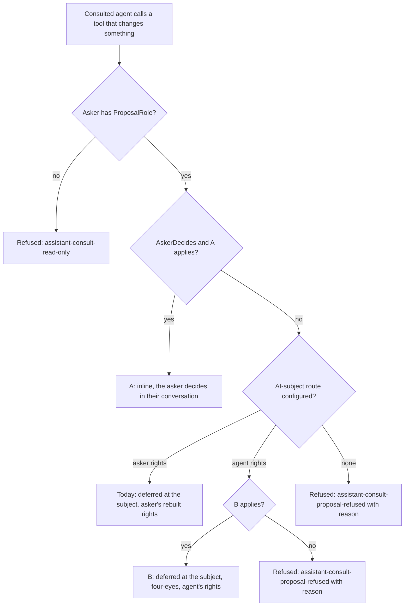

# Consultation Proposals Plan

This document works out two ways to let a consultation of an agent change something without
rebuilding the asking person's principal outside that person's own request: **A**, the asker decides
the proposal inline in their own conversation and it executes in their own request, and **B**, the
proposal waits at the subject in the consulted agent's thread and, after a subject approver decided
it, executes with the agent's own rights, as the agent's runs do. It builds on the
[agent consultation plan](ai-agent-consultation-plan.md) (C1 to C8), the
[autonomous agent runs plan](ai-autonomous-agent-runs-plan.md), the
[run configuration as data](ai-agent-run-configuration-plan.md) (accountable rights) and the
[runtime overrides](ai-agent-runtime-overrides-plan.md) (technical account). It was checked against
`main` at `f8f70a08` on 2026-10-22. It is a plan, not usage documentation.

## Status

Decided by Lars, 2026-10-22: every decision from CP1 to CP24 is **Decided** (see the decision record).
Lars followed the recommendation except for three decisions: CP20 (b) adds "leave for approvers" to
the A card, CP21 (c) lets administrators switch the routes within a ceiling set in code, and CP23 (c)
delivers A and B together. Implementation is in progress on `feature/consultation-proposals`.

The plan assumes the parallel fix that makes the platform recognise the asker of a consultation in the
current request by actor id, so that the consult turn, the consultation viewer and the invocation gate
use the live request principal of the asker instead of comparing only the name identifier claim.
Option A depends on it.

## Problem

- A consulted agent may leave deferred proposals in its thread (`Proposals(true)`, the default). An
  approved proposal executes in a background operation with the asker's rights only
  (`DelegatedOnly`), so the invocation gate asks the application's `INhAiPrincipalFactory` for the
  asker's principal outside the asker's request.
- Some applications never build a person's principal outside that person's own request. They consult
  with `Proposals(false)`: the consulted agent can only describe a change in its answer, and nobody can
  act on it from the consultation.
- Such applications still want the agent's expertise to lead to a change: either right away, decided by
  the person who asked, or later, decided by the people who decide the agent's work on the subject.

## Goals

- A consultation can lead to a change without any person's principal being rebuilt outside that
  person's request.
- No escalation: what a consultation reads stays bound to the asker's rights (C2 of the consultation
  plan); what it changes is either the asker's own live rights (A) or the agent's own bounded rights
  under a hard four-eyes decision (B).
- One clear rule per proposal: A, B or refused, audited, and explained to the consulted model and to
  people.
- Today's behaviour stays the default; both options are opt-ins per consultation registration.

## Non-goals

- Changing `INhAiPrincipalFactory`, delegated agent runs (`DelegateFromInitiator`) or accountable rights
  of runs.
- Consultations from a headless agent turn whose initiator is not in the request: the consult turn
  itself already needs the rebuilt principal there, with or without proposals.
- Changing requests (`assistant.request.*`) or hand-offs, which already start runs that work with the
  agent's own rights.
- Executing a consulted agent's change without a decision. Every non-read call of a consultation stays
  a proposal (`RequireApprovalForEffects`), also when the tool needs no approval elsewhere.
- Consultations configured in the administration; consultations stay code-only.

## How it works today

Read from `NhAssistantConsultationService`, `NhAssistantConsultationToolHandler`,
`NhAssistantToolCallInterceptor`, `NhAssistantTurnRunner`, `NhAssistantProposalDecisions`,
`NhAssistantProposalExecutor`, `NhAiAgentInvocationGate` and `NhAssistantApprovalEvidenceProvider`.

### A consultation and its proposals

- **Recording.** The consult turn runs in the consulted agent's invocation scope with `Grants = []`,
  `DelegateFromInitiator = true`, the asker as initiator **and** as accountable owner,
  `IsRequestTurn` = whether the asker's own request is the current one, and
  `RequireApprovalForEffects`. Non-read tools are offered only when `AllowProposals` is on and the
  asker has `ProposalRole` (Participant by default); otherwise a named one is refused with
  `assistant-consult-read-only`. A non-read call the gate allows (grant source `delegated`, the
  asker's rights) becomes an approval in the consulted agent's thread about the subject:
  `ConsultationId`, `InitiatorActorId` = asker, the proposal's `AccountableOwnerId` = asker, mode
  forced to **deferred**, and the stored call (`AwaitingApproval`) that execution replays. The
  consulted model gets "proposal recorded" and continues. No message enters the thread; the
  consultation record (`AssistantConsultation`) counts the proposals.
- **Policy.** `NhAssistantApprovalPolicies.Resolve(agent, tool, trigger: null, isRun: true)`: the
  agent's tool-specific policy, else its agent policy, else `TriggerDefault` (approvers with the
  subject role Approver, 3 days, reminders after a day, `RequireUnchangedSubject`, not four-eyes).
  The snapshot is stored on the proposal.
- **Approving.** Subject approvers are notified (`RunEndedWithProposals`, initiator = asker) and
  decide through `POST approvals/{id}/decisions` or the inbox. `NhAssistantApproverCheck` refuses agent
  identities, people who may not see the thread, the initiator under `FourEyes`, people who match no
  approver rule, and people who fail the tool's approve policies. The `Initiator` rule lets the asker
  approve their own consultation proposal when the agent's policy contains it and is not four-eyes.
- **Expiry.** Reminders reach consultation proposals, but the maintenance job expires and escalates
  only proposals of a run (`GetPendingThreadApprovalsAsync` filters on `RunId != null`). A
  consultation proposal has no run: it drops out of the inbox at its expiry, stays `pending` until
  someone tries to decide it, and never escalates (CP24).
- **Executing.** `EnqueueExecutionAsync` queues `NhAssistantExecuteProposal(Once)Request`, owned by
  `OwnerActor(thread, proposal.AccountableOwnerId)`. `NhAssistantProposalExecutor` builds the agent
  turn with the asker as initiator and accountable owner and sets `DelegatedOnly` because the approval
  has a `ConsultationId`: grants are empty and delegation is forced. The turn is headless
  (`IsRequestTurn = false`), so `NhAiAgentInvocationGate.ResolveInitiatorAsync` calls
  `INhAiPrincipalFactory.CreateAsync(asker, subject)`. **This is the rebuilt principal the problem is
  about.** The evidence provider then binds the approval: same proposal hash, the agent actor as actor,
  the same accountable owner, decided by someone other than the agent actor.
- **Audit.** `AgentConsulted` per consultation; inner calls and `ApprovalRequested` carry
  `ConsultationId`, `ConsultationDepth` and `AskingAgentId`; decisions record `ApprovalApproved` or
  `ApprovalRejected` with the grant source and policy id; execution records `AgentProposalExecuted`.

### Run proposals of agents with an accountable account

- `NhAiAgentAccountability`: `Agent` (the agent answers for itself), `SubjectResponsible` (the
  subject's responsible person) or `ServiceAccount` (a technical account, overridable at runtime with
  `SetServiceAccountAsync`). The thread stores whom it answers to (`AccountableOwnerId`).
- A run's scope carries the agent's grants, `DelegateFromInitiator` as configured and, in headless
  turns of an agent that answers to someone, `ActWithAccountableRights`. The gate tries, in this
  order: a gateway read, the initiator's rights when the scope delegates (`delegated`, principal
  rebuilt when headless), the accountable account's rights (`accountable`, principal rebuilt with
  `INhAiPrincipalFactory` for that account), and a code grant (`agent`, two keys: `AllowAgentGrant` on
  the tool and `Grant` on the agent, `TriggerOnly` grants never in a person's request turn).
- Run proposals carry the run's initiator (for a request or a manual start: the person who asked) and
  the thread's accountable owner. After approval they execute in the same executor without
  `DelegatedOnly`, with whatever the agent's scope allows at that moment; the background operation
  belongs to the technical account or the agent.
- Precedent: a participant who starts a run (`POST threads/start`) or asks for one through
  `assistant.request.*` already causes proposals that execute with the agent's own rights after an
  approver decided them, and neither path forces four-eyes. Hand-offs run under the receiving agent's
  own grants with no initiator.

### Inline proposals in a person's own request

- A person's own chat turn has no approval policy and records **inline** proposals; a person's request
  turn in an agent thread does the same (`IsRequestTurn` and no consultation). The turn ends
  `waiting-for-approval`; the stream emits `approval.required` and the message keeps an `approval`
  part, so the card survives a reload. While it waits, the conversation takes no new message.
- The person decides with `POST conversations/{id}/approvals/{approvalId}/decide`, which streams a
  decision turn: in a chat only the person whose turn made it (`assistant-approval-forbidden`), in an
  agent thread anyone who passes `NhAssistantApproverCheck`. Expiry is checked on the application's
  clock at the decision; cancelling the turn rejects the proposal.
- The decision turn executes the stored call **in the decider's request**
  (`RunDecisionTurnAsync`, `ExecuteApprovedAsync`) and continues the model with the real result. In a
  chat the request gate uses the live principal. In a thread, when another approver decides, the
  execution scope's initiator is still the person whose turn it was, so a call that uses that person's
  rights (delegation) makes the gate rebuild that person's principal: a four-eyes inline decision that
  executes with the initiator's rights always needs a rebuilt principal.
- The inbox leaves inline proposals without a run out (`OpenAgentProposals`), and
  `POST approvals/{id}/decisions` refuses them ("decide this proposal in the conversation").

### Where a person's principal is rebuilt

| Path | Today | A | B |
|---|---|---|---|
| Consult turn, asker in the request | live principal (after the parallel fix) | unchanged | unchanged |
| Consultation viewer, asker in the request | live principal | unchanged | unchanged |
| Execution of a consultation proposal | **rebuilt asker** | live asker, in the asker's decision request | none for a person; a technical account's principal only with `ActWithAccountableRights` |
| Decision of the proposal | approver's own request | asker's own request | approver's own request |

## Option A: the asker decides inline

### Flow

1. The consult tool runs the consultation as today. The consultation knows whether the asking turn can
   wait for its asker (CP9): a person's chat turn or request turn in a thread, in the asker's own
   request, not itself a consultation, with no decision of another consultation already waiting.
2. The consulted agent calls a tool that changes something. The interceptor resolves the policy for
   the call (CP5) and checks, with the asker's live principal, that the asker may decide it (CP4). When
   A applies, it records the proposal as today, in the consulted agent's thread (CP6), but with mode
   inline: `ConsultationId`, initiator and accountable owner the asker, grant source `delegated`, the
   policy snapshot and a lifetime of its own (CP8). The consulted model reads that the person who asked
   decides it now, and finishes its answer. Further non-read calls follow CP7.
3. The consult tool returns the answer with `decision: "asker"` and the approval id (CP19). The asking
   turn treats its own consult call as the call that waits: the call becomes `awaiting-approval` with
   that approval id and keeps the consultation's answer, the stream emits `approval.required` with the
   consultation's origin (agent, subject, consultation id), the asking message keeps an `approval` part
   and the turn ends `waiting-for-approval`, exactly as a person's own inline proposal does.
4. The asker decides on the card with the existing `decide` endpoint of the asking conversation. The
   runner accepts the approval because its consultation names this conversation and turn, checks CP4
   again with the live principal, runs the decision and execution guards, and executes the stored call
   in the consulted agent's scope: the subject's authorization resource, no grants, the asker as
   initiator, `IsRequestTurn = true`. The gate therefore uses the request's own principal. The outcome
   is recorded on the approval in the thread (`executed`, `execution-failed`, `stale`).
5. The asking model continues with its consult call's result: the consulted agent's answer plus the
   decision and the outcome (code and a bounded result). A rejection gives the answer and the
   rejection; nothing executes.

### When A cannot apply

- **Four-eyes.** A policy with `FourEyes()` keeps the initiator out, and the asker is the initiator.
  Another person deciding inline would need the asker's rebuilt principal (see above), so A never
  applies; the call takes the at-subject route or is refused (CP3).
- **The asker is no approver.** A policy whose approvers are only roles or policies the asker does not
  meet (for example `TriggerDefault` for a participant) gives no A. The tool's approve policies apply to
  the asker as to any approver.
- **"The one who caused it may not approve."** This is `FourEyes`; see above.
- **No waiting turn.** MCP callers have no card; a headless agent turn has no person in the request; a
  nested consultation runs inside another consultation's tool call.
- **A decision already waits** in the asking turn (CP7).

### Expiry and leaving

- The proposal lives `min(policy lifetime, NhAssistantLimits.ApprovalLifetime)` on the application's
  clock (15 minutes by default), because the asking conversation is blocked while it waits (CP8).
- The card survives a reload and shows in every session of the asker; the asker can come back within
  the lifetime and decide. Cancelling the turn rejects the proposal.
- When the lifetime passes, the maintenance job closes it as `expired` and frees the asking
  conversation (today the job handles only proposals of a run; see CP24); deciding after expiry answers
  `assistant-approval-expired`, as today. Nothing moves to the subject's approvers.

### Leave for approvers (CP20 (b))

- Next to Approve and Reject, the A card offers "Leave for approvers" when an at-subject route (B, or
  today's route) applies to that call: the route the consultation's configuration and the
  administration allow, checked again at the moment the asker leaves it (for B: the agent's own rights,
  the open cap of CP15, not `nh-system`, an approver other than the initiator).
- Leaving closes the A row (status `rejected`, outcome `moved`, decided by the asker) and records a new
  deferred approval at the subject under that route's rules: for B four-eyes (the asker can never
  approve it), the agent's grant source, the thread's accountable owner and the cap; for today's route
  the asker's rights. The new approval keeps the consultation id, the stored call and the policy, and
  starts its own lifetime.
- The asking turn continues as if the asker declined to decide inline: the asking model reads that the
  proposal now waits for the subject's approvers (`decision: "subject"` with the new approval id) and
  finishes its answer. Nothing executes in the asker's request.
- Both steps are audited: `ApprovalRejected` with outcome `moved` on the A row and `ApprovalRequested`
  with the new route on the new row; both carry the consultation id.
- When no at-subject route applies, the card does not offer it and the endpoint refuses it with
  `assistant-consult-proposal-refused`.

### Other rules

- Only the asker decides an A proposal, also when the asking turn is a request turn in another agent's
  thread, where that thread's approvers otherwise decide inline proposals: anyone else would execute it
  with the asker's rebuilt principal.
- An A proposal is invisible in the inbox (inline without a run, as today). The consulted agent's
  thread shows it with `canDecide = false` and the reason `assistant-consult-asker-decides` while it
  waits, and with its outcome and the asker as decider afterwards.
- A rejection by the asker does not count toward the agent's rejection cooldown and is not offered as
  rejection context to later runs: the asker declined their own request, the subject's approvers did
  not reject the agent's work.
- Like a person's own inline proposal, an A proposal takes no part in duplicate detection; its guards
  run at the decision (decision and execution stages together).

## Option B: the proposal waits at the subject and executes with the agent's rights

### Flow

1. The consult turn is unchanged: reads and the authorization of every call use the asker's live
   rights (CP11).
2. The consulted agent calls a tool that changes something and B applies (see refusals). The
   interceptor asks `INhAiAgentToolAuthorizer` whether the agent's **own** scope allows the exact call:
   the agent's grants and, for an agent with `ActWithAccountableRights` that answers to a technical
   account, that account's rights; never delegation from the asker; headless, so `TriggerOnly` grants
   count (CP13). If not, the call is refused with the reason `agent-not-granted`.
3. The proposal is recorded deferred in the consulted agent's thread, as a run proposal would be:
   `ConsultationId`; `InitiatorActorId` = asker; the proposal's `AccountableOwnerId` = the thread's
   accountable owner (the technical account or the agent); `GrantSource` = what the agent's scope gave
   (`agent` or `accountable`); the policy snapshot with `FourEyes = true` (CP12); reminders,
   guard keys, duplicate detection and the rejection cooldown as for run proposals, and expiry and
   escalation by the maintenance job once it handles consultation proposals (CP24).
4. Subject approvers are notified as today. The asker sees the proposal in the thread and the inbox
   with `canDecide = false` and `assistant-four-eyes-required`, also when the asker is an approver.
5. An approver decides in their own request; the approver must pass the tool's approve policies, so the
   decider is entitled to the change themselves.
6. Execution runs like a run proposal: the turn is built with the asker as initiator and the technical
   account (or agent) as accountable owner, with a new `AgentRightsOnly` flag instead of `DelegatedOnly`
   so that delegation from the initiator is off even for an agent whose runs delegate. The gate never
   asks `INhAiPrincipalFactory` for a person. The background operation belongs to the technical
   account or the agent. A technical account replaced after the proposal keeps executing it, as run
   proposals do (SPM-294).
7. The asker is told the outcome (CP16).

### Why B is acceptable

The asker causes work that executes with rights other than the asker's own. What bounds it:

- **The asker's own live rights at proposal time** (CP11): the call was one the asker could make
  themselves when it was proposed. B only replaces who executes it, not what may be proposed.
- **Hard four-eyes**: the asker can never approve it, whatever the policy says (CP12).
- **The subject's approvers decide**, and every approver must pass the tool's approve policies with
  their own principal.
- **The agent's grants and tool selection**: only tools in the consulted agent's selectors, exposed to
  agents, that its two-key grants or its technical account's rights allow; checked at proposal time and
  again at execution.
- **The guards and preconditions** of the tool (`RequireUnchangedSubject`, proposal guards,
  revalidation) close a proposal that no longer fits.
- **Audit**: initiator, consultation, route, grant source, decider and execution are recorded (CP17).
- **Bounded volume**: the existing consultation limits plus a cap on open B proposals per asker
  (CP15).

### When B must be refused

Refused per call with `assistant-consult-proposal-refused` and a reason the consulted model reads; the
call is not recorded. Static cases also fail at startup.

| Case | Reason | Startup |
|---|---|---|
| The agent answers to a subject's responsible person (CP10) | `agent-answers-to-person` | yes |
| The subject is the whole application, `nh-system` (CP14) | `whole-application` | yes, for a registration on `nh-system` |
| The policy that applies has no approver rule other than the initiator (CP12) | `no-approver` | yes, where the policy is known per tool |
| The agent's own rights do not allow the call (CP11) | `agent-not-granted` | no |
| The asker already has the maximum of open B proposals on the subject (CP15) | `open-limit` | no |
| The agent is in shadow, or consultations are refused for another reason | as today | as today |

## Combination A+B

Per non-read call of a consultation (CP3):



- A comes first: it uses the asker's own rights, needs nobody else and answers now.
- The at-subject route is either today's (asker's rights, rebuilt) or B (agent's rights); never both.
- The fallback is today's `Proposals(false)` behaviour for that call: the consulted model reads why and
  describes the change in its answer instead. Non-read tools are not offered at all when no route can
  ever apply (static checks); dynamic checks decide per call.
- The platform's consultation instruction, which today says that every change "only records a proposal
  for the subject's approvers", names the routes the consultation has, so the consulted model tells
  the asker who decides.
- The recommended setup for applications that never rebuild a person's principal is
  `AskerDecides()` with `AtSubject(Agent)`.

## Configuration surface

### Code

```csharp
.ConfigureAgent(SampleProjectCloserComposition.AgentId, agent => agent
    .ServiceAccount(operationsAccountId)
    .AllowConsultation(ProjectSubjects.Type, consult => consult
        .Description("Knows whether a project can be completed.")
        .Proposals(proposals => proposals
            .MinimumRole(NhAiSubjectRole.Participant)          // as Proposals(true, Participant)
            .AskerDecides()                                    // A, when the policy lets the asker decide
            .AtSubject(NhAssistantConsultationRights.Agent)    // B; Asker is today's route
            .Policy("project-consultation"))));                // optional, CP5
```

- `Proposals(bool allowed, NhAiSubjectRole minimumRole)` stays and means today's route:
  `Proposals(true, role)` is `AtSubject(Asker)` with `MinimumRole(role)`; `Proposals(false)` is no
  route. No existing registration changes behaviour.
- `NhAssistantConsultationOptions` gains `AskerDecides` (bool), `AtSubjectRights`
  (`NhAssistantConsultationRights?`: `Asker`, `Agent` or none) and `ProposalPolicyId`; `AllowProposals`
  and `ProposalRole` keep their meaning (any route configured, and its role).
- Startup refuses `AtSubject(Agent)` on an agent that answers to a subject's responsible person or on
  `nh-system`, a proposal policy that is not registered, and a known policy with only the initiator rule
  for B.
- `NhAssistantLimits.MaxOpenConsultationProposalsPerAsker` (CP15).

### Administration (CP21 (c))

Consultations stay registered in code, but administrators can switch the routes of an agent's
consultations within a ceiling that code sets:

- **Ceiling (code).** The consultation registration says which routes are allowed: A
  (`AskerDecides()`), B (`AtSubject(Agent)`) or today's route (`AtSubject(Asker)`). The administration
  can never switch on a route the code does not allow.
- **Switches (administration).** Per agent, an administrator switches each allowed route on or off. For
  a code agent the switch is an override with "back to the code setting"; for an agent created in the
  administration the switch is the setting itself. Every switch is stored with the agent's run
  configuration in the administration data and applies to every consultation of that agent.
- **Effect.** The routes that apply to a call are the code's routes minus the switched-off ones; CP3
  then picks per call. With every route off, the consultation is read-only for that agent, as
  `Proposals(false)`.
- **Editor.** The agent editor shows the routes with an explanation of each (A: the asker decides in
  their own chat; B: the subject's approvers decide and it executes with the agent's rights; today's
  route: it executes with the asker's rights later) and their state (code, overridden, not allowed),
  in every shipped language.
- **Audit.** A change is audited like other changes of an agent's run configuration.

What the administration already changes still applies: the technical account override (B proposals
keep the account they were recorded with), switching off, pausing and stopping (approved B proposals of
a stopped agent wait, as run proposals do), and shadow (no consultations).

## API and contract changes

All additive; no breaking change. The one changed behaviour is CP24 (a), which gets a release-note
entry in `docs/release-notes/v-next.md` under `NewHeap.Platform.AI.Chat`.

| Surface | Change |
|---|---|
| `NhAssistantConsultationAnswer` and the consult tool's output | optional `decision` (`asker`, `subject`, or absent) and `approvalIds`; contract version stays 1 (CP19) |
| Chat approval view (`approval.required`, `approval` part) | optional `consultation` origin: consultation id, agent id, subject type, id and display name |
| `POST conversations/{id}/approvals/{approvalId}/decide` | also accepts an A proposal whose consultation names this conversation and its waiting turn; same request and stream |
| `NhAssistantProposalDto`, `NhAssistantSubjectProposalDto` | `consultationRoute` (`asker-decides`, `subject-asker-rights`, `subject-agent-rights`) |
| `NhAssistantThreadDecisionDto.reasonCode` | new `assistant-consult-asker-decides`; B uses `assistant-four-eyes-required` |
| `NhAssistantConsultationDto` | counts per route of the proposals it left |
| Error codes | `assistant-consult-proposal-refused` (with `reason`), `assistant-consult-asker-decides` |
| `NhAssistantAgentNotificationKind` | `ConsultationProposalDecided` (CP16) |
| `NhAssistantAuditEvent` | `ConsultationRoute` (CP17) |
| Public builder types | `NhAssistantConsultationProposalBuilder`, `NhAssistantConsultationRights` |

The mock API in `@newheap/platform-ai-chat/testing` gets a scenario step for an A card and a B proposal.

## UI

- **Chat, A.** The approval card names the consulted agent and the subject ("The intake reviewer
  proposes, about PRJ-12"), shows the presenter's text, can expand the consulted agent's answer, says
  that it runs with the asker's own rights and has Approve and Reject. After the decision it shows the
  outcome as a person's own inline proposal does. Keyboard, focus, loading and error states as the
  existing card.
- **Thread and subject pages.** A and B proposals keep the "from consultation" badge; a new line names
  who asked and through which assistant. A pending A proposal shows "waiting for {asker} to decide"
  without actions. A B proposal shows the grant-source badge (agent or technical account) and, for the
  asker, the four-eyes reason instead of the actions.
- **Inbox and boards.** B proposals appear like run proposals; A proposals do not appear.
- **Chat after B.** The consult call's card says that a proposal waits for the subject's approvers,
  with a link to it in the thread when the asker may read the thread.
- Texts in English (and the other maintained languages with aligned keys).

## Audit

- `AgentConsulted` unchanged.
- `ApprovalRequested`, `ApprovalApproved`, `ApprovalRejected`, `ApprovalExpired` and
  `AgentProposalExecuted` of a consultation proposal carry `ConsultationRoute`; the existing
  `GrantSource`, `InitiatorActorId` and `ConsultationId` complete the picture.
- An A decision and execution are recorded with the asker as decider and actor of the decision turn;
  the execution's `ToolInvoked` has grant source `delegated`.
- A B execution's `ToolInvoked` has grant source `agent` or `accountable` and the technical account as
  accountable owner.
- A refused proposal records the inner call's `ToolInvoked` with `assistant-consult-proposal-refused`
  and the reason; no approval event.
- No question, answer or argument content in audit, as today.

## Persistence and migrations

No migration (CP18):

- The route of a proposal is derived: `ConsultationId` with mode inline is A, with mode deferred and
  grant source `delegated` is today's route, with grant source `agent` or `accountable` is B.
- The asking turn's consult call stores the A approval in its existing `ApprovalId` (no foreign key) and
  keeps the consultation's answer in its `ResultJson` while it waits; `AssistantConsultation` already
  holds the asking conversation and turn.
- The approval's `ConversationId` stays the consulted agent's thread, so retention, the thread view,
  guards and revalidation keep working.

## Sample case

Extend SPM-278 (CP22) instead of adding a case:

- **A.** The intake reviewer's consultation adds `AskerDecides()` with a consultation policy whose
  approver is the initiator (its own policy is four-eyes and agent-wide, so CP5 (b) applies). A
  participant asks the project assistant whether the project is ready for review; the reviewer answers
  and proposes `projects.request-review`, the participant approves on the card, and the request
  executes in the participant's own request with the participant's rights. A second participant without
  the tool's rights gets no card: the call is refused and the answer explains it.
- **B.** The project closer allows consultation with `AtSubject(Agent)` and answers to the operations
  technical account. A participant who may manage the project asks whether PRJ-12 can be completed;
  the closer proposes `projects.change-status`, the proposal waits in the closer's thread, the
  participant cannot approve it (also as a project approver), another project approver approves it and
  it executes with the technical account. Under CP11 (a) a participant without the manage policy gets
  the refusal instead; under CP11 (b) that participant could cause the proposal too.
- **Evidence that no person's principal is rebuilt.** The sample's tests register a principal factory
  that refuses people and counts calls, and assert it is never asked for a person in either flow.
- Update the registry entry, `ai/nh-ai-agent-runs.md`, the consumer guide, the AI.Chat and
  AI.Chat.AspNet READMEs, `docs/sample-catalog.md` where its narrative changes, and the management
  portal's case.

## Tests

- **Library, `NewHeap.Platform.AI.Chat.Tests`:** the route matrix of CP3 (A, today, B, refused) per
  call; A with chat and thread request turns, the live principal used and the principal factory never
  asked; A refused for four-eyes, for an asker who is no approver and for MCP, headless and nested
  askers; one decision per consultation and per turn; expiry, cancel and reload; rejection outside the
  cooldown; B recorded with the technical account, `agent` or `accountable` grant source and forced
  four-eyes; the asker refused as approver; execution with the agent's rights and no delegation for an
  agent whose runs delegate; every B refusal reason and the startup checks; the open cap; the
  notification; audit fields.
- **Relational, SQL Server and PostgreSQL:** the queries that link an A approval to its asking call,
  count open B proposals per asker and expire and escalate consultation proposals (CP24), as theories
  over `RelationalTestProvider`.
- **Angular:** the approval card with a consultation origin, the decision stream for it, the thread
  decision reason, the B line in proposals and the mock scenario.
- **Sample:** SPM-278 integration tests on PostgreSQL and the management portal check.
- Verification as AGENTS.md says: `npm run test:affected` while building, the full matrix once per
  train.

## Risks

- **A blocks the asking conversation** for up to the lifetime. Bounded by the short lifetime and
  cancel; the card says so.
- **A hasty approval.** The asker approves a consulted agent's change in the flow of a chat. The
  presenter's text, the agent and the subject on the card, and the policy (which must let the asker
  decide) bound it; it never exceeds the asker's own rights.
- **A policy written for runs now governs inline decisions.** A consultation policy (CP5) lets the
  application say what it means; a tool-specific policy keeps winning.
- **B rights drift.** The asker may lose rights between proposal and execution. The approver, who must
  be entitled to the tool, decides; guards close stale work. The asker's role is not checked again, as
  for run proposals.
- **B and the meaning of `TriggerOnly`.** Counting such grants for a person's consultation stretches
  "never in a person's request turn" (CP13); CP11's requirement keeps the asker within their own
  rights.
- **Approver load.** A participant can cause B proposals for people with more rights. The daily
  consultation cap, the tool-call limit per consultation, duplicate detection, the rejection cooldown
  and CP15 bound it.
- **Contract change for MCP clients.** The consult tool's output grows; the contract hash changes while
  the version and export names stay (CP19).
- **Changed expiry of today's consultation proposals.** With CP24 (a), proposals that waited past their
  expiry close as `expired` on the next maintenance round after the upgrade, and escalating policies
  start to escalate them; the release notes say so.

## Decision record

Each line: the question, the options, the recommendation and the status.

| # | Question | Options | Recommendation | Status |
|---|---|---|---|---|
| CP1 | Which routes does the platform offer? | (a) A only; (b) B only; (c) A and B as opt-ins next to today's route; (d) A and B replace today's route. | (c): applications that rebuild principals keep today's route, the others choose A, B or both; no behaviour changes on upgrade. | Decided: (c). |
| CP2 | How is it configured? | (a) a proposals builder `Proposals(p => p.MinimumRole(...).AskerDecides().AtSubject(rights).Policy(id))`, keeping `Proposals(bool, role)` as today's route; (b) one enum of modes. | (a): A and the at-subject route are independent, and five enum values would be harder to read than two settings. | Decided: (a). |
| CP3 | Which route applies when several are configured? | (a) per call: A when it applies, else the configured at-subject route when it applies, else refused; (b) at-subject first, A as fallback; (c) the asker chooses on a card. | (a): A uses the asker's own rights and needs nobody else; one predictable rule the model and the audit can name. | Decided: (a). |
| CP4 | Who may decide an A proposal? | (a) only when the policy for the call lets the asker decide: an approver rule the asker meets (the initiator rule included), not four-eyes, and the tool's approve policies, checked with the live principal at proposal and at decision; (b) the asker always, as for their own chat proposals. | (a): the policy says who may let the agent's work happen on the subject; A changes where and with whose principal it is decided, not who may decide. | Decided: (a). |
| CP5 | Which approval policy does a consultation proposal follow? | (a) as today: the agent's tool policy, its agent policy, else `TriggerDefault`; (b) a consultation may name its own policy, used where the agent has no tool-specific policy; (c) a consultation policy overrides every agent policy. | (b): the agent's policy was written for its runs; the application can say what consultations need without weakening a tool-specific rule. | Decided: (b). |
| CP6 | Where is an A proposal stored? | (a) in the consulted agent's thread, as consultation proposals are today, with the asking call linked to it; (b) in the asking conversation. | (a): one place for consultation proposals, so the thread shows what happened, and retention, guards and revalidation keep working. | Decided: (a). |
| CP7 | How many A decisions can wait? | (a) one per consultation and per asking turn; further calls take the at-subject route or are refused; (b) several, decided one after another; (c) one card for all. | (a): matches the one waiting inline proposal per turn; more is rare and can wait at the subject. | Decided: (a). |
| CP8 | What are the lifetime and the end of an A proposal? | (a) `min(policy lifetime, ApprovalLifetime)`, the card survives reloads, cancel rejects, the maintenance job expires it and frees the conversation, nothing moves on; (b) the policy's lifetime; (c) on expiry it moves to B. | (a): the conversation is blocked while it waits; moving it on would make others decide what the asker left. | Decided: (a). |
| CP9 | Which asking turns can wait for an A decision? | (a) a person's chat turn and request turn in a thread, in the asker's request; not MCP calls, headless agent turns or nested consultations; (b) also headless turns, decided through a notification. | (a): only these have a person and a stream in the request; (b) would need the rebuilt principal again. | Decided: (a). |
| CP10 | Which agents can use B? | (a) only agents that answer to a technical account; (b) also agents that answer for themselves, with their code grants; (c) every agent. | (b): the rule is "no person answers for, or lends rights to, work another person caused"; an agent that answers for itself executes its runs with its grants already. Stricter reading of the brief: (a). | Decided: (b), a technical account or an agent that answers for itself. |
| CP11 | Whose rights bound what a B consultation may propose? | (a) both: the asker's live rights in the consult turn (as today) and the agent's own rights, checked at proposal and at execution; (b) the agent's own rights only, reads still the asker's. | (a): keeps the consultation plan's promise that a consultation cannot launder the agent's rights, needs no change in the consult turn's authorization; (b) can follow as an opt-in if needed, and requests already offer it. | Decided: (a), both the asker's live rights and the agent's rights. |
| CP12 | How is four-eyes enforced in B? | (a) always: the stored snapshot gets `FourEyes = true`, and B is refused when no approver rule other than the initiator remains; (b) B only with a policy that sets `FourEyes()` itself. | (a) with the startup check: the platform guarantees it, and `TriggerDefault` and most run policies work unchanged. | Decided: (a), always four-eyes with a startup check. |
| CP13 | Do `TriggerOnly` grants count for a B execution? | (a) yes: the execution is headless and decided by another person, as a requested run; (b) no: a person steered the consultation. | (a), given CP11 (a); with CP11 (b) choose (b). | Decided: (a). |
| CP14 | What about the whole application (`nh-system`)? | (a) refuse B, allow A; (b) refuse both; (c) allow B. | (a): app-wide work caused by any asker is too broad for B; A stays within the asker's own rights. | Decided: (a), refuse B, allow A for `nh-system`. |
| CP15 | Is the number of open B proposals per asker capped? | (a) `NhAssistantLimits.MaxOpenConsultationProposalsPerAsker` per subject, default 5; (b) existing limits only. | (a): existing limits allow up to about 200 proposals a day per asker; a cap keeps approvers' inboxes usable. | Decided: (a), per asker per subject, default 5. |
| CP16 | Is the asker told what became of a B proposal? | (a) a new notification kind `ConsultationProposalDecided` to the asker when it is rejected, expires or its execution ended; (b) nothing beyond the thread. | (a): the asker caused it and otherwise never hears of it; the default policy sends it in-app only. | Decided: (a), `ConsultationProposalDecided`. |
| CP17 | How does the audit show the route? | (a) a `ConsultationRoute` field on the approval and execution events plus the refusal reason on the inner call; (b) new event kinds per route. | (a): the existing events stay the timeline; one field tells which path without joining tables. | Decided: (a). |
| CP18 | Is a migration needed? | (a) no: the route is derived from consultation id, mode and grant source, and the asking call links through its approval id; (b) an explicit route column on `AssistantApproval` (SQL Server and PostgreSQL). | (a): every fact is already stored; no downstream migration. | Decided: (a), no migration for the route on approvals. |
| CP19 | How does the consult tool's contract change? | (a) additive optional `decision` and `approvalIds`, version 1; (b) version 2 with new export names. | (a): additive for models and MCP clients; the contract hash changes anyway. | Decided: (a), additive, version 1. |
| CP20 | What does the UI offer? | (a) A card in the chat, read-only A in the thread, B like run proposals with "requested by" and the four-eyes reason, no "leave for approvers" on the A card; (b) also "leave for approvers", which moves an A proposal to B. | (a): (b) needs a second approval row and a second rule; add it when people ask for it. | Decided by Lars: (b), deviating from the recommendation; see "Leave for approvers". |
| CP21 | What can administrators configure? | (a) nothing new, consultations stay code-only; (b) show the routes read-only in the run catalog; (c) let administrators switch routes. | (a) now, (b) later when the run catalog shows consultations at all. | Decided by Lars: (c), deviating from the recommendation; see "Administration". |
| CP22 | Which sample evidence? | (a) extend SPM-278 with A (intake reviewer) and B (project closer, technical account), with a principal factory that refuses people; (b) a new case. | (a): AGENTS.md asks to extend the existing case; SPM-278 is the consultation case. | Decided: (a), extend SPM-278. |
| CP23 | In which order is it delivered? | (a) B first (server side, reuses run execution), then A (chat flow and card); (b) A first; (c) together. | (a): B gives these applications proposals at all with the smallest change; A adds the immediate path. | Decided by Lars: (c), deviating from the recommendation: A and B in one delivery. |
| CP24 | Does the maintenance job expire and escalate consultation proposals? | (a) every consultation proposal, today's route included, with a release note (an escalating policy then escalates them); (b) only A and B proposals; (c) as today, lazily at the next decision. | (a): the policy's `OnExpiry` should mean the same for every proposal, and A needs the job to free the asking conversation anyway. | Decided: (a), with a release note. |
