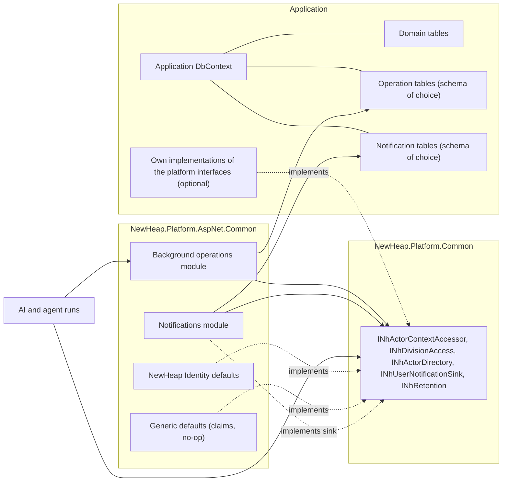

# Platform Modules Without NewHeap Identity Plan

This document is the architecture and implementation plan for using background operations and
notifications in applications that do not derive their EF context from `NhIdentityDbContext`.
Both modules become hostable in any EF context, in their own schema. What they need from an
identity model goes through platform-wide interfaces in `NewHeap.Platform.Common`. NewHeap
Identity implements those interfaces by default; other applications implement them for their
own users and tenancy. It is a plan, not usage documentation: once the features exist, the
package READMEs, the consumer guide and the sample cases are authoritative.

The plan follows consumer feedback: reusable parts belong in the platform, and existing
applications without the NewHeap identity model should be able to adopt them. It was checked
against the code on 2026-10-14. [Baseline](#baseline) lists what exists and what each part of
this plan has to change.

## Status

Implemented on 2026-10-14 with sample case SPM-281, and SPM-083 and SPM-086 extended. The open
questions of the first draft were answered the same day and are part of the
[decision record](#decision-record).

## Implementation status

All five phases are implemented. The implementation deviates from the plan below where building
it showed a simpler or safer way, or a gap the plan had not seen:

- **No foreign-key options.** The model extensions have only the `Schema` option
  (`NhPlatformModuleModelOptions`). An application that wants foreign keys to its own tables adds
  them after the call, as `NhIdentityDbContext` does for its users, divisions and user
  notifications.
- **Three more gaps.** The platform's controllers and hub require the `Bearer` and
  `Identity.Application` schemes, so `AddNewHeapAuthenticationForwarding` forwards them to the
  application's scheme. Hangfire was only wired by the platform builder, so
  `AddNewHeapHangfireProcessing` does what `WithHangfire` does. The hub was only mapped by the
  platform's application builder, so `MapNewHeapBackgroundOperations` maps it.
- **Shared infrastructure.** The modules use NewHeap mapping, localization, validation, collection
  processing, the database log and the mail service, which the platform builder registered. The
  standalone registration adds each one the application has not registered; the database log is a
  no-op, because the NewHeap log lives in the identity model, and the mapping uses the platform's
  profiles unless the application has its own NewHeap mapping.
- **Projection without a store fails at start (C7).** As before, a host with notification
  projection and no way to deliver refuses to start, now with a message that names
  `INhUserNotificationSink`, instead of only logging.
- **Default sink.** The default `INhUserNotificationSink` stores NewHeap user notifications when the
  notifications module is registered and delivers nothing otherwise, so a host that registered only
  `INhUserNotificationService` keeps working.
- **The hub** reads the user from the `NameIdentifier` claim and checks the division through
  `INhDivisionAccess`, because `IHttpContextAccessor` is not reliable inside a hub.
- **JSON.** The NewHeap Angular clients read enum names. Applications without the platform builder
  configure `JsonStringEnumConverter` themselves.
- **AI display names** keep the claims first and ask `INhActorDirectory` only when the claims carry
  no name, so existing hosts see no change.
- **Agent runs and rollback.** A run's background operation rolls back with the application's
  transaction; the assistant's own run row of a rolled-back publish is cleaned up by its
  maintenance, as before. The sample shows the rollback on a separate project for that reason.

## Problem

Background operations and notifications are only available to applications whose EF context
derives from `NhIdentityDbContext`. The coupling sits in four places:

1. **Registration.** `WithBackgroundOperations` and `WithNotifications` are methods of the
   platform configurator, whose context type is constrained to `NhIdentityDbContext<…>`.
   Inside `WithBackgroundOperations`, only the default owner directory uses `TUser`.
2. **Model.** The tables are mapped only in `NhIdentityDbContext.OnModelCreating`, with
   foreign keys to the application's identity tables:
   - `NhBackgroundOperation` refers to `TUser` (cascade), `TDivision` (restrict) and
     `NhUserNotification` (restrict);
   - `NhUserNotification` refers to `TUser` (cascade);
   - `NhNotification.CreatedByUserId` refers to `TUser` (set null).
3. **Current user and division.** The controllers read `HttpContext.GetUserId()` and
   `GetActiveDivisionId()`, and `HasDivisionAccessAsync`, which asks the NewHeap user manager
   for the user's claims.
4. **In-app notifications.** The background-operation projector writes `NhUserNotification`
   through `INhUserNotificationService`.

As a result, such an application cannot use background operations or anything built on them:
durable AI runs, durable ingestion and autonomous agent runs. It also gets no in-app
notifications. `nhai` already runs without the identity model, so the gap is only in these two
modules.

## Goals

- **Any EF context.** Both modules map into any EF context through a model extension, in a
  schema the application chooses.
- **Standalone registration.** `AddNewHeapBackgroundOperations<TContext>` and
  `AddNewHeapNotifications<TContext>` work without the platform configurator. The existing
  `WithBackgroundOperations` and `WithNotifications` stay and use the same core.
- **Platform-wide interfaces.** The current actor, actor information, division access,
  in-app notification delivery and retention become interfaces in `NewHeap.Platform.Common`.
  They are designed once for the whole platform, not per module, so AI and later modules use
  the same seams.
- **No change for existing applications.** Applications on `NhIdentityDbContext` keep the
  exact model, the same foreign keys and the same behavior: no migration, no data move, no
  configuration change.
- **Transactional by construction.** The modules live in the application's own context, so an
  enqueue or a notification written inside the application's transaction commits or rolls
  back with it.

## Non-goals

- Library-owned migrations or a separate `DbContext` per module. That is the later
  [modular storage](#relation-to-modular-storage) step; this plan keeps its door open.
- Changing the identity model, ASP.NET Core Identity integration, divisions or authentication.
- Replacing Hangfire, or changing dispatch, lease, checkpoint, signal or delivery semantics.
- Merging AI's subject access (`INhAiSubjectAccessResolver`) into the platform interfaces.
  Subject roles stay an AI concept.

## Baseline

Paths are relative to `src/Back-end/Libraries`.

| Area | Exists today | Change in this plan |
|---|---|---|
| Package layering | `NewHeap.Platform.Common` is referenced by `AspNet.Common`, `AI.Common` and `AI.Chat`; `AI.Chat` does not reference `AspNet.Common` | The platform-wide interfaces live in `NewHeap.Platform.Common`; implementations live in `AspNet.Common` |
| Repository | `IRepository<T>` resolves `INhIdentityDbContext`, an empty marker interface; `Repository<T>` works on any context configured with `UseNewHeapSqlServer` or `UseNewHeapPostgreSql` | Module services resolve their context through a module context accessor |
| Background operations | 7 entities, about 10,000 lines in 29 files in `AspNet.Common`; owner kinds `User`, `Agent` and `System`; `INhBackgroundOperationAccess` and `INhBackgroundOperationOwnerDirectory` exist | Model extension, standalone registration, platform interfaces |
| Notifications | 4 entities (`NhNotification`, `NhNotificationDelivery`, `NhUserNotification`, `NhUserNotificationMessage`), about 2,500 lines; services do not read the user table; `NhBaseUserNotificationController` reads the current user | Model extension, standalone registration, `INhUserNotificationSink` implementation |
| Hangfire | `AddNewHeapHangfire` exists as a service-collection extension; `WithHangfire` adds the server and queue resolver | A standalone registration wraps the same pieces |
| Current actor | `HttpContext.GetUserId()` and `GetActiveDivisionId()`; AI uses string actor ids and `NhAiInvocationContext` | `INhActorContextAccessor` |
| Division access | `HttpContext.HasDivisionAccessAsync`, through the NewHeap user manager | `INhDivisionAccess` |
| Actor information | `NhIdentityBackgroundOperationOwnerDirectory<TUser>`; AI's `INhAssistantDisplayNameResolver` | `INhActorDirectory`; module interfaces delegate to it by default |
| In-app notifications | The projector calls `INhUserNotificationService` and stores `UserNotificationId`; AI notifies through Web Push and `INhAssistantAgentNotificationChannel` | `INhUserNotificationSink` |
| Deletion | Foreign-key cascades on user deletion | `INhRetention` with module participants |
| Sample | `SampleProjectManagementDbContext` derives from `NhIdentityDbContext`; operation and notification migrations exist | Unchanged; a plain-context host proves the new path |

## Platform-wide interfaces

All live in `NewHeap.Platform.Common` and use no ASP.NET Core types. Names are part of the
review.

| Interface | Purpose | NewHeap Identity default | Default without NewHeap Identity |
|---|---|---|---|
| `NhActorRef(Kind, Id)` and `NhActorKinds` | One reference for users, agents and systems, with a string id (a user id in `D` format) | n/a | n/a |
| `INhActorContextAccessor` | The current actor and active division of the request or the running operation | `GetUserId`, `GetActiveDivisionId` | `ClaimTypes.NameIdentifier` as user id, no active division |
| `INhDivisionAccess` | Whether an actor may work in a division | The current `HasDivisionAccessAsync` logic | No divisions: every division is denied, and work without a division is allowed |
| `INhActorDirectory` | Display name, e-mail address and culture of actors, in one batch call | Reads `TUser` | Returns the id as the display name |
| `INhUserNotificationSink` | Tells a user something in the application, optionally continuing an earlier thread through a returned reference | The notifications module writes `NhUserNotification` | No-op, unless the notifications module or the application registers one |
| `INhRetention` and `INhRetentionParticipant` | `ForgetUserAsync` and `ForgetDivisionAsync`, fanned out to every registered module | `NhUserManager.DeleteAsync` calls `ForgetUserAsync`; division deletion keeps its foreign-key restriction | The application calls both from its own deletion flows |

Module-specific interfaces stay and become thin. `INhBackgroundOperationOwnerDirectory`
delegates to `INhActorDirectory` by default, and `INhBackgroundOperationAccess` keeps deciding
access to one operation for people other than its owner.

## Architecture



## Registration

```csharp
// The application's own context hosts both modules, by default in the schemas nhops and
// nhnotify. A schema option overrides that; Schema = null keeps the context's own schema.
protected override void OnModelCreating(ModelBuilder builder)
{
    base.OnModelCreating(builder);
    builder.AddNewHeapBackgroundOperations();
    builder.AddNewHeapNotifications(notifications => notifications.Schema = "app_notifications");
}

services.AddNewHeapNotifications<AppDbContext>();
services.AddNewHeapHangfireProcessing(hangfire => hangfire.UsePostgreSqlStorage(...));
services.AddNewHeapBackgroundOperations<AppDbContext>(operations => operations
    .AddAccess<ProjectOperationAccess>()
    .AddAssistantAgentRuns());
services.AddNewHeapAuthenticationForwarding("app");

// Only for what differs from the generic defaults.
services.AddNewHeapActorContext<AppActorContextAccessor>();
services.AddNewHeapActorDirectory<AppActorDirectory>();
services.AddNewHeapDivisionAccess<AppTenantAccess>();

// After building the application.
app.MapControllers();
app.MapNewHeapBackgroundOperations();
```

An application on `NhIdentityDbContext` changes nothing. `NhIdentityDbContext` calls the same
model extensions with its foreign keys and `Schema = null`, and `WithBackgroundOperations` and
`WithNotifications` call the standalone registration with the identity defaults.

## Decision record

Decided on 2026-10-14 and binding for this plan.

| # | Decision | Rationale |
|---|---|---|
| C1 | Both modules map through public model extensions: `AddNewHeapBackgroundOperations` and `AddNewHeapNotifications`. Their default schemas are `nhops` and `nhnotify`; the `Schema` option overrides them, and `Schema = null` keeps the context's default schema. Foreign keys to identity tables are added after the call by the context that wants them. | New applications get recognizable module schemas, every application can choose its own, and `NhIdentityDbContext` keeps its exact model. |
| C2 | `NhIdentityDbContext` calls both extensions with every foreign key and `Schema = null`. A model-snapshot test proves that a new migration of the sample is empty. | No migration or data move for existing applications. |
| C3 | The platform-wide interfaces live in `NewHeap.Platform.Common` and use no ASP.NET Core types. | Background operations, notifications and AI share one set of seams across the package layering. |
| C4 | Actors are `NhActorRef` with a string id; user ids keep their `Guid` columns and convert at the module boundary. | AI already uses string actor ids, and the operation owner kinds already include agents and systems. |
| C5 | Division stays the platform's tenancy term. Applications map their own tenancy unit onto divisions through `INhDivisionAccess` and the actor context. Without an implementation there are no divisions: the actor context has no active division, every division is denied, and work without a division is allowed. | `DivisionId`, the active-division header and the Angular client all use it already, and deny-by-default cannot widen access. |
| C6 | Module services resolve their EF context through a module context accessor instead of `INhIdentityDbContext`. The standalone registration binds it to `TContext`; the identity registration binds it to the identity context. | Removes the dependency on the marker without touching other repositories. |
| C7 | The projector delivers through `INhUserNotificationSink`. The notifications module implements the sink, and `UserNotificationId` becomes the sink's opaque thread reference. With projection enabled and nothing to deliver to, the host refuses to start. | Operations no longer depend on where notifications are stored. |
| C8 | Without foreign keys, deletion goes through `INhRetention`. Background operations and notifications register idempotent participants that do what the foreign keys do in identity hosting: `ForgetUserAsync` removes the user's operations and user notifications and clears `NhNotification.CreatedByUserId`; `ForgetDivisionAsync` removes the division's operations. | Deletion stays explicit and testable when cascades are gone, with the same result in both hosting variants. |
| C9 | NewHeap Identity calls `ForgetUserAsync` from an `NhUserManager.DeleteAsync` override, in the same transaction and before the Identity delete; the cascades remain as a safety net. Division deletion in identity hosting does not call `ForgetDivisionAsync` and keeps the foreign-key restriction, so a division with operations still cannot be deleted. | One deletion path for every module that registers a participant, including later ones, without changing division behavior. |
| C10 | Everything ships in a minor release of nuget-common. Existing public interfaces stay. Where a platform interface replaces part of a module interface, the module interface delegates to it and is not marked obsolete in this plan. | Non-breaking adoption; cleanup is a later decision. |
| C11 | AI aligns in the same minor. Its defaults delegate to the platform interfaces where they overlap: display names to `INhActorDirectory`. An in-app channel for agent notifications through `INhUserNotificationSink` becomes available and is enabled by the host with one call. `INhAiPrincipalFactory` and subject access stay AI-specific. | One source for names and in-app notifications, without new notifications appearing in existing AI hosts. |
| C12 | The executable sample evidence for hosting without NewHeap Identity is a "partner portal" host with a plain EF context in SampleProjectManagement's tests. The sample does not get a second application. | It proves the public registration end to end without a second application to maintain. |

## Delivery phases

### Phase 1: platform interfaces and identity defaults

- Add the interfaces and `NhActorRef` to `NewHeap.Platform.Common`.
- Add the NewHeap Identity defaults and the generic defaults to `AspNet.Common`.
- Let the background-operation controllers, the owner directory, the projector and the
  notification controller use them.
- All existing background-operation, notification, AI and sample tests pass unchanged. That
  proves the identity defaults keep the current behavior.

### Phase 2: model extensions and module context

- Move the mappings out of `NhIdentityDbContext` into `AddNewHeapBackgroundOperations` and
  `AddNewHeapNotifications`, including the default schemas, the schema override and the
  opt-in foreign keys.
- Add the module context accessor, and let the module services, startup validators and health
  check use it.
- Add the model-snapshot test (C2) on SQL Server and PostgreSQL.

### Phase 3: standalone registration

- Add `AddNewHeapBackgroundOperations<TContext>` and `AddNewHeapNotifications<TContext>`, with
  the Hangfire wiring of `AddNewHeapHangfire`.
- Rebuild `WithBackgroundOperations` and `WithNotifications` on them.
- Add the sink implementation of the notifications module, and the retention participants.
- Override `NhUserManager.DeleteAsync` to call `ForgetUserAsync` in the same transaction
  before the Identity delete (C9).

### Phase 4: plain-context proof and AI alignment

- A provider test host in `NewHeap.Platform.AspNet.Common.Tests` with a plain EF context, its
  own user table and its own actor, directory and tenancy implementations. It must show:
  - enqueue with commit and rollback;
  - dispatch, cancel, retry and signals;
  - fan-out;
  - in-app notifications through the sink;
  - retention.
- In SampleProjectManagement's tests, a neutral "partner portal" host with a plain context
  that registers both modules through the public API. It runs a durable AI run and an agent
  run end to end. This is the executable sample evidence that the repository rules require
  (C12).
- The AI defaults delegate to the platform interfaces, and the in-app channel for agent
  notifications becomes available (C11).

### Phase 5: documentation and guidance

- Release notes for `NewHeap.Platform.Common` and `NewHeap.Platform.AspNet.Common`.
- A new atomic guidance rule for hosting the modules without NewHeap Identity, and updates to
  `nh-operations-events-jobs-notifications`.
- A sample case for the plain-context host, and an extension of SPM-083 and SPM-086.
- The consumer guide and skill references, regenerated.

## Verification

Every phase runs on SQL Server and PostgreSQL; EF Core InMemory is never relational
evidence.

- **Unchanged identity hosting:**
  - a new migration of the sample is empty;
  - the existing operation, notification, AI and sample suites pass without changes.
- **Plain context:**
  - an application without `NhIdentityDbContext` starts and enqueues;
  - a rolled-back transaction leaves no operation and no notification;
  - a committed one dispatches once and delivers its notification;
  - cancel, retry and signal check the actor and the division through the application's
    implementations.
- **Schemas:**
  - without a schema option, the tables land in `nhops` and `nhnotify`;
  - an overridden schema is used everywhere, including indexes and foreign keys;
  - `Schema = null` keeps the context's default schema;
  - a second context in the same database does not see the tables.
- **Defaults:** without an actor implementation the claims default applies; without
  divisions, an operation with a division is denied; without a sink, operations complete
  without notifications.
- **Retention:**
  - `ForgetUserAsync` and `ForgetDivisionAsync` leave the same state in plain hosting as the
    foreign keys leave in identity hosting;
  - a second call changes nothing;
  - deleting a user through `NhUserManager` calls `ForgetUserAsync`, and a failing
    participant rolls the user deletion back;
  - deleting a division with operations still fails in identity hosting.
- **AI:** display names come from `INhActorDirectory`; agent notifications appear in-app only
  when the host enables the channel.
- **Repository checks:** guidance, snapshot, impact and release validators.

## Risks

- **Model drift.** Moving the mapping can change column types, index names or delete
  behaviors by accident. Mitigation: the model-snapshot test on both providers, and an empty
  migration as the acceptance criterion.
- **Two hosting variants.** Tests must cover both. Mitigation: shared provider test bases
  that run once with identity hosting and once with the plain context.
- **Interface design for the whole platform.** A seam that is too narrow for AI or a later
  module forces a second version. Mitigation: phase 1 reviews the interfaces against every
  current consumer, including AI's display names and notifications.
- **Migrations stay with the application.** A change to the operation or notification model
  still needs a consumer migration, as today. Release notes keep listing it.
- **Tenancy mapping.** Applications with another tenancy model must map it onto divisions.
  A wrong mapping widens access. Mitigation: deny-by-default without an implementation, and
  provider tests for the division checks.

## Relation to modular storage

The ideal end state gives every platform module its own schema, `DbContext` and library-owned
migrations, connected through the platform-wide interfaces and one unit of work for modules
in the same database. This plan builds the interfaces and the model extensions that state
needs. A later module context calls the same model extension and adds its own migrations.
The step then still needs a data move for existing applications, but no new seams.

## Answered questions

The first draft left five questions open. They were answered on 2026-10-14:

| Question | Answer | Decision |
|---|---|---|
| Schema names for new applications | `nhops` and `nhnotify`, overridable | C1 |
| Division default without an implementation | No divisions | C5 |
| Should NewHeap Identity call `INhRetention` on user deletion | Yes | C9 |
| Is the "partner portal" host in the sample tests enough sample evidence | Yes | C12 |
| AI alignment in the same minor or later | Same minor | C11 |
